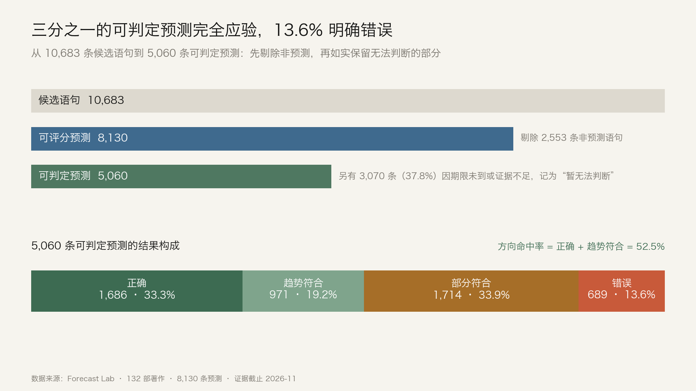
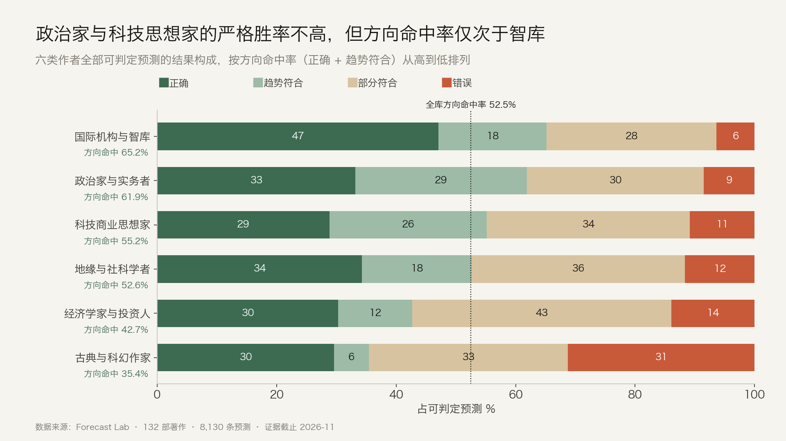
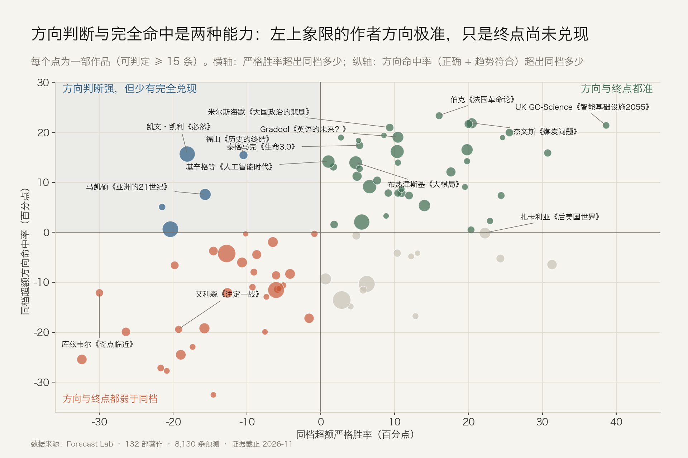
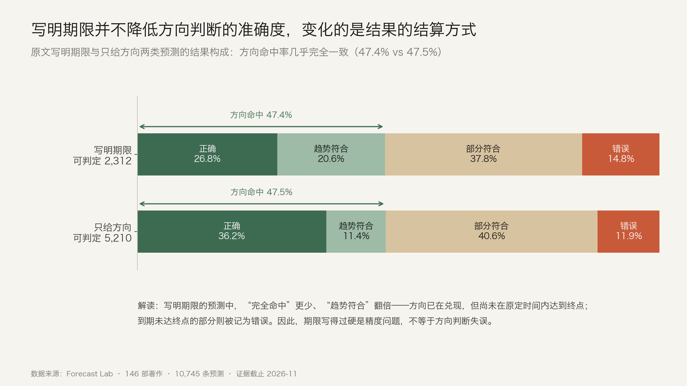
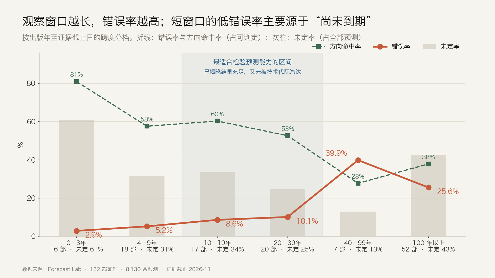
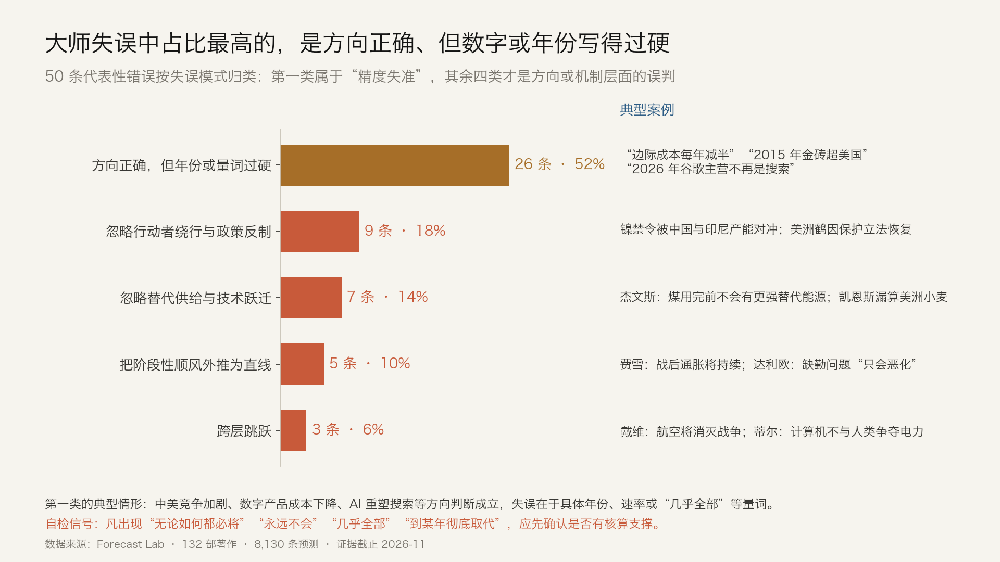

# Forecast Lab · 信号与噪音：可复盘的预测实验室

**对 132 部著作与机构报告中的 8,130 条预测进行逐条事实核验，检验历史预测的准确度、有效方法与典型失误。**

[](https://github.com/nebulonvc/forecast-lab/actions/workflows/check.yml)
[](LICENSE)
[](LICENSE)

---

## 研究价值

这项研究可以从四个方面为读者提供帮助：

1. **判断哪些人的哪些书值得读。** 关于未来的书很多，但作者的判断质量差异很大，同一作者的不同作品也可能相差悬殊。我们将每部作品与同一时间跨度的作品比较，给出可复核的排名，帮助读者把有限的阅读时间投向经过检验的作品，并知道一本书中哪些部分更可信。
2. **校准对专家与机构的信任。** 区分"偶然命中"与"稳定的判断能力"，区分"方向判断准确"与"时间表准确"，避免因名气高估或因个别失误低估一位作者。
3. **学习可迁移的预测方法。** 从高准确度作品中提炼出约束账本、制度激励、地缘底盘、技术功能扩散、风险边界、多情景条件六类方法，并总结五种需要规避的失误模式。
4. **建立自己的预测与复盘习惯。** 用同一套方法写下对未来的判断，借助 AI Agent 与 GitHub Actions 定期核对，在事后检验自己的判断质量。

### 值得读的书：按领域推荐

以下作品在同一时间跨度的作品中综合表现领先（依据[同档基准排行榜](docs/05-same-tier-ranking.md)，可判定预测 ≥ 15 条）。"阅读提示"指出各书最可信的部分与需要留意之处。

| 领域 | 推荐作品 | 阅读提示 |
| :--- | :--- | :--- |
| 地缘政治 | 伯克《法国革命论》(1790)、麦金德《民主的理想与现实》(1919)、扎卡利亚《后美国世界》(2008)、卡普兰《地理的复仇》(2012) | 学习如何以财政、军队、地理等硬约束推演格局；卡普兰的技术细节推测可略读 |
| 科技商业 | 英国政府科学办公室《智能基础设施的未来：通向 2055 的情景》(2006)、弗里德曼《世界是平的》(2005)、凯文·凯利《失控》(1994) | 凯文·凯利优先读《失控》；《必然》方向判断很强，但具体年份与公司断言需打折 |
| AI 与奇点 | 泰格马克《生命 3.0》(2017)、博斯特罗姆《超级智能》(2014)、基辛格等《人工智能时代与人类未来》(2021) | 三本均零错误，以条件与机制表达判断；库兹韦尔《奇点临近》的时间表不宜采信 |
| 人口能源资源 | 梅多斯《增长的极限》(1972)、杰文斯《煤炭问题》(1866)、IEA《全球关键矿产展望 2024》 | 学习存量—流量—产能的核算方法；同时留意替代技术对约束的改写 |
| 宏观金融 | 费雪《货币的购买力》(1920)、塔勒布《黑天鹅》(2007)、凯恩斯《和平的经济后果》(1919) | 重在风险结构与传导机制；本领域点位与时机预测普遍不准，任何作者都应谨慎看待 |
| 社会制度教育 | Graddol《英语的未来？》(1997)、OECD《回到教育的未来》(2020)、杜波依斯《黑人的灵魂》(1903) | 学习多条线索交叉推演与多情景表达 |
| 科幻推演 | 威尔斯《预言》(1901)、戴维《航空器》(1919) | 读其对技术功能扩散的推演；威尔斯的世界政府构想（《公开的阴谋》）可略过 |

> **[查看全部 132 部作品的完整排行榜 →](docs/05-same-tier-ranking.md)**　排名为回顾性统计，反映本库口径下相对同龄作品的表现，不构成对作者的整体评价。

---

## 研究目的

关于未来的著作与报告层出不穷，但其中的判断很少在事后被系统性检验。缺少检验，会导致两种常见的误判：一是将偶然命中视为能力，进而高估作者在其他领域的判断；二是因个别失误而否定作者在结构性问题上的长期洞见。

本项目受纳特·西尔弗（Nate Silver）《信号与噪音》启发，尝试以可复核的方式回答三个问题：

1. **哪些预测者在哪些领域、哪些时间跨度上显著优于同类基准？**
2. **准确的预测依赖哪些可迁移的推理方法？**
3. **即使是顶尖预测者，失误又集中在哪些模式上？**

研究覆盖 16 世纪至 2025 年的 132 部作品，涉及地缘政治、宏观金融、科技商业、人工智能、能源与人口、社会制度、科幻推演七个领域，作者包括伯克、马尔萨斯、威尔斯、凯恩斯、基辛格、克里斯坦森、库兹韦尔，以及 IEA、OECD、世界银行等机构。

> **推荐首先阅读：[核心研究发现](docs/00-key-insights.md)**——包括数据分布、各领域超越基准的预测者、可借鉴的方法、需规避的失误模式，以及 14 个详细的历史案例。

---

## 核心发现



### 一、准确度最高的群体是具备"约束账本"习惯的专业机构

| 作者类型 | 作品数 | 严格胜率 | 方向命中率 | 错误率 |
| :--- | ---: | ---: | ---: | ---: |
| **国际机构与政府智库**（IEA、OECD、世界银行、英国政府科学办公室等） | 21 | **47.0%** | **65.2%** | **6.3%** |
| 政治家与战略实务者（李光耀、布热津斯基、基辛格等） | 15 | 33.1% | 61.9% | 8.5% |
| 地缘与社科学者（扎卡利亚、卡普兰、亨廷顿等） | 27 | 34.3% | 52.6% | 11.7% |
| 经济学家与投资人（凯恩斯、塔勒布、达利欧等） | 17 | 30.3% | 42.7% | 13.9% |
| 科技商业思想家（克里斯坦森、弗里德曼、凯文·凯利等） | 19 | 28.8% | 55.2% | 10.8% |
| 古典思想家与科幻作家（威尔斯、凡尔纳、贝拉米等） | 33 | 29.6% | 35.4% | 31.3% |

*严格胜率 = 正确 ÷ 可判定；方向命中率 = (正确 + 趋势符合) ÷ 可判定；错误率 = 错误 ÷ 可判定。*

机构报告多为近年出版，可能受益于观察窗口较短。但在**控制时间跨度后**，智库在 0–9 年档（47.7%，其他群体 20%–25%）与 10–39 年档（46.1%，其他群体 32%–40%）均保持领先。其优势主要来自三个习惯：先核算存量、产能与成本约束；避免绝对化结论；以条件情景表达不确定性。


### 二、方向判断是一种同样稀缺、同样值得重视的能力

严格胜率衡量的是"在原定时间内完全兑现"，方向命中率（正确 + 趋势符合）衡量的是"变化的方向是否看对"。两者是不同的能力。许多作者的终点尚未到达或时间表偏早，但方向判断远超同档平均水平：

- **政治家与战略实务者**：严格胜率 33.1%，方向命中率 61.9%，仅次于智库；其中 29% 为"趋势符合"。
- **科技商业思想家**：严格胜率 28.8%，方向命中率 55.2%；《必然》严格胜率仅 18.7%，方向命中率却达 76.0%，高出同档 15.7 个百分点。
- **福山《历史的终结》**方向命中率 68.2%，**基辛格等《人工智能时代》**方向命中率 71.8% 且零错误，**泰格马克《生命 3.0》**方向命中率 75.0% 且零错误。



下图将两种能力分开呈现。左上象限的作品方向判断明显强于同档，只是尚未完全兑现；对于中长期决策而言，这类判断同样具有很高的参考价值。



方向判断最强的 20 部作品见[核心研究发现 · 3.5 节](docs/00-key-insights.md#35-方向判断另一种被低估的能力)。

### 三、预测能力具有明显的领域边界

同一作者在不同题材上的表现差异显著：

- **H. G. 威尔斯**：《预言》（1901）推演技术功能扩散，严格胜率 52.2%；《公开的阴谋》（1928）构想世界政府，错误率 40.9%。
- **瑞·达利欧**：《债务危机》（2018）零错误；《原则：应对变化中的世界秩序》（2021）严格胜率仅 12.3%。
- **凯文·凯利**：《失控》（1994）经 32 年检验错误率 5.7%；《必然》（2016）方向命中率高，但在具体公司与年份上多次失误。

因此，评估一条预测时应关注其是否落在作者的能力圈内，而非作者的整体声誉。


### 四、写明期限会提高错误率，但并不降低方向判断的准确度

写明期限的预测与只给方向的预测，方向命中率几乎相同（53.0% vs 52.2%）。差别在于结算方式：写明期限的预测中"趋势符合"占 28.6%（方向已在兑现，但未在原定时间达到终点），期限届满未达终点的部分则被记为错误，因此错误率更高（17.9% vs 12.3%）。



换言之，期限写得过硬主要是**精度问题**，而非方向判断失误。有存量、产能与建设周期核算支撑时，写明期限照样准确：IEA、米尔斯海默、杰文斯写明期限的预测严格胜率在 50%–63% 之间。分领域的错误率对比见[图 8](docs/figures/fig08-explicit-vs-implicit.png)。

### 五、观察窗口越长，检验越严格

出版 3 年内作品的错误率为 2.9%，40 年以上升至 25%–40%。短窗口的低错误率在很大程度上是因为大量预测尚未到期（未定率 60.7%），而非作者更为准确。因此，**本项目对任何作品的评价都以同一时间跨度档的平均水平为基准**。



### 六、失误分为"精度失准"与"方向误判"两类

对 50 条代表性大师失误的归类显示，占比最高的一类（26 条）是**方向正确、但年份、速率或量词写得过硬**，如"金砖四国 2015 年 GDP 超过美国""所有数字产品边际成本每年下降 50%"。这类失误的方向判断本身成立，属于精度失准，严重程度低于方向误判。

真正的方向误判集中于四种模式：

1. **忽略替代供给与技术跃迁**：马尔萨斯、埃利希未能预见化肥与绿色革命对粮食供给的改变。
2. **忽略行动者的绕行与政策反制**：如断言美洲鹤必然灭绝，未考虑后续保护立法。
3. **将阶段性趋势外推为长期单调变化**：如将战后短期通胀视为持续上涨。
4. **跨层跳跃**：由"技术可行"直接推出"社会政治终局"，如"航空将消灭战争与民族主义"。



### 七、哪些作品跑赢了同档基准

我们将全部 132 部作品分别与同一时间跨度档的平均水平比较，计算三项超额：严格胜率超额、方向命中率超额与低错优势，并以三者的算术平均作为**综合超额**排序。在可判定 ≥ 15 条的 86 部作品中，**46 部综合超额为正**。


综合超额前 20 名（单位：百分点）：

| 排名 | 作者 · 作品 | 领域 | 跨度档 | 可判定 | 严格胜率超额 | 方向命中率超额 | 低错优势 | 综合超额 |
| ---: | :--- | :--- | :--- | ---: | ---: | ---: | ---: | ---: |
| 1 | 英国政府科学办公室 (UK G…《智能基础设施的未来：通向2055的…》 | 科技商业 | 20–39年 | 27 | +38.6 | +21.4 | +6.4 | **+22.1** |
| 2 | Edmund Burke《法国革命论》 | 地缘政治 | 100 年以上 | 31 | +16.0 | +23.4 | +25.6 | **+21.7** |
| 3 | 德内拉·梅多斯、丹尼斯·梅多斯…《增长的极限》 | 人口能源资源 | 40–99年 | 17 | +8.5 | +19.4 | +28.1 | **+18.7** |
| 4 | 经合组织 (OECD)《回到教育的未来：经合组织的四种学校…》 | 社会制度教育 | 4–9年 | 34 | +30.7 | +15.9 | +5.2 | **+17.3** |
| 5 | Scott Nearing《下一步：经济世界联邦计划》 | 地缘政治 | 100 年以上 | 23 | +19.8 | +14.3 | +16.9 | **+17.0** |
| 6 | 埃文·约翰·戴维（Evan J…《航空器：战争与和平中的发展及其商业…》 | 科幻乌托邦 | 100 年以上 | 42 | +20.0 | +21.7 | +8.9 | **+16.9** |
| 7 | 哈尔福德·麦金德（Halfor…《民主的理想与现实》 | 地缘政治 | 100 年以上 | 38 | +25.5 | +20.0 | +4.5 | **+16.7** |
| 8 | H. G. 威尔斯 (H. G…《预言》 | 科幻乌托邦 | 100 年以上 | 90 | +19.8 | +16.6 | +12.2 | **+16.2** |
| 9 | 威廉·斯坦利·杰文斯（Will…《煤炭问题：关于国家进步与煤矿可能耗…》 | 人口能源资源 | 100 年以上 | 72 | +20.4 | +21.9 | +4.7 | **+15.7** |
| 10 | 经合组织 (OECD)《经合组织数字经济展望2024》 | 科技商业 | 0–3年 | 15 | +24.6 | +19.0 | +2.9 | **+15.5** |
| 11 | W. E. B. 杜波依斯（W…《黑人的灵魂》 | 社会制度教育 | 100 年以上 | 16 | +5.1 | +18.4 | +19.3 | **+14.3** |
| 12 | Alfred Thayer M…《美国海权的利益：现在与未来》 | 地缘政治 | 100 年以上 | 58 | +17.6 | +12.1 | +8.3 | **+12.7** |
| 13 | H. G. 威尔斯 (H. G…《即将到来的事物：对战后的预测》 | 科幻乌托邦 | 100 年以上 | 124 | +10.3 | +16.2 | +7.8 | **+11.4** |
| 14 | Irving Fisher《货币的购买力》 | 宏观金融 | 100 年以上 | 17 | +8.8 | +3.3 | +19.7 | **+10.6** |
| 15 | David Graddol《英语的未来？》 | 社会制度教育 | 20–39年 | 85 | +10.4 | +19.1 | +1.9 | **+10.5** |
| 16 | 李光耀 (Lee Kuan Y…《李光耀回忆录》 | 地缘政治 | 20–39年 | 24 | +10.4 | +14.0 | +5.9 | **+10.1** |
| 17 | H. G. 威尔斯 (H. G…《世界的走向：对未来岁月的猜测与预测》 | 科幻乌托邦 | 40–99年 | 42 | +7.6 | +10.4 | +11.3 | **+9.8** |
| 18 | 联合国粮农组织 (FAO)《全球森林部门展望2050：可持续经…》 | 人口能源资源 | 4–9年 | 21 | +19.5 | +9.1 | +0.4 | **+9.7** |
| 19 | 迈克斯·泰格马克（Max Te…《生命3.0》 | AI 与奇点 | 4–9年 | 36 | +5.2 | +17.4 | +5.2 | **+9.3** |
| 20 | 尼克·博斯特罗姆（Nick B…《超级智能》 | AI 与奇点 | 10–19年 | 44 | +10.9 | +7.9 | +8.6 | **+9.1** |

⚠️ 表示未定率 ≥ 60%，多为近年出版、大量预测尚未到期，排名稳定性较低。

> **[查看全部 132 部作品的完整排行榜 →](docs/05-same-tier-ranking.md)**　包括主榜（可判定 ≥ 15 条，86 部）、参考榜（5–14 条，19 部）与未参与排名的作品（27 部），并为每部作品标注"全面领先 / 准且稳 / 高命中·高波动 / 方向型 / 谨慎少错 / 全面落后"等类型。CSV 版本见 [`datasets/same_tier_ranking.csv`](datasets/same_tier_ranking.csv)。

各领域领先与落后作品的对比、方法表现与数据分布，见[核心研究发现](docs/00-key-insights.md)中的 14 幅图表。

---

## 代表性历史案例

| 作者 | 预测内容 | 后续结果 |
| :--- | :--- | :--- |
| **伯克**（1790） | 法国大革命缺乏财政、军纪与社会秩序支撑，终将由军事强人收场 | 拿破仑掌权；全书 31 条可判定预测零错误 |
| **杰文斯**（1866） | 英国煤耗增长无法长期维持 ✅；煤炭耗尽前不会出现更强替代能源 ❌ | 英国煤产量 1913 年见顶；石油与天然气随后兴起 |
| **威尔斯**（1901） | 很可能在 1950 年前出现成功往返的飞行器 | 1903 年莱特兄弟首飞 |
| **克里斯坦森**（1997） | 传统车企将长期忽视电动车 ✅；电动车将从低端廉价市场切入 ❌ | 打开市场的是高性能、高价位的特斯拉 Roadster |
| **卡普兰**（2012） | 21 世纪欧洲仍将在关键意义上受其与俄罗斯关系的影响 | 2014 年克里米亚事件、2022 年俄乌战争 |
| **马汉**（1897） | 运河必建于尼加拉瓜 ❌；无论建于何处都将成为全球贸易枢纽 ✅ | 运河建于巴拿马，并成为全球航运咽喉 |
| **埃利希**（1968） | 无论采取何种紧急措施，1970 年代都将有数亿人饿死 | 绿色革命使粮食增长超过人口增长；全书错误率 51.1% |
| **库兹韦尔**（2005） | 将半导体的指数增长外推至纳米制造与生物医学 | 20 年后严格胜率 5.4%，错误率 27.0% |

各案例的背景、成败原因与可借鉴之处，详见[核心研究发现 · 第六节](docs/00-key-insights.md#六十四个历史案例详解)。完整的 100 条精彩预测与 50 条大师失误，见 [330 条精选预测全集](docs/reports/curated-330-compendium.md)。

---

## 可借鉴的推理方法

准确的预测集中于以下六类方法：

| 方法 | 核心做法 | 代表 |
| :--- | :--- | :--- |
| **约束账本法** | 拆解存量、流量、在建产能、成本与付费方，以硬约束限定结论 | IEA、杰文斯、李光耀 |
| **制度与激励结构法** | 分析决策权、考核指标与成本承担者，而非公开表态 | 伯克、克里斯坦森、塔勒布 |
| **地缘底盘法** | 以地理、海上通道与邻国安全焦虑等慢变量为锚 | 扎卡利亚、卡普兰、麦金德 |
| **技术功能扩散法** | 预测"将能实现何种功能"，而非"由何种产品或企业实现" | 威尔斯、戴维、弗里德曼 |
| **风险边界法** | 不预测点位，而识别风险暴露、损失承担者与兜底机制 | 塔勒布、鲁比尼 |
| **多情景条件法** | 并列多条路径，并给出判别各路径的领先信号 | OECD、世界银行、梅多斯 |

**按时间跨度选择方法**：3 年以内依据已开工产能、排期与立法日程，可给出具体时间；3–15 年依据制度激励，以情景分支表达；15 年以上仅判断地理、人口结构与技术功能等慢变量，不给出精确年份或具体企业。

完整的七步操作流程见[数据阅读与预测实践指南](docs/03-data-and-forecasting-guide.md)。

---

## 演示视频

| 《预测，能否被量化？》精华短版（3 分 49 秒） | 《预测，能否被量化？》完整大课版（1 小时 12 分） |
| :---: | :---: |
| [](https://github.com/nebulonvc/forecast-lab/releases/download/v1.1.0/01-short-quantifying-forecasts.mp4) | [](https://github.com/nebulonvc/forecast-lab/releases/download/v1.1.0/02-masterclass-quantifying-forecasts.mp4) |
| 3 分钟读懂 132 部著作、8,130 条预测的量化实验与核心反常识结论 · [观看 / 下载 1080p](https://github.com/nebulonvc/forecast-lab/releases/download/v1.1.0/01-short-quantifying-forecasts.mp4) | 13 章全景大课：从时代背景与名家故事切入，逐领域复盘命中、翻车与七步实战法 · [观看 / 下载 1080p](https://github.com/nebulonvc/forecast-lab/releases/download/v1.1.0/02-masterclass-quantifying-forecasts.mp4) |

完整 13 章时间轴与双行 SRT 字幕见 [media/README.md](media/README.md)。

---

## 数据驱动的预测方法优化与 Agent 接入（MCP & Skill）

定性归纳出六类有效方法之后，更关键的一步是**用全库实证数据训练一套可计算的预测方法优化模型**，让用户在任何 AI Agent 终端提出判断时，都能根据数据自动完成概率校准、失误扫雷与推理方法寻优。

### 一、基于 132 部著作与 $t_0$ 历史状态的超学习器（Super-Learner）

我们将仓库内 **132 部独立作品的 10,683 条样本**（**8,130 条可评分预测、5,060 条明确判定、2,553 条剔除非预测对照**）构建为严格防信息穿越的训练集——仅提取预测发布时点 $t_0 \in [1531, 2026]$ 当时可知的事前特征（含 $t \le t_0 - 10$ 时点因果滚动基准率、宏观通胀/技术狂热/地缘压力历史状态面板、承诺硬度与推理透镜，绝不读取事后核验文本）。

融合**三层经验贝叶斯收缩**（Kahneman & Tversky 1979; Efron & Morris 1975）、**右删失两阶段风险分解**（Kalbfleisch & Prentice 2002）、**FFORMA 特征驱动方法元学习**（Montero-Manso et al. 2020 二阶牛顿直方图提升树 `HistXGBoost`）与**对数线性意见池温度校准**（Genest & Zidek 1986; Satopää et al. 2014），在严格的**按著作整书隔离五折交叉验证（Out-of-Book 5-Fold Grouped CV）**中取得全面最优拟合：

| 模型架构（整书隔离样本外评测） | 5 类 Brier ↓ | 5 类 LogLoss ↓ | 已判定 4 类 Brier ↓ | 已判定 4 类 LogLoss ↓ | 序数 RPS ↓ | 方向校准误差 ECE ↓ |
| :--- | ---: | ---: | ---: | ---: | ---: | ---: |
| 静态时间跨度档 × 显隐期限查表基线 | 0.7537 | 1.4756 | 0.7128 | 1.2827 | 0.1913 | 7.04% |
| 正则化广义线性模型（含 $t_0$ 历史状态 + 透镜） | 0.6855 | 1.3580 | 0.7178 | 1.2962 | 0.1924 | 3.70% |
| 二阶牛顿直方图提升树（`HistXGBoost`） | **0.6684** | **1.3198** | 0.7033 | 1.2684 | 0.1891 | 1.84% |
| **温度校准对数线性超学习器（生产采用）** | **0.6701** | **1.3215** | **0.7002** | **1.2637** | **0.1884** | **1.79%** |

同时，通过 **Cochran-Mantel-Haenszel (CMH) 分层检验**锁死同一 `(时间跨度分档 × 显隐期限)` 剥离短窗红利后，数据直接给出了方法寻优的定量依据：**有硬账本支撑的显式期限相比无账本拍脑袋日期，同层严格胜率高出 `+14.84pp`、错误率降低 `-5.88pp`**；而无账本硬数字外推（严格胜率 `-8.73pp`）、阶段顺风单调速率外推（错误率 `+8.80pp`）、无账本“超越/取代”定时断言（错误率 `+7.00pp`）及多目标捆绑命题（严格胜率 `-6.64pp`）均显著拉低表现。

### 二、评估新技术“这次是否不一样”：150 年同构扩散曲线 × 当下实时瓶颈校准

针对新技术预测中最核心的难题——**“仅看文本结构不懂具体行业新事实，怎么判断一项新技术到底是不是‘这次不一样’？”**——优化器内置了跨越 1882–2025 年 **12 次技术浪潮的四层扩散基线库**（[`datasets/historical_tech_diffusion_atlas.json`](datasets/historical_tech_diffusion_atlas.json)，融合 Comin-Hobijn NBER CHAT 跨国采用库、Bass 1969 S 曲线系数与保罗·大卫“发电机悖论”）：

| 物理与制度摩擦层级 | 历史代表性同构前辈（增量 5%→50% / 存量 5%→50%） | “这次是否不一样”历史规律 |
| :--- | :--- | :--- |
| **第 1 层：纯比特消费协议** | 移动社交 / 消费级生成式 AI 对话端（`2.8 年` / `3.5 年`） | **真能不一样**：零硬件折旧与低追责摩擦，扩散常快于直觉 |
| **第 2 层：消费级终端硬件** | 智能手机（`4.8 年` / `6.5 年`）、乘用电动车（新车 `6.5 年` / **保有量 `14.5 年`**） | **增量快、存量慢**：全社会保有量永远受换机/报废物理周期封顶 |
| **第 3 层：企业核心工作流** | 公有云迁移（`7.5 年` / `9.5 年`）、跨国企业 ERP（`9.0 年` / `11.5 年`） | **发电机悖论重演**：任务提效快，但内网脏数据、合规审计使净岗位替代极慢 |
| **第 4 层：重资产/具身硬件/强监管** | 工业机器人（`14 年` / `22 年`）、电网储能（新增 `9 年` / 发电存量 `22 年`）、L4 自动驾驶/临床新药（`14–20 年`） | **从未不一样过**：速度上限永远由变压器排期、MTBF 良率与事故归责立法最慢短板锁死 |

由此，优化器对每条预测自动完成**五步闭环干预**：
1. **伪预测过滤与规范要素体检**：剥离“应当如何”的倡议或静态格言，核查六要素及方法披露完整度。
2. **高赔率失误陷阱定量拆雷**：拦截无账本硬数字、单调速率外推、无基数超越断言与跨层乌托邦跳跃。
3. **“历史同构给骨架斜率 × 实时搜证填当下参数”双校准**：对技术/产业命题自动运行 Bass S 曲线反演（`evaluate_tech_differentiation`），测算所需速度相对同构前辈的透支倍数、给出 `1.0x–1.5x` 合理渗透区间，并列出 **3 项必须联网核查的当下实时瓶颈指标**（如变压器并网排队月数、POC 转年框续费率、整机回本周期）。
4. **反事实方法与承诺硬度寻优**：遍历 **6 大主推理方法 × 反校验透镜 × 承诺硬度**，量化改写前后的严格胜率提升与错误率下降幅度。
5. **终局预测强制显式写出预测方法**：最终交付的《终局预测卡》必须把 **【可核验预测承诺 + 主预测方法与四步推导链 + 历史同构校准与实时瓶颈参数 + 反校验逻辑 + 8,130 库校准概率 + 证伪红线】** 完整写出来。

### 三、三种接入方式（支持任何 AI Agent 终端，纯 Python 3.11+ 标准库零依赖）

#### 方式 1：复制下面这段话发给任何 Agent 终端即可接入（最简推荐）

适用于 **Claude Code、Antigravity、Cursor、Codex CLI、Windsurf、Cline、OpenCode** 等任意终端（即便当前在空白目录或其他项目目录，Agent 也会自动零依赖拉取并挂载预固化模型 [`datasets/forecast_optimizer_model.json`](datasets/forecast_optimizer_model.json)）：

```text
请帮我接入开源的 Forecast Lab 数据驱动预测方法优化器（仓库：https://github.com/nebulonvc/forecast-lab.git ，纯 Python 3.11+ 标准库零依赖）：
1. 若当前目录不在 forecast-lab 仓库内，请先执行 `test -d ~/.forecast-lab || git clone --depth 1 https://github.com/nebulonvc/forecast-lab.git ~/.forecast-lab`（若已在仓库内则直接使用当前目录），并阅读 `.agents/skills/forecast-optimizer/SKILL.md`；若当前终端支持配置本地 MCP Server，可将 `python3 <仓库路径>/toolkit/forecast_mcp.py` 挂载为 `forecast-lab-optimizer`。
2. 每当我提出预测想法（尤其是评估 AI、机器人、能源、新产业“这次是否不一样”）时，你必须先调用 MCP 工具 `optimize_forecast` 与 `evaluate_tech_differentiation`（或运行 `python3 <仓库路径>/toolkit/forecast_optimizer.py optimize --statement "<预测草案>" --domain "<领域>"`）：先用 8,130 条历史预测 Super-Learner 与 150 年 12 次技术浪潮 Bass 扩散曲线给“历史同构骨架斜率”，再根据工具列出的 `realtime_parameters_to_fetch_now` 联网查询当下的真实行业瓶颈数据（如并网排期、BOM回本周期、付费留存率）修正斜率。
3. 【强制交付规范——必须把预测方法写出来】：你最终输出给我的每一条预测，绝不允许只给一句裸结论或拍脑袋概率，必须将“预测结论”与“预测方法”作为整体完整写出：
   (a) 可核验预测承诺（主体 + 对象 + 量词 + 含分母可测指标【严分增量流量 vs 存量保有量】+ 唯一权威结算数据源 + 明确期限 + 排除边界）；
   (b) 显式预测方法与四步推导链（明确写出选用哪套主方法原型、代入当下实时瓶颈数据的四步推导计算过程、历史同构技术校准结论、反校验透镜对冲逻辑与承诺硬度依据）；
   (c) 8,130 库样本外校准先验概率（展示优化前基线 vs 优化后的严格胜率、方向命中率、部分符合率、错误风险对比）；
   (d) 2–3 个季度/半年度可查的领先观测指标，以及事件×机制×时间三轴明确证伪红线。
准备好后请回复我：“Forecast Lab 预测方法优化与历史同构校准引擎已就绪，请告诉我你的预测想法。”
```

#### 方式 2：挂载标准 MCP Server（[`.mcp.json`](.mcp.json) / [`toolkit/forecast_mcp.py`](toolkit/forecast_mcp.py)）

在仓库根目录启动 Claude Code、Cursor 或 Antigravity 时会自动识别 [`.mcp.json`](.mcp.json)；在其他全局客户端中添加以下配置即可调用 7 个标准工具（`optimize_forecast`、`evaluate_tech_differentiation`、`query_reference_class`、`bayesian_update_forecast`、`audit_forecast_ledger`、`register_optimized_forecast`、`get_optimizer_benchmark`）：

```json
{
  "mcpServers": {
    "forecast-lab-optimizer": {
      "command": "python3",
      "args": ["/path/to/forecast-lab/toolkit/forecast_mcp.py"]
    }
  }
}
```

#### 方式 3：通过通用 Agent Skill 或命令行直接调用

仓库内置技能定义 [`.agents/skills/forecast-optimizer/SKILL.md`](.agents/skills/forecast-optimizer/SKILL.md)，或直接在终端运行 CLI 输出包含四步推导链与终局预测卡的完整优化报告：

```bash
python3 toolkit/forecast_optimizer.py optimize \
  --statement "到2028年底，AI将彻底取代50%以上的软件工程师工作，代码编写成本每年减半。" \
  --domain "AI"
```

完整的数学推导、八组模型交叉验证表与工具契约见 **[《数据驱动的预测方法优化与 MCP/Skill 接入指南》](docs/06-forecast-method-optimization.md)**。

---

## 接入预测账本系统、自动事实核查与市场回测

完成预测方法的校准与寻优后，下一步是将预测纳入长期账本持续追踪核对。本项目提供**两种账本运行模式**，可按使用场景任选：

### 模式一：零代码纯文本账本（无需下载或运行任何程序，支持 Polymarket 对标与盲测回测）

如果你不希望在本地下载或运行任何外部脚本，也无需克隆 132 部原书仓库，可以直接让 AI Agent **仅通过只读公开 Markdown/JSON 文档**建立纯 `.md` 预测账本：

```text
请只读阅读 https://raw.githubusercontent.com/nebulonvc/forecast-lab/main/AGENT_SETUP.md 与方法表 https://raw.githubusercontent.com/nebulonvc/forecast-lab/main/method-pack/manifest.json ，帮我以“零代码、纯 Markdown”方式接入《信号与噪音》预测系统（全程不要下载或运行任何外部脚本程序）：
1. 先通过对话向我问 4 个简短问题，确定我的预测目标、关注领域、存放位置（本地目录、我的 GitHub 仓库或自有 Agent 系统）与复盘频率；
2. 根据我的回答，从 manifest.json 提取对应领域的历史基准胜率、主推理透镜、反校验透镜与一手数据源，在当前目录创建纯文本规则 `AGENTS.md` 与预测总账本 `forecasts/README.md`；
3. 后续每次做预测或复盘前重新只读读取一次最新 `manifest.json` 以保持方法同步，并协助我完成：七步法去噪立卡、联网正反双向事实核查、只读访问 Polymarket 公开接口拉题与结算认证，或开展历史时间截点盲测回测。
```

- **预测方法自动热同步**：预测透镜与基准率表托管于公开纯数据文件 [`method-pack/manifest.json`](method-pack/manifest.json)，方法迭代后 Agent 重新只读拉取即可生效，不影响本地账本。
- **Agent 自动事实核查与 Polymarket 结算认证**：Agent 用自带搜索成对核查支持与反面一手数据；并直接只读访问 Polymarket 官方公开接口（`gamma-api.polymarket.com`，免密钥、免钱包）拉取题目、认证 UMA 终局结果并计算 Brier Score 与超额优势（Market Edge）；亦可读取 [`curated_backtest_questions.json`](method-pack/curated_backtest_questions.json) 立即进行时间截点隔离的历史盲测练习。

详见 [给 Agent 的零代码接入协议 (`AGENT_SETUP.md`)](AGENT_SETUP.md) 与 [零代码接入、事实核查与 Polymarket 回测指南](docs/05-quickstart-onboarding-and-polymarket.md)。

### 模式二：整仓 Fork 审计账本（SHA-256 证据校验与 GitHub Actions 定时巡检）

克隆或 Fork 本仓库后，可使用内置的 [`my-forecasts/`](my-forecasts/) 账本与自动化工作流：

1. **优化定稿并冻结入账**：通过 MCP 工具 `register_optimized_forecast` 或 [`toolkit/periodic_tracker.py`](toolkit/periodic_tracker.py) 将带显式方法推导链的预测卡写入 `my-forecasts/`，并由 `pipeline.py check` 执行字节级哈希校验。
2. **云端每月自动检索正反证据**：配置 DeepSeek 与 Exa 的 API Key 后，GitHub Actions（[`periodic-forecast.yml`](.github/workflows/periodic-forecast.yml)）每月自动并发检索支持与反驳证据，并以 Issue 推送复盘简报。
3. **三轴阻尼贝叶斯后验复盘**：无外部 API 时，由本地 Agent 检索一手统计数据并调用 `bayesian_update_forecast` 按事件、机制、时间三轴更新概率分布。

详见 [Fork 与定期预测工作流指南](docs/04-fork-and-agent-workflow.md)。

---

## 共建实证数据库：用你自己的 Agent 或 API 拆解一本书并提交 PR

欢迎任何研究者与读者将新的著作、机构报告或人物访谈拆解为可审计的预测案例，并通过 Pull Request 合入本库（`cases/<slug>/` + `datasets/all_cases_summary.csv` + [同档基准排行榜](docs/05-same-tier-ranking.md)）。我们提供**两条完全等价的标准流水线**，共享同一套 v5 抽取标准、正反双向一手搜证规则与六道确定性防污染闸门：

| 共建路径 | 适用人群与工具 | 核心执行方式 |
| :--- | :--- | :--- |
| **路径一：用你自己的 Agent 跑书**<br>（零额外 API 费用） | 使用 **Claude Code、Antigravity、Cursor、Codex CLI、Windsurf、OpenCode** 等自有 AI Agent 的用户 | `contribute_book.py chunk-txt` 切块 → Agent（及并行子智能体）按 `prompt_v5.txt` 逐块抽取 + 自带联网搜索正反双向搜证 + 六维语义自检 → `contribute_book.py` 确定性对齐、裁剪上下文、SHA-256 存档并入库 |
| **路径二：用你自己的 API 跑书**<br>（BYOK 全自动并发） | 拥有 **DeepSeek / OpenAI 兼容接口**（OpenAI、OpenRouter、通义千问、SiliconFlow 等）与 **Exa Search API** 的用户 | `prepare_book.py txt` 并发抽取 → `contribute_book.py trim-contexts` 裁剪 → `verify_prediction.py --all-forecasts` 并发双向搜证与独立复核 → `contribute_book.py import-verify` 一键固化证据并入库 |

### 复制下面这段话发给你的 Agent 即可跑完一本书并准备 PR

```text
请帮我按《信号与噪音》Forecast Lab 的 v5 标准协议拆解一本新书，并生成可直接提交 PR 合入主数据库的完整案例（先阅读 `.agents/skills/book-contributor/SKILL.md` 与 `docs/07-contribute-a-book.md`）：
1. 先向我确认 5 项元数据与运行方式：书名、作者、初版代理年份、所属七大标准领域之一、所属六类标准作者类型之一，以及原书 TXT 文件路径（我来把原书 TXT 放入被 `.gitignore` 忽略的 `cases/<slug>/input/` 目录，绝不提交进 Git）。同时问我是使用【路径一：由你（Agent 原生阅读与自带联网搜索）零 API 费用完成】，还是【路径二：调用我配置的 DeepSeek / OpenAI 兼容 API 与 Exa API 并发跑完】。
2. 初始化案例并切分原文：运行 `python3 toolkit/contribute_book.py init ...`，切块执行 v5 抽取（严守逐字 quote 对齐、7 类非预测剔除与指代消歧），并通过 `contribute_book.py trim-contexts` 裁剪 `context`，确保不泄露原书全文。
3. 严格执行正反双向一手事实核查：对每条可评分预测，必须成对检索支持证据与反面/瓶颈证据（优先统计局、央行、IEA/OECD/世行、学术与财报一手出处），将正文存档至 `cases/<slug>/data/sources/` 并登记真实 SHA-256 与截至日（<= cutoff），执行六维语义复核后按五类互斥结论落盘。
4. 合入总数据库并运行全部 PR 门禁：依次运行 `python3 toolkit/contribute_book.py sync-database --case cases/<slug>`、`python3 toolkit/contribute_book.py pr-check --case cases/<slug>` 与 `python3 -m unittest discover -s toolkit/tests -v`。
5. 全部门禁通过后，为我汇总本书的五类统计与同档超额表现，检查 `git status` 确认无原书全文或 API 密钥残留，并协助我创建分支、提交 Commit 与 Pull Request。
```

### 终端快速命令速览

<details>
<summary><b>展开查看路径一（自有 Agent）与路径二（自有 API）核心 CLI 闭环</b></summary>

```bash
# 0. 初始化社区案例目录（自动创建已被 .gitignore 忽略的 input/ 目录）
python3 toolkit/contribute_book.py init \
  --case cases/<author-book-v5> --book "<书名>" --author "<作者>" \
  --publication-year 2010 --domain "科技、商业与产业颠覆" --author-type "科技商业思想家与产业实践者"

# --- 路径一：自有 Agent 原生模式 ---
python3 toolkit/contribute_book.py chunk-txt --case cases/<author-book-v5> --txt cases/<author-book-v5>/input/book.txt
# (由 Agent 阅读 chunks.jsonl 与 prompt_v5.txt 写出 proposals，再导入并裁剪上下文)
python3 toolkit/contribute_book.py import-extractions --case cases/<author-book-v5> --txt cases/<author-book-v5>/input/book.txt --proposals cases/<author-book-v5>/output/txt_import/chunk_proposals
python3 toolkit/contribute_book.py export-verify-tasks --case cases/<author-book-v5>
# (由 Agent 联网正反双向搜证并自检后，登记原始网页正文与评估)
python3 toolkit/contribute_book.py apply-assessments --case cases/<author-book-v5> --assessments assessments.jsonl --evidence-raw evidence_raw.jsonl

# --- 路径二：自有 API 并发模式（支持 DeepSeek 或任意 OpenAI 兼容 --api-base）---
python3 toolkit/prepare_book.py --case cases/<author-book-v5> txt cases/<author-book-v5>/input/book.txt --apply --budget-cny 15
python3 toolkit/contribute_book.py trim-contexts --case cases/<author-book-v5>
python3 toolkit/verify_prediction.py --case cases/<author-book-v5> --all-forecasts --workers 8 --budget-cny 20 --exa-budget-usd 10
python3 toolkit/contribute_book.py import-verify --case cases/<author-book-v5>

# --- 统一合入总数据库与 PR 验收 ---
python3 toolkit/contribute_book.py sync-database --case cases/<author-book-v5>
python3 toolkit/contribute_book.py pr-check --case cases/<author-book-v5>
python3 -m unittest discover -s toolkit/tests -v
```

</details>

### PR 合入主数据库的 5 条硬标准

1. **版权零泄漏**：原书全文（`.txt`/`.pdf`/`.epub`）绝不入库，`claims.jsonl` 已通过 `trim-contexts` 裁剪上下文，仅保留必要短引文与指代支撑片段。
2. **密钥与隐私零残留**：无任何 API Key 或本机绝对路径（`/Users/...`、`/home/...`）。
3. **100% 字节级证据哈希**：所有计分条目的外部证据均已在 `data/sources/` 本地归档，且通过 `pipeline.py check` 的 SHA-256 与截止日防穿越校验。
4. **全量候选覆盖与报告幂等**：全书候选 `unreviewed == 0`，且 `output/report.md`、`output/claims.csv`、`output/summary.json` 与底层 JSONL 100% 同步。
5. **总表与榜单同步**：已运行 `contribute_book.py sync-database` 更新 `datasets/all_cases_summary.csv`、`datasets/same_tier_ranking.csv` 与 `docs/05-same-tier-ranking.md`，并通过 `contribute_book.py pr-check` 与全量单元测试。

详见 **[《社区共建指南：用你自己的 Agent 或 API 拆解一本书并合入数据库》](docs/07-contribute-a-book.md)**。

---

## 文档导航

| 目的 | 文档 |
| :--- | :--- |
| **了解核心研究发现** | [docs/00-key-insights.md](docs/00-key-insights.md) |
| **用自己的 Agent 或 API 拆书并提 PR 入库** | [docs/07-contribute-a-book.md](docs/07-contribute-a-book.md) |
| **数据驱动的预测方法优化（MCP & Skill）** | [docs/06-forecast-method-optimization.md](docs/06-forecast-method-optimization.md) |
| **复制给 AI Agent 的零代码接入协议** | [AGENT_SETUP.md](AGENT_SETUP.md) |
| **零代码接入、事实核查与 Polymarket 回测** | [docs/05-quickstart-onboarding-and-polymarket.md](docs/05-quickstart-onboarding-and-polymarket.md) |
| 理解研究方法与判定标准 | [docs/01-methodology-signal-and-noise.md](docs/01-methodology-signal-and-noise.md) |
| 了解核验管线的工程设计 | [docs/02-engineering-architecture.md](docs/02-engineering-architecture.md) |
| 学习阅读数据与实践预测 | [docs/03-data-and-forecasting-guide.md](docs/03-data-and-forecasting-guide.md) |
| 建立个人定期预测账本 | [docs/04-fork-and-agent-workflow.md](docs/04-fork-and-agent-workflow.md) |
| 浏览 100 条精彩预测、50 条失误与 180 条未来方向 | [docs/reports/curated-330-compendium.md](docs/reports/curated-330-compendium.md) |
| 阅读完整统计报告与人物画像 | [docs/reports/panoramic-report.md](docs/reports/panoramic-report.md) |
| **查看全部作品的同档基准排行榜** | [docs/05-same-tier-ranking.md](docs/05-same-tier-ranking.md) |
| 查询任一作品的统计数据（CSV） | [datasets/](datasets/README.md) |
| 逐条核对原文引文与证据 | [cases/](cases/README.md) |

<details>
<summary><b>判定标准</b></summary>

每条预测归入以下五类之一，类别互斥：

| 类别 | 定义 | 全库条数 |
| :--- | :--- | ---: |
| 正确 | 在声明的口径与观察窗口内，主要可检验结果已发生 | 1,686 |
| 趋势符合 | 持续的客观数据支持预测方向，但终点尚未到达 | 971 |
| 部分符合 | 复合命题中分项有对有错，或不同合理口径结论不同 | 1,714 |
| 错误 | 主要可检验结果与预测相反，或期限届满未发生 | 689 |
| 暂无法判断 | 期限未到、前提未触发或缺乏可靠公开证据 | 3,070 |

- 抽取阶段剔除比喻、格言、政策建议、历史复述等非预测语句，共 2,553 条。
- "部分符合"不折算为 0.5 分；"趋势符合"不计入终局命中。
- 证据不足时保留"暂无法判断"，不强行判定。
- 每条判定均绑定公开证据并保存文件哈希，可独立复核。

</details>

<details>
<summary><b>本地运行</b></summary>

仅需 Python 3.11+，无第三方依赖：

```bash
python3 -m unittest discover -s toolkit/tests -v
python3 toolkit/pipeline.py --case cases/lky-guantianxia check
python3 toolkit/periodic_tracker.py --case my-forecasts digest
```

</details>

---

## 研究局限与许可

- **回顾性研究**：全部结果均为事后核验，选书受文本可得性与研究者偏好影响，不构成公平的预测竞赛排名。
- **非独立性**：同一作品中的多条预测可能共享同一事件簇，不宜作为独立样本进行显著性检验。
- **版权**：仓库不含任何原书全文，仅保留必要的短引文与公开证据快照，原文版权归原作者所有。
- **许可**：代码采用 [MIT](LICENSE)，研究报告与数据集采用 [CC BY 4.0](LICENSE)。

**谨此致谢纳特·西尔弗的《信号与噪音》，它是本项目的思想起点。**
