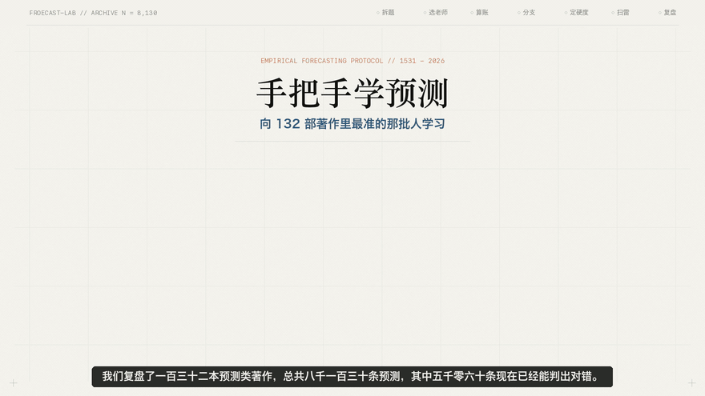
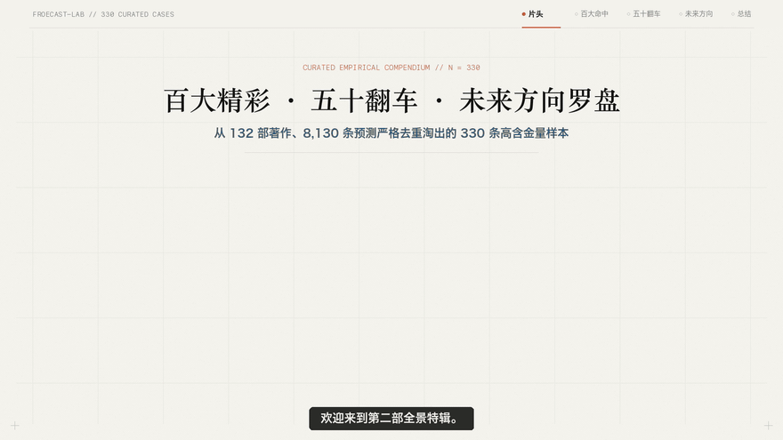

# Forecast Lab · 信号与噪音：可复盘的预测实验室

**对 132 部著作与机构报告中的 8,130 条预测进行逐条事实核验，检验历史预测的准确度、有效方法与典型失误。**

[](https://github.com/nebulonvc/forecast-lab/actions/workflows/check.yml)
[](LICENSE)
[](LICENSE)

---

## 研究目的

关于未来的著作与报告层出不穷，但其中的判断很少在事后被系统性检验。缺少检验，会导致两种常见的误判：一是将偶然命中视为能力，进而高估作者在其他领域的判断；二是因个别失误而否定作者在结构性问题上的长期洞见。

本项目受纳特·西尔弗（Nate Silver）《信号与噪音》启发，尝试以可复核的方式回答三个问题：

1. **哪些预测者在哪些领域、哪些时间跨度上显著优于同类基准？**
2. **准确的预测依赖哪些可迁移的推理方法？**
3. **即使是顶尖预测者，失误又集中在哪些模式上？**

研究覆盖 16 世纪至 2025 年的 132 部作品，涉及地缘政治、宏观金融、科技商业、人工智能、能源与人口、社会制度、科幻推演七个领域，作者包括伯克、马尔萨斯、威尔斯、凯恩斯、基辛格、克里斯坦森、库兹韦尔，以及 IEA、OECD、世界银行等机构。

> **推荐首先阅读：[核心研究发现](docs/00-key-insights.md)**——包括数据分布、各领域超越基准的预测者、可借鉴的方法、需规避的失误模式，以及 12 个详细的历史案例。

---

## 核心发现

### 一、准确度最高的群体是具备"约束账本"习惯的专业机构

| 作者类型 | 作品数 | 严格胜率 | 方向命中率 | 错误率 |
| :--- | ---: | ---: | ---: | ---: |
| **国际机构与政府智库**（IEA、OECD、世界银行、英国政府科学办公室等） | 21 | **47.0%** | **65.2%** | **6.3%** |
| 政治家与战略实务者（李光耀、布热津斯基、基辛格等） | 15 | 33.1% | 61.9% | 8.5% |
| 地缘与社科学者（扎卡利亚、卡普兰、亨廷顿等） | 27 | 34.3% | 52.6% | 11.7% |
| 经济学家与投资人（凯恩斯、塔勒布、达利欧等） | 17 | 30.3% | 42.7% | 13.9% |
| 科技商业思想家（克里斯坦森、弗里德曼、凯文·凯利等） | 19 | 28.8% | 55.2% | 10.8% |
| 古典思想家与科幻作家（威尔斯、凡尔纳、贝拉米等） | 33 | 29.6% | 35.4% | 31.3% |

*严格胜率 = 正确 ÷ 可判定；方向命中率 = (正确 + 趋势符合) ÷ 可判定；错误率 = 错误 ÷ 可判定。*

机构报告多为近年出版，可能受益于观察窗口较短。但在**控制时间跨度后**，智库在 0–9 年档（47.7%，其他群体 20%–25%）与 10–39 年档（46.1%，其他群体 32%–40%）均保持领先。其优势主要来自三个习惯：先核算存量、产能与成本约束；避免绝对化结论；以条件情景表达不确定性。

### 二、预测能力具有明显的领域边界

同一作者在不同题材上的表现差异显著：

- **H. G. 威尔斯**：《预言》（1901）推演技术功能扩散，严格胜率 52.2%；《公开的阴谋》（1928）构想世界政府，错误率 40.9%。
- **瑞·达利欧**：《债务危机》（2018）零错误；《原则：应对变化中的世界秩序》（2021）严格胜率仅 12.3%。
- **凯文·凯利**：《失控》（1994）经 32 年检验错误率 5.7%；《必然》（2016）在具体公司与年份上多次失误。

因此，评估一条预测时应关注其是否落在作者的能力圈内，而非作者的整体声誉。

### 三、失误多源于将方向判断硬化为缺乏依据的精确数字

全库中写明期限的预测错误率为 17.9%，未写死期限的方向判断为 12.3%。英国政府科学办公室《制造业的未来》（2013）尤为典型：趋势判断错误率 3.7%，写明年份的判断错误率高达 56%。

但这并不意味着应回避量化。IEA、米尔斯海默、杰文斯写明期限的预测严格胜率仍在 50%–63% 之间。**关键在于数字背后是否有存量、产能和建设周期的核算支撑。**

### 四、观察窗口越长，检验越严格

出版 3 年内作品的错误率为 2.9%，40 年以上升至 25%–40%。短窗口的低错误率在很大程度上是因为大量预测尚未到期（未定率 60.7%），而非作者更为准确。因此，**本项目对任何作品的评价都以同一时间跨度档的平均水平为基准**。

### 五、错误集中于五种可识别的模式

对 689 条错误预测的归因显示，绝大多数可归入以下五类：

1. **忽略替代供给与技术跃迁**：马尔萨斯、埃利希未能预见化肥与绿色革命对粮食供给的改变。
2. **将方向判断偷换为固定速率、精确年份或极端量词**：如"边际成本每年下降 50%""金砖四国 2015 年 GDP 超过美国"。
3. **跨层跳跃**：由"技术可行"直接推出"社会政治终局"，如"航空将消灭战争与民族主义"。
4. **忽略行动者的绕行与政策反制**：如断言美洲鹤必然灭绝，未考虑后续保护立法。
5. **将阶段性趋势外推为长期单调变化**：如将战后短期通胀视为持续上涨。

凡出现"无论采取何种措施都必将""永远不会""几乎全部"等绝对化表述，其出错率显著高于平均水平。

---

## 代表性历史案例

| 作者 | 预测内容 | 后续结果 |
| :--- | :--- | :--- |
| **伯克**（1790） | 法国大革命缺乏财政、军纪与社会秩序支撑，终将由军事强人收场 | 拿破仑掌权；全书 31 条可判定预测零错误 |
| **杰文斯**（1866） | 英国煤耗增长无法长期维持 ✅；煤炭耗尽前不会出现更强替代能源 ❌ | 英国煤产量 1913 年见顶；石油与天然气随后兴起 |
| **威尔斯**（1901） | 很可能在 1950 年前出现成功往返的飞行器 | 1903 年莱特兄弟首飞 |
| **克里斯坦森**（1997） | 传统车企将长期忽视电动车 ✅；电动车将从低端廉价市场切入 ❌ | 打开市场的是高性能、高价位的特斯拉 Roadster |
| **卡普兰**（2012） | 21 世纪欧洲仍将在关键意义上受其与俄罗斯关系的影响 | 2014 年克里米亚事件、2022 年俄乌战争 |
| **马汉**（1897） | 运河必建于尼加拉瓜 ❌；无论建于何处都将成为全球贸易枢纽 ✅ | 运河建于巴拿马，并成为全球航运咽喉 |
| **埃利希**（1968） | 无论采取何种紧急措施，1970 年代都将有数亿人饿死 | 绿色革命使粮食增长超过人口增长；全书错误率 51.1% |
| **库兹韦尔**（2005） | 将半导体的指数增长外推至纳米制造与生物医学 | 20 年后严格胜率 5.4%，错误率 27.0% |

各案例的背景、成败原因与可借鉴之处，详见[核心研究发现 · 第六节](docs/00-key-insights.md#六十二个历史案例详解)。完整的 100 条精彩预测与 50 条大师失误，见 [330 条精选预测全集](docs/reports/curated-330-compendium.md)。

---

## 可借鉴的推理方法

准确的预测集中于以下六类方法：

| 方法 | 核心做法 | 代表 |
| :--- | :--- | :--- |
| **约束账本法** | 拆解存量、流量、在建产能、成本与付费方，以硬约束限定结论 | IEA、杰文斯、李光耀 |
| **制度与激励结构法** | 分析决策权、考核指标与成本承担者，而非公开表态 | 伯克、克里斯坦森、塔勒布 |
| **地缘底盘法** | 以地理、海上通道与邻国安全焦虑等慢变量为锚 | 扎卡利亚、卡普兰、麦金德 |
| **技术功能扩散法** | 预测"将能实现何种功能"，而非"由何种产品或企业实现" | 威尔斯、戴维、弗里德曼 |
| **风险边界法** | 不预测点位，而识别风险暴露、损失承担者与兜底机制 | 塔勒布、鲁比尼 |
| **多情景条件法** | 并列多条路径，并给出判别各路径的领先信号 | OECD、世界银行、梅多斯 |

**按时间跨度选择方法**：3 年以内依据已开工产能、排期与立法日程，可给出具体时间；3–15 年依据制度激励，以情景分支表达；15 年以上仅判断地理、人口结构与技术功能等慢变量，不给出精确年份或具体企业。

完整的七步操作流程见[数据阅读与预测实践指南](docs/03-data-and-forecasting-guide.md)。

---

## 演示视频

| 《手把手学预测》（6 分钟） | 《百大精彩 · 五十翻车 · 未来方向全景》（8 分钟） |
| :---: | :---: |
| [](https://github.com/nebulonvc/forecast-lab/releases/download/v1.0.0/01-hands-on-forecasting-tutorial.mp4) | [](https://github.com/nebulonvc/forecast-lab/releases/download/v1.0.0/02-panoramic-330-forecasts.mp4) |
| 全库结论、七步预测法与美国数据中心用电推演 · [观看](https://github.com/nebulonvc/forecast-lab/releases/download/v1.0.0/01-hands-on-forecasting-tutorial.mp4) | 100 条精彩命中、50 条失误归因与六大领域 180 条未来方向 · [观看](https://github.com/nebulonvc/forecast-lab/releases/download/v1.0.0/02-panoramic-330-forecasts.mp4) |

章节时间轴见 [media/README.md](media/README.md)。

---

## 建立个人定期预测账本

历史回顾的最终检验，是将同样的方法用于前瞻预测，并在事后核对。仓库中的 [`my-forecasts/`](my-forecasts/) 为此提供了完整模板。Fork 后可以：

1. **与 AI Agent 协作建立并优化预测卡（MCP & Skill）**：仓库内置了基于全库 8,130 条预测与发布时点历史状态训练的**数据驱动预测方法优化引擎**（[`.mcp.json`](.mcp.json) + [`toolkit/forecast_mcp.py`](toolkit/forecast_mcp.py) + [`.agents/skills/forecast-optimizer/SKILL.md`](.agents/skills/forecast-optimizer/SKILL.md)）。在 Claude Code、Antigravity、Cursor、Codex 等任意 Agent 终端接入后，可自动对原始判断执行样本外概率校准、高赔率失误陷阱拦截与最优「主透镜 + 反校验透镜 + 承诺硬度」反事实寻优，并将收敛后的预测卡冻结写入账本。
2. **定期自动检索新证据**：配置 DeepSeek 与 Exa 的 API Key 后，GitHub Actions 每月自动检索支持与反驳证据，并以 Issue 形式推送复盘简报。
3. **无 API 时由本地 Agent 执行三轴贝叶斯复盘**：调用 `bayesian_update_forecast` 按事件、机制、时间三个维度计算阻尼对数赔率后验分布并汇报最新进展。

详见 [数据驱动的预测方法优化与 MCP/Skill 接入指南](docs/06-forecast-method-optimization.md) 及 [Fork 与 Agent 协作指南](docs/04-fork-and-agent-workflow.md)。

---

## 文档导航

| 目的 | 文档 |
| :--- | :--- |
| **了解核心研究发现** | [docs/00-key-insights.md](docs/00-key-insights.md) |
| **数据驱动的预测方法优化（MCP & Skill）** | [docs/06-forecast-method-optimization.md](docs/06-forecast-method-optimization.md) |
| 理解研究方法与判定标准 | [docs/01-methodology-signal-and-noise.md](docs/01-methodology-signal-and-noise.md) |
| 了解核验管线的工程设计 | [docs/02-engineering-architecture.md](docs/02-engineering-architecture.md) |
| 学习阅读数据与实践预测 | [docs/03-data-and-forecasting-guide.md](docs/03-data-and-forecasting-guide.md) |
| 建立个人定期预测账本 | [docs/04-fork-and-agent-workflow.md](docs/04-fork-and-agent-workflow.md) |
| 浏览 100 条精彩预测、50 条失误与 180 条未来方向 | [docs/reports/curated-330-compendium.md](docs/reports/curated-330-compendium.md) |
| 阅读完整统计报告与人物画像 | [docs/reports/panoramic-report.md](docs/reports/panoramic-report.md) |
| 查询任一作品的统计数据（CSV） | [datasets/](datasets/README.md) |
| 逐条核对原文引文与证据 | [cases/](cases/README.md) |

<details>
<summary><b>判定标准</b></summary>

每条预测归入以下五类之一，类别互斥：

| 类别 | 定义 | 全库条数 |
| :--- | :--- | ---: |
| 正确 | 在声明的口径与观察窗口内，主要可检验结果已发生 | 1,686 |
| 趋势符合 | 持续的客观数据支持预测方向，但终点尚未到达 | 971 |
| 部分符合 | 复合命题中分项有对有错，或不同合理口径结论不同 | 1,714 |
| 错误 | 主要可检验结果与预测相反，或期限届满未发生 | 689 |
| 暂无法判断 | 期限未到、前提未触发或缺乏可靠公开证据 | 3,070 |

- 抽取阶段剔除比喻、格言、政策建议、历史复述等非预测语句，共 2,553 条。
- "部分符合"不折算为 0.5 分；"趋势符合"不计入终局命中。
- 证据不足时保留"暂无法判断"，不强行判定。
- 每条判定均绑定公开证据并保存文件哈希，可独立复核。

</details>

<details>
<summary><b>本地运行</b></summary>

仅需 Python 3.11+，无第三方依赖：

```bash
python3 -m unittest discover -s toolkit/tests -v
python3 toolkit/pipeline.py --case cases/lky-guantianxia check
python3 toolkit/periodic_tracker.py --case my-forecasts digest
```

</details>

---

## 研究局限与许可

- **回顾性研究**：全部结果均为事后核验，选书受文本可得性与研究者偏好影响，不构成公平的预测竞赛排名。
- **非独立性**：同一作品中的多条预测可能共享同一事件簇，不宜作为独立样本进行显著性检验。
- **版权**：仓库不含任何原书全文，仅保留必要的短引文与公开证据快照，原文版权归原作者所有。
- **许可**：代码采用 [MIT](LICENSE)，研究报告与数据集采用 [CC BY 4.0](LICENSE)。

**谨此致谢纳特·西尔弗的《信号与噪音》，它是本项目的思想起点。**
