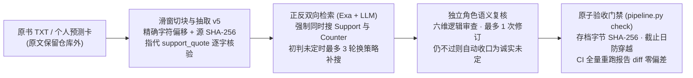
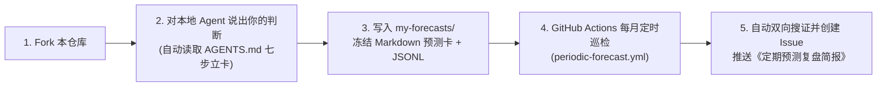

# Forecast Lab · 信号与噪音：可复盘的预测实验室

> **跨越近五百年 132 部著作、8,130 条预测的实证复盘，以及一套可与 AI Agent 协同运作的“去噪与定期预测”开源工具链。**

[](https://github.com/nebulonvc/forecast-lab/actions/workflows/check.yml)
[-2B5B84)](toolkit/)
[](LICENSE)
[](LICENSE)

---

## 🌟 这个项目做了什么？

人们热爱谈论预言，却极少给预言记账。

受纳特·西尔弗（Nate Silver）经典著作 **《信号与噪音》（*The Signal and the Noise*）** 启发，我们构建了一套**零外部依赖、全链路哈希可核验**的预测审计引擎，对横跨 16 世纪至今的 **132 部代表性著作与智库报告**（涵盖地缘政治、宏观金融、科技产业、人工智能、能源生态、社会制度与科幻推演七大领域）进行了逐句抽取与公开事实核验：

- 📚 **132 部独立作品** · **10,683 条原始候选**（按规则筛除格言、倡议、历史复述等非预测噪音 2,553 条）
- 🎯 **8,130 条可评分预测** · 其中 **5,060 条已形成明确事实判定**（正确 1,686 · 趋势符合 971 · 部分符合 1,714 · 错误 689 · 暂无法判断 3,070）
- 🧭 人工精选 **330 条高含金量样本**：**100 条跨时代封神命中** + **50 条顶尖大师翻车解剖** + **六大领域 180 条 2026–2035 未来跟踪罗盘**
- 🤖 **一键 Fork 即用的个人定期预测实验室**：内置 `my-forecasts/` 账本、`AGENTS.md` 智能体协议与 GitHub Actions 定时搜证工作流，帮你和 AI Agent 一起做自己的定期贝叶斯预测复盘！

---

## 🎬 视频 Demo：14 分钟看懂全库发现与七步预测法

我们制作了两部科研档案风双人配音演示视频（仓库内展示高清动图预览与字幕，1080p 完整有声原片托管于 **[GitHub Releases `v1.0.0`](https://github.com/nebulonvc/forecast-lab/releases/tag/v1.0.0)**）：

| Demo 1：《手把手学预测》（`06:08`） | Demo 2：《百大精彩 · 五十翻车 · 未来方向全景》（`07:56`） |
| :---: | :---: |
| [](https://github.com/nebulonvc/forecast-lab/releases/download/v1.0.0/01-hands-on-forecasting-tutorial.mp4) | [](https://github.com/nebulonvc/forecast-lab/releases/download/v1.0.0/02-panoramic-330-forecasts.mp4) |
| **[▶️ 下载/播放 1080p MP4 (29MB)](https://github.com/nebulonvc/forecast-lab/releases/download/v1.0.0/01-hands-on-forecasting-tutorial.mp4)** · [字幕 SRT](media/subtitles/01-hands-on-forecasting-tutorial.srt) | **[▶️ 下载/播放 1080p MP4 (53MB)](https://github.com/nebulonvc/forecast-lab/releases/download/v1.0.0/02-panoramic-330-forecasts.mp4)** · [字幕 SRT](media/subtitles/02-panoramic-330-forecasts.srt) |
| 拆解全库成绩单底线，用 **7 个步骤 + 美国数据中心用电完整推演** 教你像顶尖智库一样做预测 | 逐页呈现 **100 条精彩命中、50 条大师翻车五大死因**，以及 **六大领域 180 条未来跟踪指标** |

> 章节时间轴与纯 Python 动画生成脚本说明见 👉 [`media/README.md`](media/README.md)

---

## 1️⃣ 方法论：致敬《信号与噪音》，我们如何识别“真信号”？

> 📖 深度方法论长文 👉 [`docs/01-methodology-signal-and-noise.md`](docs/01-methodology-signal-and-noise.md) ｜ 底层评估契约 👉 [`toolkit/METHOD.md`](toolkit/METHOD.md)

我们在此特别感谢纳特·西尔弗的 **《信号与噪音》**。他指出：在信息过载时代，预测失败的根源往往不是缺乏数据，而是把短期随机波动当成永久趋势（过拟合噪音），用刺猬式的绝对口号代替狐狸式的条件边界，并在事后悄悄搬移记分球门。

为此，我们在研究中确立了四项硬核方法准则：

1. **先剥离“伪预测”噪音（抽取 v5 八分类筛网）**：代码强制区分真正的未来变化承诺（`forecast`）与比喻格言、政策倡议、出版前历史、静态机制说明、过去反事实，剔除 2,553 条不可证伪修辞。
2. **五类互斥结论，绝不注水折分**：
   | 类别 | 全库条数 | 判定标准与防噪音设计 |
   | :--- | ---: | :--- |
   | **正确** | 1,686 | 在声明口径与观察窗口内，主要可检验结果已符合（计算**严格胜率**唯一分子） |
   | **趋势符合** | 971 | 已有持续客观数据沿预测方向发展，但终局未到（**单列！绝不提前吹成终局命中**） |
   | **部分符合** | 1,714 | 分项有对有错或不同合理口径结果不同（**绝不折算 0.5 分掩盖分项失误**） |
   | **错误** | 689 | 主要可检验结果与预测方向相反，或写明期限明确跳票 |
   | **暂无法判断** | 3,070 | 远期未到、前提未触发或公开证据不足（**诚实保留未知，不算错也不强判**） |
3. **事件 × 机制 × 时间 三轴独立记账**：结果猜对了不代表作者的因果理由成立；方向对了但拖延十年才发生，时间轴照样记账。
4. **实证提炼“6 大真信号原型”与“5 大高赔率噪音”**：
   - **谁最准？全库没有全能先知，最高胜率属于“带约束账本的专业机构与战略实务者”**（锁定同一时间跨度档后依然成立）：
     | 作者群体 | 独立作品 | 可判定数 | 严格胜率 | 方向命中率 | 错误率 | 核心特征 |
     | :--- | ---: | ---: | ---: | ---: | ---: | :--- |
     | **国际机构与政府智库** (IEA/OECD/世行/UK GO-Science等) | 21 | 661 | **47.0%** | **65.2%** | **6.3%** | 存量产能底盘扎实、情景边界克制 |
     | **政治家与战略实务者** (李光耀/布热津斯基/基辛格/伯克等) | 15 | 727 | 33.1% | **61.9%** | **8.5%** | 深谙决策者约束与利益买单结构，长周期极稳 |
     | **地缘与社科政治学者** (扎卡利亚/卡普兰/米尔斯海默等) | 27 | 1,123 | 34.3% | 52.6% | 11.7% | 框架清晰，但易把单一理论外推过头 |
     | **经济学家与金融投资人** (凯恩斯/塔勒布/达利欧/索罗斯等) | 17 | 518 | 30.3% | 42.7% | 13.9% | 危机传导机制敏锐，但宏观定时点位极易失手 |
     | **科技商业思想家与实践者** (克里斯坦森/弗里德曼/KK/博斯特罗姆等) | 19 | 1,238 | 28.8% | 55.2% | 10.8% | 技术功能方向准，常错在时间表过激与忽略监管摩擦 |
     | **古典思想家与科幻/乌托邦作家** (威尔斯/凡尔纳/贝拉米等) | 33 | 793 | 29.6% | 35.4% | 31.3% | 工程功能推演偶有神作，乌托邦政治终局大面积翻车 |
   - **6 大高胜率推理方法原型**：① 约束账本法 · ② 制度与激励结构法 · ③ 地缘底盘与权力均衡法 · ④ 技术功能扩散链法 · ⑤ 风险边界与反脆弱法 · ⑥ 多情景条件分支法。
   - **5 大高频翻车噪音模式**：① 忽略替代供给与技术跃迁 · ② 把方向对偷换成固定速率/硬年份/极端量词 · ③ 从技术可行直接跳到社会政治终局（跨层跳跃） · ④ 忽略行动者绕行与政策反制 · ⑤ 把短期顺风外推成永久单调直线。

---

## 2️⃣ 工程实践：用确定性代码管线防幻觉、防事后偏见

> 📖 完整工程图解（含状态机与并发预算时序图） 👉 [`docs/02-engineering-architecture.md`](docs/02-engineering-architecture.md)

如果直接把一本书扔给大模型问“他预测准不准”，模型极易顺着事后记忆篡改引文、挑有利新闻自圆其说。我们的工程方案是：**仅用 Python 3.11+ 标准库（零第三方依赖），把 LLM 严格限制在确定性校验闸门之内**：



- **引文零篡改**：`prepare_book.py` 要求每段 `quote` 与消歧依据精确对齐源文本偏移，拒绝模糊编造。
- **正反双向搜证 + 自适应补检索**：`verify_prediction.py` 强制成对生成支持与反证查询，仅允许引用搜索真实返回的 URL 正文，单条硬上限 18 次请求，杜绝死循环。
- **双币种线程安全账本与防重复扣费**：分别锁定 LLM（人民币）与 Exa（美元）预算上限；超时未知状态保留冻结额度且绝不盲目重发；导出时自动全盘扫描密钥指纹。

---

## 3️⃣ 怎么看数据，以及怎么用这套方法做预测？

> 📖 数据防误读铁律与七步实战手册 👉 [`docs/03-data-and-forecasting-guide.md`](docs/03-data-and-forecasting-guide.md)

### 看懂数据的三条铁律
1. **只跟同一时间跨度的同行比（看 `同档超额 Δ`）**：`0–3年` 超短窗平均方向命中本就高达 **81.0%**（60.7% 尚未到期），而 `20–39年` 长周期方向命中降至 **52.6%**。打开 [`datasets/all_cases_summary.csv`](datasets/all_cases_summary.csv) 时，请重点看 **`同档超额严格胜率_pp`** 与 **`同档低错优势_pp`**。
2. **区分“有账本的时间”与“拍脑袋的时间”**：全库写死年份（`explicit`）错误率 **17.9%**，高于未写日期方向判断（`12.3%`）；但 IEA（53.3% 严格）、米尔斯海默（62.5%）、杰文斯（62.5%）证明——有存量与产能建设周期账本支撑时，硬期限依然极稳。
3. **善用三份核心研究成果**：
   - 📊 **[全景方法论报告](docs/reports/panoramic-report.md)** + **[132 部全案例统计总表 CSV](datasets/all_cases_summary.csv)**：查各领域基准率、多书作者稳定性与八大决策场景选透镜矩阵；
   - 🏆 **[330 条精选预测全集](docs/reports/curated-330-compendium.md)** + **[精选 330 条总表 CSV](datasets/curated_330_forecasts.csv)**：看 100 条高光命中、50 条大师翻车教训，以及 **六大领域 180 条附 2026–2035 领先指标的未来方向**；
   - 🔬 **[案例启发的预测流程（17 组经典同书正反对照）](docs/reports/case-inspired-process.md)** + **[134 个独立案例目录](cases/README.md)**：逐句核查原话与公开证据。

### 普通人可直接上手的“七步预测法”
1. **拆题防偷换**：写成 `主体 + 对象 + 量词 + 指标(含分母) + 期限 + 条件`，严分 `出现 ≠ 普及 ≠ 主导 ≠ 取代`；
2. **配双透镜**：按场景选定一个主方法透镜 + 一个必配反校验透镜（如算力预测用 `IEA 电力账本 + 杰文斯反弹悖论`）；
3. **算硬账本**：列清存量、流量、在建周期、成本与谁买单；
4. **画条件分支**：问清谁想做、谁有权、谁能绕行，把 $P(A)$ 与 $P(B \mid A)$ 分开记账；
5. **定承诺硬度**：3 年内看排期给区间，5–15 年用情景分支，15 年以上只押慢结构不押精确年份；
6. **反例表扫雷**：用五大高频失败模式做发布前体检，删掉无根据的绝对化量词；
7. **事前冻结 + 三轴复盘**：生成不可事后涂改的预测卡，定期按**事件轴、机制轴、时间轴**独立复盘。

---

## 4️⃣ Fork + AI Agent：3 分钟搭建你自己的“定期预测分析实验室”

> 📖 完整配置教程与 Agent 指令集 👉 [`docs/04-fork-and-agent-workflow.md`](docs/04-fork-and-agent-workflow.md) ｜ 智能体协议 👉 [`AGENTS.md`](AGENTS.md)

我们把整套引擎做成了一个**可 Fork 的个人预测追踪模版**，让你和你的 AI Agent（Claude Code / Antigravity / Cursor / Codex）共同维护一份持续进化的前瞻预测账本：



### 快速体验命令
```bash
# 1. 查看预置的 3 条 2026–2030 个人预测样板并执行完整性校验（零依赖、无需密钥）
python3 toolkit/pipeline.py --case my-forecasts check
python3 toolkit/periodic_tracker.py --case my-forecasts digest

# 2. 登记一条你自己的新预测（自动生成 my-forecasts/cards/<id>.md 并纳入追踪）
python3 toolkit/periodic_tracker.py --case my-forecasts add \
  --id "2026-my-forecast-01" \
  --domain "AI与产业商业化" \
  --statement "到2028年底，中国新能源乘用车新车年度销量渗透率将超过65%。" \
  --horizon "2026–2028" \
  --scope "以中汽协或乘联会年度国内乘用车公布口径为准" \
  --method "约束账本法 + 技术功能扩散链法" \
  --counter-lens "检查充电电网负荷瓶颈与购置税政策调整影响" \
  --indicators "月度零售渗透率、动力电池成本、县域快充桩增速" \
  --falsification "2028年全年渗透率低于65%"
```

- **与 AI Agent 无缝对话**：仓库自带 [`AGENTS.md`](AGENTS.md) 与 [`.agents/skills/forecast-tracker/SKILL.md`](.agents/skills/forecast-tracker/SKILL.md)。直接在 Agent 中打开项目说：*“帮我把关于 XX 的判断按七步法做成预测卡入库”* 或 *“帮我对 `my-forecasts` 做一次本季度的正反证据巡检”*，Agent 即会自动按规范执行。
- **云端每月自动盯盘**：Fork 后在仓库 `Settings → Secrets → Actions` 配置 `BOOKPRED_DEEPSEEK_API_KEY` 与 `EXA_API_KEY`，工作流 [`periodic-forecast.yml`](.github/workflows/periodic-forecast.yml) 将每月自动检索正反新证据，并在检测到信号变化时通过 **GitHub Issue** 向你发送复盘简报！

---

## 📂 仓库目录全景导航

```text
forecast-lab/
├── README.md                          # 项目总览与快速导航
├── AGENTS.md                          # AI Agent (Claude Code / Antigravity / Cursor) 协作指令规范
├── LICENSE                            # 代码 MIT + 报告与数据集 CC BY 4.0 双协议说明
├── .agents/skills/forecast-tracker/   # Agent 定期预测立卡与贝叶斯复盘专用 Skill
├── .github/workflows/
│   ├── check.yml                      # CI：215 项单元测试 + 全量案例 SHA-256 与报告幂等校验
│   ├── periodic-forecast.yml          # 个人预测账本每月定时搜证与 Issue 简报推送工作流
│   └── verify-book.yml                # 任意书籍案例云端并发 API 搜证与核查工作流
│
├── docs/                              # 核心方法论、工程架构与实战教程
│   ├── 01-methodology-signal-and-noise.md   # 致敬《信号与噪音》：研究方法、五类结论与六大原型
│   ├── 02-engineering-architecture.md       # 工程实践：防幻觉管线、状态机与并发预算架构图解
│   ├── 03-data-and-forecasting-guide.md     # 怎么看数据（三条铁律）& 七步实战预测手把手指南
│   ├── 04-fork-and-agent-workflow.md        # Fork 指南：结合 Agent 与 GitHub Actions 做定期预测分析
│   ├── reports/                             # 三份核心深度研究长文（全景报告 / 330精选全集 / 流程定稿）
│   └── reference/                           # 引擎底层规则参考（METHOD / CLOUD_RUN / SEARCH_VERIFIER / 人工复刻）
│
├── datasets/                          # 清洗对齐后的核心 CSV 汇总表（UTF-8-BOM，Excel 直开）
│   ├── README.md                      # 详细字段字典与 Python 快速查询示例
│   ├── all_cases_summary.csv          # 132 部独立著作统计总表（37 列，含同跨度档超额胜率）
│   └── curated_330_forecasts.csv      # 330 条精选预测总表（100 命中 + 50 翻车 + 180 未来方向）
│
├── media/                             # 演示视频预览动图、完整 SRT 字幕与纯 Python 渲染源码
├── my-forecasts/                      # Fork 用户专属“个人定期预测工作区”（含 3 条预置样板卡片）
├── toolkit/                           # 零外部依赖 Python 3.11+ 核心引擎与 215 项模拟 API 单元测试
└── cases/                             # 134 个已核验独立案例包（原文短引文 + 公开证据存档 + 评估报告）
```

---

## ⚡ 本地 30 秒验证与复现

无需安装任何第三方库、无需配置任何 API Key，在仓库根目录直接运行：

```bash
# 运行全部 215 项引擎单元测试
python3 -m unittest discover -s toolkit/tests -v

# 校验经典案例与个人预测样板的字节级证据哈希并重生成报告
python3 toolkit/pipeline.py --case cases/lky-guantianxia check
python3 toolkit/pipeline.py --case my-forecasts check
```

---

## ⚖️ 学术诚实边界与开源许可

- **回顾性研究声明**：全库 132 部作品属于历史回顾性核查而非事前盲测竞赛，同书预测之间存在共享宏观事件簇的非独立性；跨书比较请务必遵循“同时间跨度分档、同期限类型”原则。
- **版权与材料边界**：本仓库仅保存程序代码、原创研究报告、必要的原文短引文及公开统计/机构证据快照，**不包含任何受版权保护的原书全文**。原书引文及第三方公开材料的著作权归原作者与原机构所有。
- **开源协议**：仓库内软件源码采用 **[MIT License](LICENSE)**，原创研究报告、方法文档与整理数据集采用 **[CC BY 4.0](LICENSE)** 协议开放共享。
