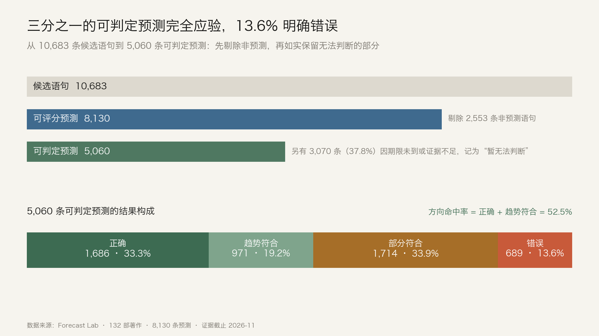
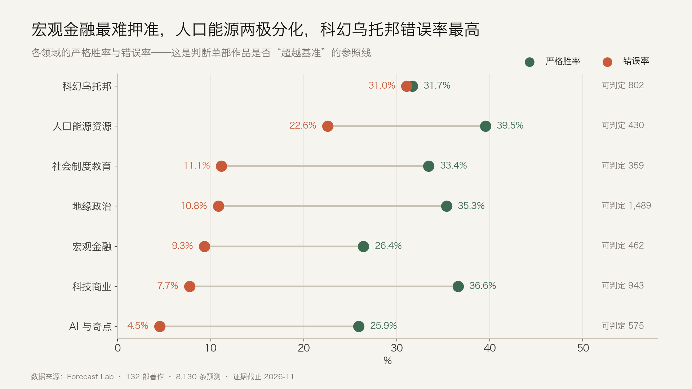
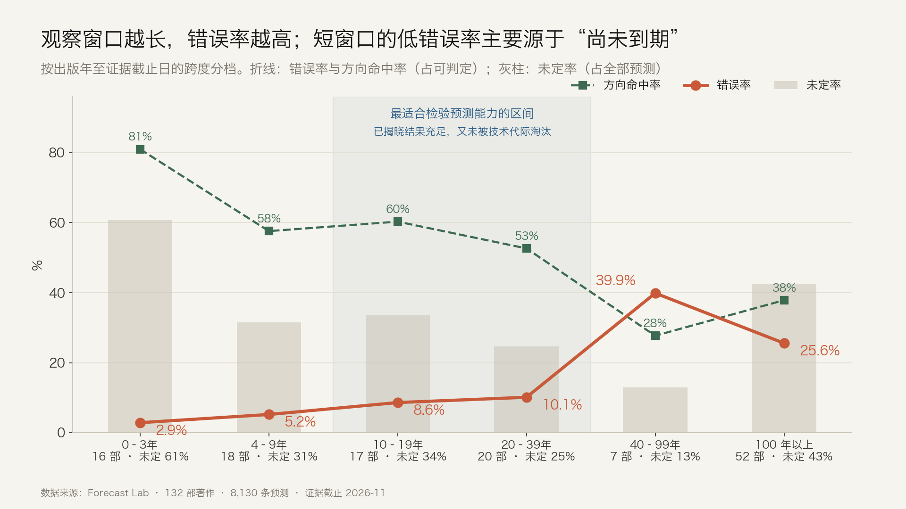
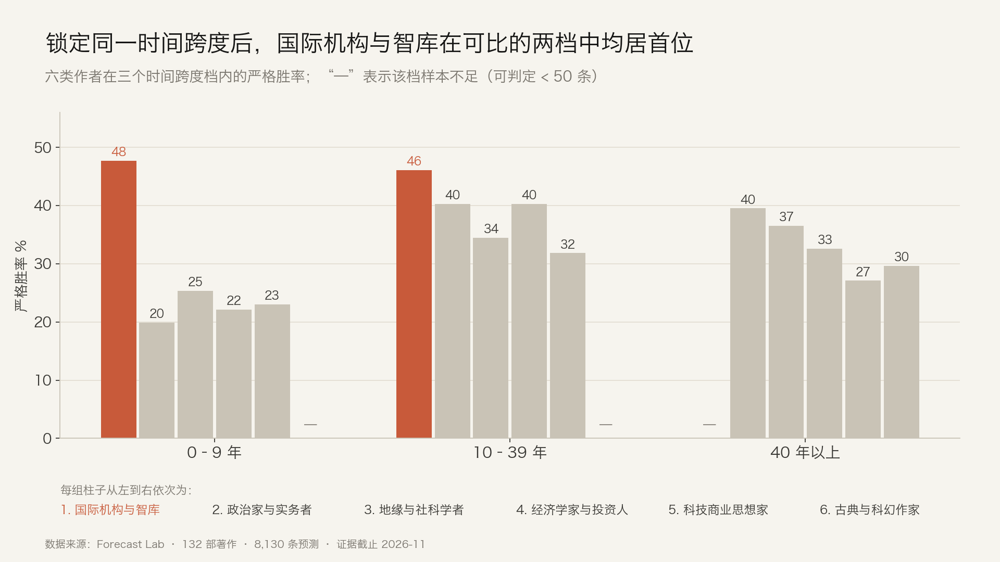
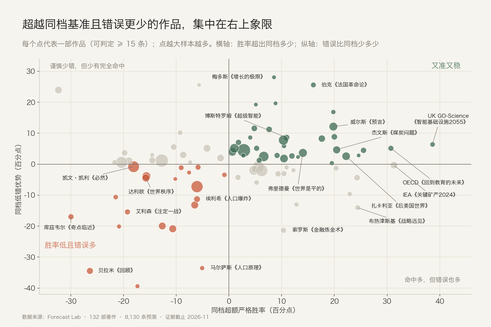
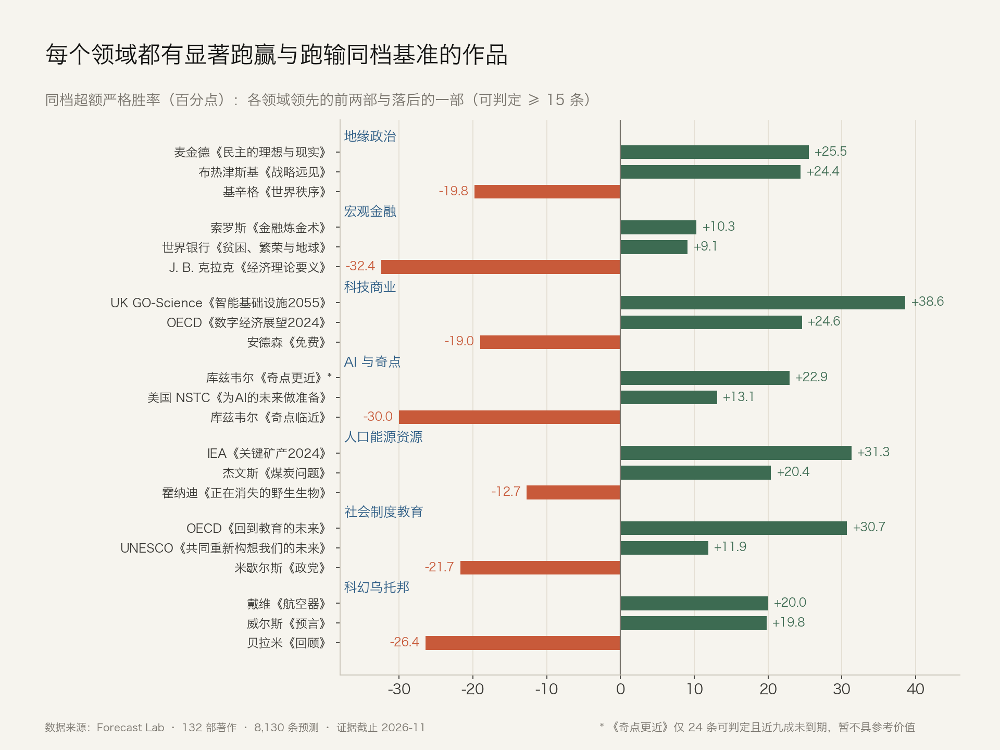
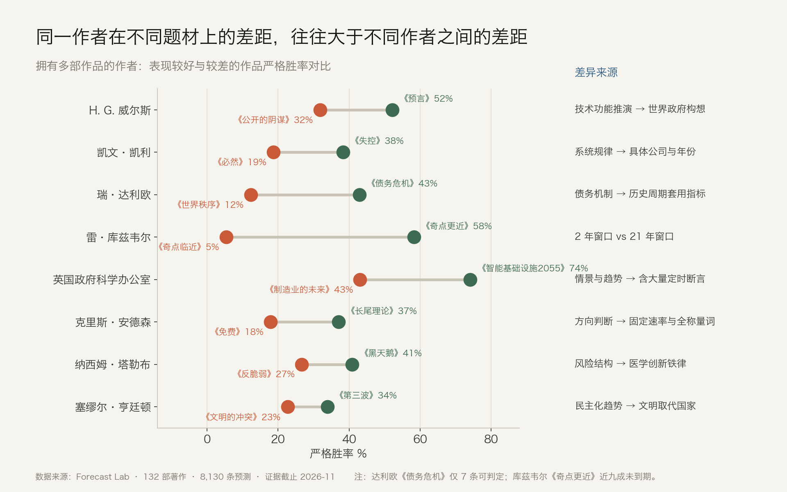
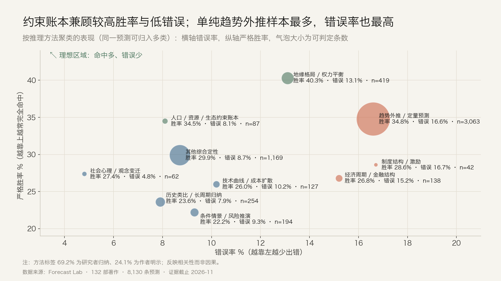
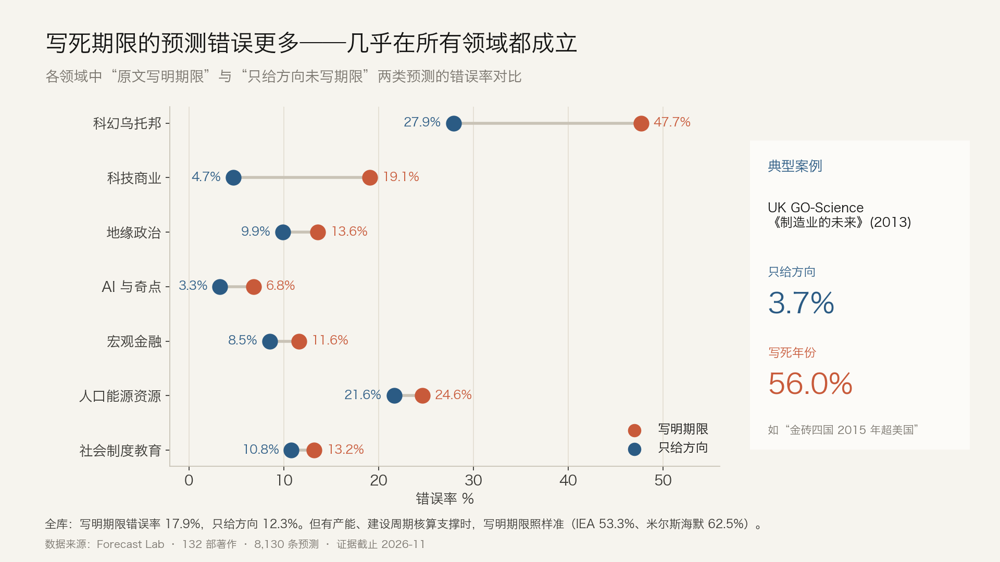
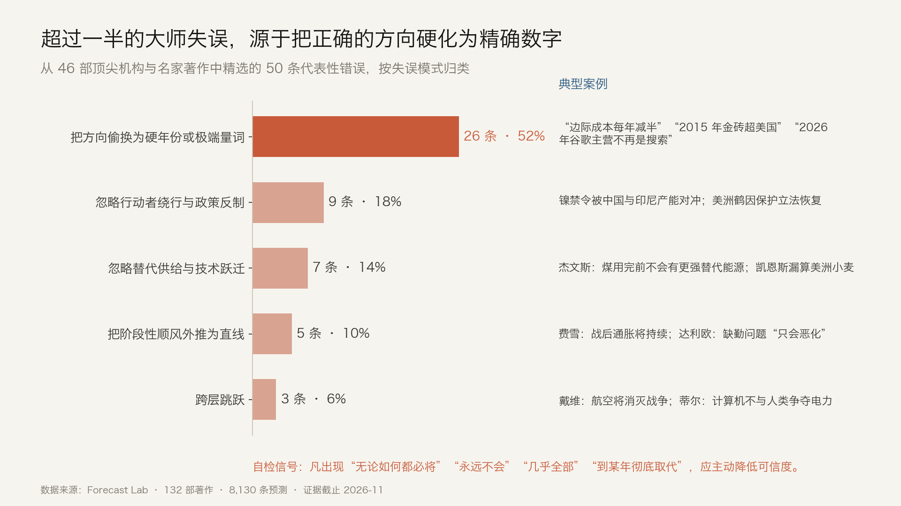

# 核心研究发现：8,130 条历史预测的检验结果

> 本文汇总项目的主要结论，面向希望了解研究结果而不必阅读代码或逐个案例的读者。内容依次为：研究目的、数据分布、各领域超越基准的预测者、可借鉴的推理方法、需规避的失误模式，以及 12 个历史案例详解。全文配有 10 幅可视化图表，每幅图的标题即为该图所支持的结论。

| 图 | 回答的问题 | 所在章节 |
| :--- | :--- | :--- |
| 1 | 8,130 条预测的核验结果如何分布？ | 2.1 |
| 2 | 时间跨度如何影响检验难度？ | 2.3 |
| 3 | 各领域的基准水平相差多少？ | 2.2 |
| 4 | 控制时间跨度后，哪类作者最准确？ | 3.2 |
| 5 | 哪些作品同时超越同档胜率与错误率基准？ | 3.3 |
| 6 | 各领域中谁领先、谁落后？ | 3.3 |
| 7 | 同一作者为何在不同作品间差距悬殊？ | 3.4 |
| 8 | 写明期限是否更容易出错？ | 4 |
| 9 | 哪些推理方法表现更好？ | 4 |
| 10 | 顶尖预测者的失误集中在哪里？ | 5 |

---

## 一、研究目的

关于未来的著作与报告数量庞大，但其中的判断很少在事后被系统性核验。缺少核验会造成两类偏差：

- **幸存者偏差**：将一次偶然命中视为预测能力，进而高估作者在其他领域的判断。
- **事后否定**：因个别期限落空而否定作者在结构性问题上的长期判断。

纳特·西尔弗在《信号与噪音》中指出，信息总量的增长并不意味着有效信号的同步增长，多出的部分大多是噪音。本项目据此采取逐条核验的方法：从代表性著作中抽取可检验的预测，依据公开证据判定其结果，从而建立一份可复核的预测记录。

研究旨在回答三个问题：

1. 哪些预测者在哪些领域、哪些时间跨度上显著优于同类基准？
2. 准确的预测依赖哪些可迁移的推理方法？
3. 顶尖预测者的失误集中于哪些模式？

---

## 二、数据分布

### 2.1 总体结果

研究覆盖 **132 部**著作与机构报告，时间跨度为 16 世纪至 2025 年，涉及七个领域。

从中共抽取 **10,683 条**候选语句，剔除比喻、格言、政策建议、历史复述等非预测语句 2,553 条后，保留 **8,130 条**可评分预测。核验结果如下：

*图 1　从候选语句到可判定预测，以及五类结果的构成*

- **可判定预测 5,060 条**：严格胜率 33.3%，方向命中率 52.5%，错误率 13.6%。
- **暂无法判断 3,070 条（37.8%）**：期限未到、前提未触发或缺乏可靠公开证据。此类预测保留为未定，不作强行判定。
- **趋势符合单独计数**：方向已获证据支持但终点未到，不计入终局命中。
- **部分符合不折算分值**：复合命题中分项结果不一致时如实记录，不以 0.5 分处理。

> 指标定义：严格胜率 = 正确 ÷ 可判定；方向命中率 = (正确 + 趋势符合) ÷ 可判定；错误率 = 错误 ÷ 可判定；可判定 = 预测总数 − 暂无法判断。

### 2.2 各领域基准

各领域的平均表现差异显著，以下数值即为后文判断"超越基准"的参照：

| 领域 | 作品数 | 可判定 | 严格胜率 | 方向命中率 | 错误率 | 特征 |
| :--- | ---: | ---: | ---: | ---: | ---: | :--- |
| 地缘政治与国际秩序 | 27 | 1,489 | 35.3% | 56.6% | 10.8% | 样本量最大，表现分化明显 |
| 宏观经济、金融与市场 | 17 | 462 | 26.4% | 45.2% | 9.3% | 难度最高，点位与时机预测极少成功 |
| 科技、商业与产业颠覆 | 14 | 943 | 36.6% | 53.9% | 7.7% | 方向判断普遍准确，失误多在时间表 |
| AI 与奇点前沿 | 12 | 575 | 25.9% | 69.4% | 4.5% | 方向命中率最高、错误率最低，但过半未到期 |
| 人口、能源、资源与生态 | 12 | 430 | 39.5% | 52.3% | 22.6% | 两极分化：核算派准确，末日外推派失误严重 |
| 社会结构、制度与教育 | 26 | 359 | 33.4% | 49.3% | 11.1% | 古典著作占比高，大量命题难以操作化 |
| 科幻推演与乌托邦 | 24 | 802 | 31.7% | 36.9% | 31.0% | 工程功能推演偶有佳作，政治乌托邦失误集中 |

*图 3　各领域严格胜率与错误率（按错误率排序）*

读图要点：两点间距越大，说明该领域“完全命中”远多于“明确错误”。科幻乌托邦两点几乎重合，人口能源领域胜率最高但错误率也居第二。

### 2.3 时间跨度对检验难度的影响

**出版时间距今越远，检验越严格**。不同时间跨度的作品不宜直接比较。

*图 2　观察窗口与错误率、方向命中率、未定率的关系*

- 出版 3 年内的作品错误率为 2.9%，但其未定率高达 60.7%。低错误率主要源于难题尚未到期，而非作者更准确。
- 出版 10–39 年的作品最适合检验预测能力：既有足够多已揭晓的结果，又未被技术代际更替完全淘汰。
- 因此，本项目对任何作品的评价**均以同一时间跨度档的平均水平为基准**。

---

## 三、超越基准的预测者

### 3.1 基准的定义

对每部作品计算两项指标：

- **同档超额胜率** = 该作品严格胜率 − 同一时间跨度档的平均严格胜率。正值表示优于同档作品。
- **同档低错优势** = 同档平均错误率 − 该作品错误率。正值表示比同档作品更少出错。

仅当可判定预测不少于 15 条时，结果才具有参考意义。

### 3.2 按作者类型的总体比较

| 作者类型 | 作品数 | 严格胜率 | 方向命中率 | 错误率 |
| :--- | ---: | ---: | ---: | ---: |
| **国际机构与政府智库** | 21 | **47.0%** | **65.2%** | **6.3%** |
| 政治家与战略实务者 | 15 | 33.1% | 61.9% | 8.5% |
| 地缘与社科学者 | 27 | 34.3% | 52.6% | 11.7% |
| 经济学家与投资人 | 17 | 30.3% | 42.7% | 13.9% |
| 科技商业思想家 | 19 | 28.8% | 55.2% | 10.8% |
| 古典思想家与科幻作家 | 33 | 29.6% | 35.4% | 31.3% |

机构报告多为近年出版，可能受益于较短的观察窗口。但在控制时间跨度后，智库在 0–9 年档（47.7%，其他群体 19.9%–25.4%）和 10–39 年档（46.1%，其他群体 31.8%–40.3%）中均位列第一。

其优势并非源于更高的智识水平，而在于方法上的三个习惯：**先核算约束，避免绝对化结论，以条件情景表达不确定性。**

*图 4　六类作者在三个时间跨度档内的严格胜率*

读图要点：在 0–9 年与 10–39 年两档中，智库（橙色）均明显高于其他群体；40 年以上档没有智库样本。

### 3.3 各领域超越基准的代表作品

*图 5　全部作品的同档超额胜率与同档低错优势（可判定 ≥ 15 条）*

读图要点：横轴越靠右，完全命中的比例越高于同龄作品；纵轴越靠上，出错比例越低于同龄作品。绿色点位于右上象限，属于“又准又稳”；红色点位于左下象限，胜率与错误率均劣于同档。索罗斯、布热津斯基《战略远见》位于右下象限，命中多但错误也多，属于高波动型。

*图 6　各领域同档超额严格胜率的领先者与落后者*

下表给出每个领域更完整的名单与评述。

以下仅列可判定预测不少于 15 条的作品。"超额"为同档超额胜率（百分点）。

**地缘政治与国际秩序**

| 作品 | 可判定 | 严格胜率 | 错误率 | 超额 | 评述 |
| :--- | ---: | ---: | ---: | ---: | :--- |
| 扎卡利亚《后美国世界》(2008) | 83 | 59.0% | 6.0% | **+22.2** | 胜率高且错误率低，本领域最具参考价值 |
| 麦金德《民主的理想与现实》(1919) | 38 | 57.9% | 21.1% | +25.5 | 预见欧亚大陆交通开放与俄国政治走向 |
| 布热津斯基《战略远见》(2012) | 31 | 61.3% | 22.6% | +24.4 | 胜率高但错误率同样偏高，波动较大 |
| 荷兰 WRR《互联世界中的安全》(2020) | 42 | 52.4% | 9.5% | +24.3 | 聚焦军费与盟友协调等硬约束 |
| 伯克《法国革命论》(1790) | 31 | 48.4% | **0%** | +16.0 | 两百余年检验零错误（见案例 1） |
| 卡普兰《地理的复仇》(2012) | 131 | 43.5% | 6.1% | +6.6 | 样本量大，方向命中率 69.5% |
| ❌ 艾利森《注定一战》(2017) | 34 | 8.8% | 20.6% | −19.3 | 结构判断正确，具体数值与年份多次落空 |

**宏观经济、金融与市场**（难度最高，超越基准者较少）

| 作品 | 可判定 | 严格胜率 | 错误率 | 超额 | 评述 |
| :--- | ---: | ---: | ---: | ---: | :--- |
| 塔勒布《黑天鹅》(2007) | 22 | 40.9% | **0%** | +4.0 | 不预测点位，分析风险承担与兜底结构 |
| 世界银行《贫困、繁荣与地球》(2024) | 36 | 44.4% | **0%** | +9.1 | 分地区、分收入层，以情景处理不确定性 |
| 费雪《货币的购买力》(1920) | 17 | 41.2% | 5.9% | +8.8 | |
| ⚠️ 索罗斯《金融炼金术》(1987) | 35 | 45.7% | 31.4% | +10.3 | 短期拐点判断准确，长期宿命论判断失误，高波动 |
| ❌ 达利欧《原则：变化中的世界秩序》(2021) | 73 | 12.3% | 9.6% | −15.8 | 同一作者《债务危机》零错误；本书将历史周期模板套用于具体指标 |

**科技、商业与产业颠覆**

| 作品 | 可判定 | 严格胜率 | 错误率 | 超额 | 评述 |
| :--- | ---: | ---: | ---: | ---: | :--- |
| 英国政府科学办公室《智能基础设施 2055》(2006) | 27 | **74.1%** | 3.7% | **+38.6** | 全库单部作品最高，经 20 年检验 |
| 弗里德曼《世界是平的》(2005) | 93 | 49.5% | 6.5% | +14.0 | 样本量大且表现稳定 |
| OECD《数字经济展望 2024》 | 15 | 60.0% | 0% | +24.6 | 窗口较短，有待长期检验 |
| ❌ 安德森《免费》(2009) | 67 | 17.9% | 7.5% | −19.0 | 方向正确，但频繁使用固定速率与全称量词 |
| ❌ 凯文·凯利《必然》(2016) | 171 | 18.7% | 9.4% | −18.1 | 同一作者《失控》230 条错误率 5.7%；本书在具体公司与年份上失误较多 |

**AI 与奇点前沿**

| 作品 | 可判定 | 严格胜率 | 错误率 | 超额 | 评述 |
| :--- | ---: | ---: | ---: | ---: | :--- |
| 博斯特罗姆《超级智能》(2014) | 44 | 47.7% | **0%** | +10.9 | 不给出 AGI 年份，以条件表述，12 年零错误 |
| 美国 NSTC《为人工智能的未来做准备》(2016) | 16 | 50.0% | 6.2% | +13.1 | |
| 泰格马克《生命 3.0》(2017) | 36 | 33.3% | 0% | +5.2 | |
| ⚠️ 库兹韦尔《奇点更近》(2024) | 24 | 58.3% | 12.5% | +22.9 | 仅 24 条可判定，近九成未到期，**暂不具参考价值** |
| ❌ 库兹韦尔《奇点临近》(2005) | 37 | 5.4% | 27.0% | −30.0 | 将半导体指数增长外推至生物与纳米制造领域 |

**人口、能源、资源与生态**

| 作品 | 可判定 | 严格胜率 | 错误率 | 超额 | 评述 |
| :--- | ---: | ---: | ---: | ---: | :--- |
| IEA《全球关键矿产展望 2024》 | 63 | **66.7%** | 3.2% | +31.3 | 按矿种、矿山与精炼产能逐项核算 |
| 杰文斯《煤炭问题》(1866) | 72 | 52.8% | 20.8% | +20.4 | 160 年前的煤炭消耗与成本核算 |
| FAO《全球森林部门展望 2050》(2022) | 21 | 47.6% | 4.8% | +19.5 | |
| 梅多斯《增长的极限》(1972) | 17 | 29.4% | 11.8% | +8.5 | 错误率低于同档 28 个百分点，得益于多情景模拟 |
| ❌ 埃利希《人口爆炸》(1968) | 47 | 14.9% | **51.1%** | −6.1 | 过半预测错误 |
| ❌ 霍纳迪《正在消失的野生生物》(1913) | 66 | 19.7% | 45.5% | −12.7 | |

**社会结构、制度与教育**

| 作品 | 可判定 | 严格胜率 | 错误率 | 超额 | 评述 |
| :--- | ---: | ---: | ---: | ---: | :--- |
| OECD《回到教育的未来》(2020) | 34 | 58.8% | 0% | **+30.7** | 四种情景并列，零错误 |
| Graddol《英语的未来？》(1997) | 85 | 45.9% | 8.2% | +10.4 | 以人口、教育、媒体三条线索推演语言格局 |
| UNESCO《共同重新构想我们的未来》(2021) | 40 | 40.0% | 2.5% | +11.9 | |
| ❌ 米歇尔斯《政党》(1911) | 28 | 10.7% | 25.0% | −21.7 | 将"寡头统治铁律"绝对化 |

**科幻推演与乌托邦**

| 作品 | 可判定 | 严格胜率 | 错误率 | 超额 | 评述 |
| :--- | ---: | ---: | ---: | ---: | :--- |
| 戴维《航空器》(1919) | 42 | 52.4% | 16.7% | +20.0 | 推演航空技术的功能，而非社会终局 |
| 威尔斯《预言》(1901) | 90 | 52.2% | 13.3% | +19.8 | 同上 |
| ❌ 贝拉米《回顾》(1888) | 50 | 6.0% | 60.0% | −26.4 | 乌托邦社会制度构想 |
| ❌ 怀特《阿基米德》(1927) | 20 | 0% | 60.0% | −20.9 | 以哲学偏好推断物理学走向 |

> 任一作品的完整指标见 [`datasets/all_cases_summary.csv`](../datasets/all_cases_summary.csv)，重点参考 `同档超额严格胜率_pp` 与 `同档低错优势_pp` 两列。

### 3.4 同一作者的跨领域差异

全库没有在所有领域均表现优异的预测者。同一作者在不同题材上的差异往往大于不同作者之间的差异：

*图 7　多部作品作者的较好与较差作品对比*

| 作者 | 表现较好 | 表现较差 | 差异来源 |
| :--- | :--- | :--- | :--- |
| H. G. 威尔斯 | 《预言》(1901)，严格胜率 52.2% | 《公开的阴谋》(1928)，错误率 40.9% | 前者推演技术功能，后者设计世界政府 |
| 达利欧 | 《债务危机》(2018)，零错误 | 《世界秩序》(2021)，严格胜率 12.3% | 前者分析债务机制，后者以历史周期套用具体指标 |
| 凯文·凯利 | 《失控》(1994)，32 年错误率 5.7% | 《必然》(2016)，16 条错误 | 前者阐述系统规律，后者押注具体公司与年份 |
| 李光耀 | 三部著作跨 25 年，严格胜率 42.9% | 个别重要失误 | 以上一代领导人的风格推断下一代 |

**评估一条预测时，应判断其是否落在作者的能力圈内，而非依据作者的整体声誉。**

---

## 四、可借鉴的推理方法

对正确预测的归因显示，准确判断集中于六类方法。以下逐一说明其做法、代表人物、应用方式与局限。

*图 9　按推理方法聚类的严格胜率与错误率*

读图要点：左上方为理想区域。约束账本类方法错误率仅 8.1%，同时保持较高胜率；单纯趋势外推样本最多（3,063 条），但错误率最高。

### 方法 1：约束账本法

**做法**：将问题拆解为存量、年度流量、在建产能及其投产周期、单位成本与付费方，以硬约束限定结论的范围。

**代表**：IEA（严格胜率 66.7%）、杰文斯（52.8%）、李光耀、英国政府科学办公室。

**应用**：判断某种电池技术能否普及，需先确认现有产能、在建工厂投产时间、原材料供给能力，以及成本降至何种水平才会触发大规模替换。

**局限**：容易将当下技术条件下的约束视为永久上限。杰文斯准确预判了英国煤耗增长的天花板，却断言煤炭耗尽前不会出现更强的替代能源。

### 方法 2：制度与激励结构法

**做法**：不依据组织的公开表态，而分析其考核指标、利润来源、决策权归属与成本承担者。

**代表**：伯克（31 条零错误）、克里斯坦森、塔勒布《黑天鹅》（零错误）。

**应用**：判断传统车企能否完成电动化转型，需考察燃油车利润占比、经销商体系的利益、工会立场等，而非发布会上的承诺。

**局限**：能够解释在位者为何迟缓，但无法唯一确定新进入者从何种路径突破。

### 方法 3：地缘底盘法

**做法**：以地理形态、海上通道、邻国长期安全焦虑等变化极慢的因素作为判断的锚点。

**代表**：扎卡利亚（59.0%）、麦金德（57.9%）、卡普兰（方向命中率 69.5%）、米尔斯海默。

**局限**：领导层更替与意识形态转向可能打破既有惯性。

### 方法 4：技术功能扩散法

**做法**：只预测"将能实现何种功能"，而不预测"由何种产品、何家企业实现"。沿"已有雏形 → 成本跨越门槛 → 配套基础设施成熟 → 组织形态重塑"的链条推演。

**代表**：威尔斯《预言》、戴维《航空器》、弗里德曼、凯文·凯利《失控》。

**应用**："十年内多数知识工作者将常态化使用 AI 处理日常事务"，比"某企业的某产品将垄断市场"更具稳健性。

**局限**：一旦由"技术可行"推进至"社会因此发生何种变化"，错误率显著上升。

### 方法 5：风险边界法

**做法**：不预测利率、汇率等点位，而识别风险暴露面、损失承担者、兜底机制与系统脆弱点。

**代表**：塔勒布（错误率 5.4%）、鲁比尼《大威胁》（87 条仅 1 条错误）、基辛格（三部著作错误率 1.2%）。

**局限**：表述过于谨慎时，大量判断将无法检验。

### 方法 6：多情景条件法

**做法**：并列多条可能路径，明确各路径的触发条件，并给出可用于判别的领先信号。

**代表**：OECD（零错误）、世界银行（方向命中率 83.9%）、梅多斯《增长的极限》。

**局限**：情景过多且缺乏权重时，读者容易在事后选择应验的一条作为"预测成功"的依据。

### 写明期限时需要核算支撑

*图 8　各领域写明期限与只给方向两类预测的错误率*

读图要点：七个领域中，写明期限的预测（橙）错误率全部高于只给方向的预测（蓝），科技商业与科幻领域差距最大。这并非否定量化，而是提示：给出期限时，必须有产能、建设周期等可核算的依据。

### 按时间跨度选择方法

| 时间跨度 | 主要依据 | 表达方式 |
| :--- | :--- | :--- |
| 3 年以内 | 已开工产能、合同排期、立法日程 | 可给出具体时间与数值区间 |
| 3–15 年 | 制度激励、在位者约束、供需缺口 | 以多情景分支表达 |
| 15 年以上 | 地理、人口结构、技术功能扩散 | 仅判断方向，不给出精确年份或具体企业 |

---

## 五、需规避的失误模式

对 689 条错误预测的归因显示，失误高度集中于以下五种模式。

*图 10　50 条代表性大师失误的模式分布*

### 模式 1：忽略替代供给与技术跃迁

将当前的稀缺视为永久约束，未考虑价格上涨所诱发的替代供给与技术创新。

- **马尔萨斯**（1798）：粮食按算术级数增长、人口按几何级数增长，饥荒不可避免。错误率 59.1%。化肥与育种使粮食产量成倍增长。
- **埃利希**（1968）：无论采取何种紧急措施，1970 年代都将有数亿人饿死。错误率 51.1%。绿色革命改变了粮食供给。
- **凯恩斯**（1919）：若不恢复对俄贸易，1920–21 年小麦必然稀缺且昂贵。美洲产区迅速填补了供给缺口。

**自检**：若该资源价格上涨十倍，是否存在其他产地或替代技术可以补位？

### 模式 2：将方向判断偷换为精确数字

方向判断正确，却附加了固定速率、精确年份或全称量词。**50 条大师失误中有 26 条属于此类。**

- **安德森《免费》**：所有数字化产品的边际成本每年下降 50%。
- **英国政府科学办公室**（2013）：金砖四国 GDP 将于 2015 年超过美国。同一报告中不写年份的趋势判断错误率仅 3.7%，写明年份的判断错误率为 56%。
- **凯文·凯利《必然》**：到 2026 年，谷歌的主营产品将不再是搜索。

**自检**：所给出的数字与年份，是否有存量、产能或建设周期的核算支撑？若无，应改为方向性表述。

### 模式 3：跨层跳跃

由"技术可行"或"经济上不划算"直接推出社会或政治层面的终局，忽略中间的行动者决策。

- **戴维**（1919）：航空缩短了地理距离，因此将消灭战争与民族主义。
- **安吉尔**（1913）：战争在经济上不划算，因此强国不会通过占领掠夺财富。两次世界大战证伪了这一判断。
- **蒂尔**（2014）：新型计算机耗电微不足道，不会与人类争夺资源。十年后数据中心成为电网新增负荷的主要来源之一。

**自检**：从技术可行到最终结果之间，还需经过哪些行动者的决策？是否有人愿意为此付费？付费之后，政治格局是否会因此改变？

### 模式 4：忽略行动者的绕行与政策反制

将被预测对象视为被动客体，未考虑其在察觉风险后的调整。

- **霍纳迪**（1913）：按当时的捕猎速度，美洲鹤必然灭绝。后续保护立法使其种群得以恢复。
- **IEA**（2024）：对俄罗斯金属的禁令可能影响 LME 镍库存增长。中国与印尼的产能填补了缺口，库存反而翻倍。
- **Graddol**（1997）：人口向经济特区迁移将扩大粤语、吴语的使用范围。该判断未考虑国家推广普通话的政策。

**自检**：受影响的一方将如何绕行？政府是否可能出台反制措施？

### 模式 5：将阶段性趋势外推为长期单调变化

- **费雪**（1920）：战后通胀将持续。随后出现通缩。
- **达利欧**（2021）：以疫情期间的学生缺勤率推断该问题"只会不断恶化"。
- **索罗斯**（1987）：将汇率剧烈波动推断为"浮动汇率体系必然崩溃"。

**自检**：所依据的数据是否恰好来自一个特殊时期？

### 绝对化表述的预警作用

凡出现"无论采取何种措施都必将""永远不会""几乎全部""到某年彻底取代"等表述，其出错率显著高于平均水平，应作为降低可信度的信号。

---

## 六、十二个历史案例详解

### 案例 1：伯克对法国大革命走向的判断（1790）

**预测内容**：法国大革命爆发次年，伯克在《法国革命论》中断言，这场缺乏财政基础、军队纪律与社会秩序支撑的革命将陷入混乱，并最终由军事强人收场。

**后续结果**：恐怖统治与督政府时期的动荡之后，拿破仑于 1799 年掌权。

**整体表现**：31 条可判定预测，严格胜率 48.4%，**零错误**，为全库百年以上窗口中表现最稳定的作品。

**成功原因**：伯克未依据革命口号进行推断，而是检验了四项制度基础——国家能否有效征税、军队是否服从指挥、财产权是否得到保障、地方社会依靠何种纽带维系。四项基础同时瓦解，结局便有迹可循。

**借鉴意义**：评估一个政权或组织的稳定性，应关注其财政、强制力、规则与基层结构，而非其公开主张。

---

### 案例 2：杰文斯《煤炭问题》中的成功与失误（1866）

**正确的预测**：杰文斯依据煤矿开采成本与消费增速，推断英国煤耗的增长无法长期维持。英国煤炭产量于 1913 年达到峰值。他同时提出了"杰文斯悖论"：能源效率的提高往往不会减少总消耗，反而因成本下降而刺激更多使用。这一洞见至今仍用于分析 AI 算力与能源需求的关系。

**错误的预测**：他断言"英国的煤炭耗尽之前，不大可能出现更强有力的替代能源"。此后石油与天然气相继兴起。

**整体表现**：72 条可判定预测，严格胜率 52.8%，经 160 年检验仍居同档前列。

**借鉴意义**：约束核算能够揭示系统的边界，但约束本身也会诱发替代。核算与替代路径应同时考察。

---

### 案例 3：威尔斯的两部作品（1901 / 1928）

**《预言》（1901）**：预言轻便内燃机车辆将普及、城市将向郊区扩张、"很可能在 1950 年之前"将出现成功往返的飞行器（两年后莱特兄弟首飞），以及航空力量将打破堑壕战僵局。90 条可判定，严格胜率 52.2%。

**《公开的阴谋》（1928）**：构想由精英主导的世界政府。22 条可判定，错误率 40.9%。

**差异来源**：前者推演的是"已具雏形的技术将实现何种功能"，后者推演的是"人类社会应当成为何种形态"。

**借鉴意义**：对技术功能的推演可以大胆，对政治与社会终局的推演则需格外审慎。

---

### 案例 4：克里斯坦森对电动车的判断（1997）

**正确的预测**：克里斯坦森以"价值网"理论预判，磁盘巨头难以在闪存市场取得领先，传统车企将长期忽视电动车，便携设备将冲击个人电脑市场。

**错误的预测**：他认为电动车将遵循典型的颠覆路径，首先以"简单、便宜"的低端产品切入市场。实际打开市场的是特斯拉 Roadster——一款高价位的高性能跑车。

**整体表现**：34 条可判定，严格胜率 41.2%，错误率 8.8%。

**借鉴意义**：成熟的理论框架能够解释在位者为何迟缓，但无法唯一确定新进入者的突破方向。建立预测时，应将"高端切入"与"低端切入"作为并列分支。

---

### 案例 5：扎卡利亚的分层判断（2008）

**预测内容**：2008 年金融危机期间，"美国衰落论"盛行。扎卡利亚提出分层判断：非西方世界的经济与政治影响力将上升，但美国的军事与创新优势不会迅速瓦解。他还准确预判了"迪拜哈利法塔将很快超过台北 101"等具体事件。

**主要失误**：预计美国经济在全球的占比将小幅下降。实际上该比例由 2008 年的约 22.9% 上升至 2025 年的约 26%。

**整体表现**：83 条可判定，严格胜率 59.0%，错误率 6.0%，为地缘政治领域表现最佳的作品之一。

**借鉴意义**：重大问题往往不是"是或否"的二元选择，而是"哪些方面会变化、哪些方面保持稳定"。将宏观判断拆分为若干层次分别论证，能够显著提高准确度。

---

### 案例 6：卡普兰对欧洲安全格局的预判（2012）

**预测内容**：《地理的复仇》写道："21 世纪的欧洲仍将在关键意义上受其与东方、尤其是与俄罗斯关系的影响。"彼时主流观点认为欧洲已进入后冷战的持久和平时期。

**后续结果**：2014 年克里米亚事件，2022 年俄乌全面战争，欧洲安全秩序被彻底重塑。

**整体表现**：131 条可判定，方向命中率 69.5%，错误率 6.1%。

**主要失误**：脱离地理分析推测技术细节，如预测美国西海岸至亚洲的商用超音速航班将缩短三分之二航程。

**借鉴意义**：地理、邻国关系与海上通道变化极慢，是长期判断的可靠锚点。

---

### 案例 7：马汉对中美洲运河的判断（1897）

**预测内容**：马汉在同一段论述中提出两项判断——"中美洲运河最终必将建于尼加拉瓜"，以及"无论建于何处，它都将成为世界上屈指可数的贸易枢纽"。

**后续结果**：运河建于巴拿马，并成为全球最重要的航运咽喉之一。

**借鉴意义**：应将"会发生什么"与"通过何种路径发生"分开表述。路径判断的失误不否定功能判断的正确，功能判断的正确也不能为错误的路径辩护。

---

### 案例 8：IEA 关键矿产展望中的成功与失误（2024）

**正确的预测**：《全球关键矿产展望 2024》将能源转型需求拆解至锂、镍、钴、铜等具体矿种，并进一步细化到在建矿山与各国精炼份额。63 条可判定，严格胜率 66.7%，仅 2 条错误。例如"由于供给增长快于需求，2024 年钴价将保持低迷"，判断正确。

**错误的预测**：报告认为 2024 年 4 月对俄罗斯原产金属的禁令可能影响 LME 镍库存的增长。实际上中国与印尼的产能大量流入，镍库存反而翻倍。

**借鉴意义**：即使核算极为细致，仍需追问"受限一方将从何处绕行"。

---

### 案例 9：英国政府科学办公室的两份报告（2006 / 2013）

**《智能基础设施的未来》（2006）**：经 20 年检验，27 条可判定中 20 条正确（74.1%），仅 1 条错误。报告准确预判了交通脱碳的难度、基础设施数字化带来的网络安全脆弱性，以及传感器数据治理将成为瓶颈。

**《制造业的未来》（2013）**：163 条未写年份的趋势判断错误率仅 3.7%；25 条写明年份的判断（如"金砖四国 GDP 将于 2015 年超过美国"）错误率高达 56%。

**借鉴意义**：同一机构的趋势判断与定时判断表现悬殊。给出具体年份并非不可，但须以建设周期、产能等可核算的约束为依据。

---

### 案例 10：库兹韦尔的两部作品（2005 / 2024）

**《奇点临近》（2005）**：经 20 年检验，37 条可判定中仅 2 条正确（5.4%），10 条错误（27.0%）。主要问题在于将半导体的指数增长速度，外推至受物理规律、临床试验与制造链约束的分子纳米制造、生物医学与通用机器人领域。

**《奇点更近》（2024）**：目前 24 条可判定，严格胜率 58.3%。但全书 235 条预测中近九成尚未到期。

**借鉴意义**：短窗口内的高胜率不具参考价值，应以同等时间跨度的基准进行比较，并留待更长时间检验。

---

### 案例 11：埃利希《人口爆炸》（1968）

**预测内容**：全书开篇写道："1970 年代，世界将经历饥荒——无论现在采取何种紧急计划，都将有数亿人饿死。"

**后续结果**：绿色革命、杂交育种与化肥普及使全球粮食增长显著超过人口增长。

**整体表现**：47 条可判定，错误率 51.1%。

**值得注意之处**："无论采取何种措施"这一表述排除了干预因素，因此无法在事后以"预警促成了干预、从而避免了灾难"为由进行辩护。

**借鉴意义**：建立预测时，应将可能改变结果的干预措施纳入条件，而非事先予以排除。

---

### 案例 12：艾利森《注定一战》（2017）

**正确的判断**：全书核心论点——中美结构性竞争不会自然消退——至今仍获证据支持。

**错误的预测**：书中大量依据购买力平价或单年增速推导出具体数值：中国研发投入将于 2019 年超过美国、2023 年中国经济规模将比美国大 50%、未来 30 年美国占全球 GDP 比重将降至 11%。这些判断相继落空。

**整体表现**：34 条可判定，严格胜率 8.8%，错误率 20.6%，低于同档平均 19.3 个百分点。

**借鉴意义**：有效的结构性判断无需依赖未经核算的数字来增强说服力。数字越多、越具体，与现实冲突的可能性越大。

---

## 七、研究局限

1. **回顾性研究**：所有结果均为事后核验，不等同于公平的前瞻性预测竞赛。
2. **样本选择偏差**：选书依据代表性与电子文本可得性，并非随机抽样。
3. **非独立性**：同一作品中的多条预测可能共享同一事件簇（如同一轮通胀或同一场战争），不宜作为独立样本进行显著性检验。
4. **方法有效性有待前瞻验证**：上述六类方法与五种失误模式源于历史归纳，尚未经过受控实验证实。最直接的检验方式，是运用这些方法建立前瞻预测并在事后核对——这正是 [`my-forecasts/`](../my-forecasts/) 的设计目的。

---

## 延伸阅读

- 七步预测流程与场景透镜速查表：[`03-data-and-forecasting-guide.md`](03-data-and-forecasting-guide.md)
- 100 条精彩预测、50 条大师失误与 180 条未来方向：[`reports/curated-330-compendium.md`](reports/curated-330-compendium.md)
- 完整统计报告与人物画像：[`reports/panoramic-report.md`](reports/panoramic-report.md)
- 研究方法与判定标准：[`01-methodology-signal-and-noise.md`](01-methodology-signal-and-noise.md)
- 核验管线的工程设计：[`02-engineering-architecture.md`](02-engineering-architecture.md)
- 建立个人定期预测账本：[`04-fork-and-agent-workflow.md`](04-fork-and-agent-workflow.md)
