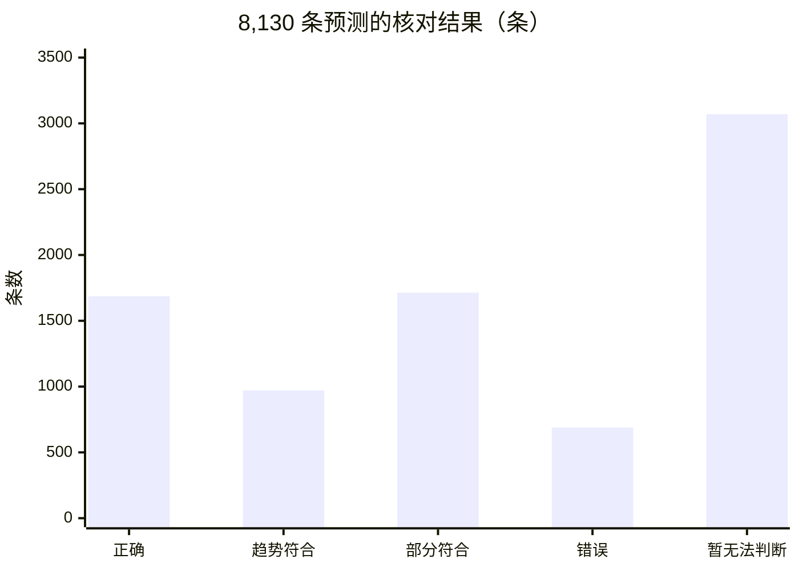
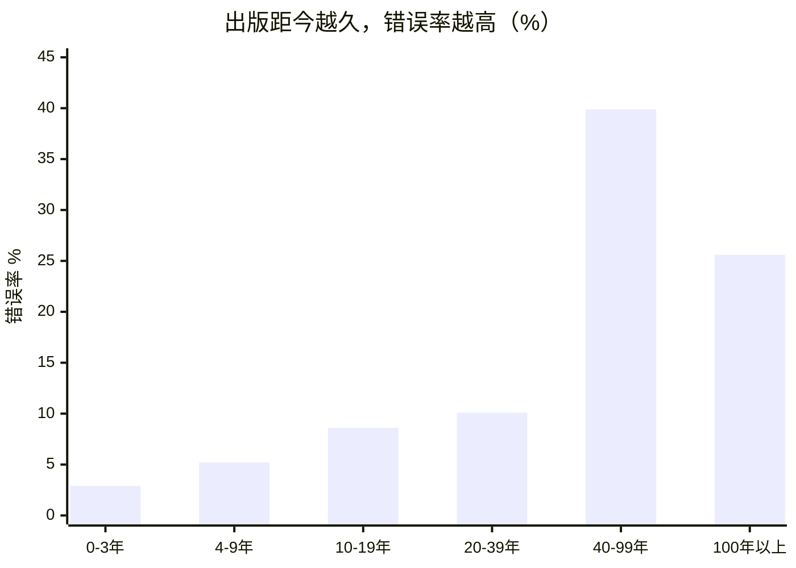

# 一篇看懂：我们从 8,130 条历史预测里学到了什么

> 这是整个项目最重要的一篇文档。不需要懂代码，也不需要看完 134 个案例，读完这一篇，你就能知道：我们为什么做这件事、数据长什么样、谁在哪个领域真的比别人准、好方法怎么学、哪些坑一定要避开，以及十几个值得反复讲的历史故事。

---

## 一、我们为什么要做这件事？

每年都有大量"未来十年将会……"的书和报告。读的时候觉得很有道理，可几乎没人回头去查：**当年那些话，后来到底说对了多少？**

不回头查，就会出两个问题：

- **把运气当本事**。某人碰巧押中一次危机，就被当成先知，他后来在别的领域说的话也被照单全收。
- **把一次失误当全盘否定**。抓住名家一个跳票的年份嘲笑，却没看到他对底层结构的判断在更长时间里是对的。

纳特·西尔弗在《信号与噪音》里说，信息越多，噪音越多，真正的规律（信号）并不会跟着变多。我们想用最笨的办法把信号找出来：**把过去几百年里有代表性的预测一条一条摘出来，用公开数据逐条核对，给人类的预测能力记一本账。**

最后我们想回答三个很实际的问题：

1. **谁的预测更靠谱？** 在什么领域、什么时间跨度上靠谱？
2. **靠谱的人用了什么方法？** 普通人能不能学？
3. **再厉害的人会在哪里栽跟头？** 我们自己做判断时怎么避开？

---

## 二、数据长什么样？

### 2.1 总账

我们读了 **132 部**著作和机构报告，时间跨度从 16 世纪到 2025 年，覆盖地缘政治、宏观金融、科技商业、人工智能、能源人口、社会制度、科幻乌托邦七个领域。

从书里摘出 **10,683 句**像预测的话，剔掉其中 2,553 句其实不是预测的（比喻、口号、政策建议、讲历史），剩下 **8,130 条真正的预测**。每一条都去找公开证据核对，结果是：

用人话说：

- **能判断对错的有 5,060 条**。其中完全说对的占三分之一（33.3%），方向说对的占一半多（52.5%），明确说错的只有 13.6%。
- **还有 3,070 条（38%）现在判断不了**：要么期限没到，要么前提没发生，要么找不到可靠数据。我们不硬判，宁可留空。
- **"趋势符合"单独算**：方向对了但终点还没到，不能提前算成"说中"。
- **"部分符合"不折成半分**：一句话里有对有错，就老老实实标出来。

### 2.2 不同领域的"及格线"差别很大

先看每个领域的平均水平，这就是后面判断"谁超过基准"的参照线：

| 领域 | 作品数 | 能判断的预测 | 完全说对 | 方向说对 | 说错 | 一句话特征 |
| :--- | ---: | ---: | ---: | ---: | ---: | :--- |
| 地缘政治与国际秩序 | 27 | 1,489 | 35.3% | 56.6% | 10.8% | 样本最多，高下分明 |
| 宏观经济、金融与市场 | 17 | 462 | 26.4% | 45.2% | 9.3% | **最难的领域**，点位和时机几乎没人押得准 |
| 科技、商业与产业颠覆 | 14 | 943 | 36.6% | 53.9% | 7.7% | 方向普遍看得准，错在时间表 |
| AI 与奇点前沿 | 12 | 575 | 25.9% | 69.4% | 4.5% | 方向最准、错得最少，但一半还没到期 |
| 人口、能源、资源与生态 | 12 | 430 | 39.5% | 52.3% | 22.6% | **两极分化最严重**：算账派极准，末日派大败 |
| 社会结构、制度与教育 | 26 | 359 | 33.4% | 49.3% | 11.1% | 古典名著多，很多话无法检验 |
| 科幻与乌托邦 | 24 | 802 | 31.7% | 36.9% | 31.0% | 工程想象偶有神作，政治乌托邦大面积翻车 |

### 2.3 时间越远，考卷越难

这是读这份数据最重要的一条常识：**一本两年前的书和一本三十年前的书，根本不是在考同一张卷子。**

- 出版不到 3 年的书，错误率只有 2.9%，但这主要是因为难题还没到期（六成判断不了），不是作者特别厉害。
- 出版 10–39 年的书，才是真正检验本事的地方：既有足够多已经揭晓的结果，又还没被技术代际彻底淘汰。
- 所以我们评价任何一本书，**都只拿它和同样时间跨度的书比**，这就是下面"超额"的意思。

---

## 三、谁真的比别人准？

### 3.1 怎么算"超过基准"

我们给每本书算两个数：

- **超额胜率** = 这本书"完全说对"的比例 − 同时间跨度所有书的平均值。正数说明比同龄人准。
- **低错优势** = 同时间跨度平均错误率 − 这本书的错误率。正数说明比同龄人少犯错。

两个都是正数，而且样本够多（能判断的预测至少 15 条），才算真正跑赢了基准。

### 3.2 一个反直觉的总体结论：最准的不是预言家，是记账的机构

| 作者类型 | 作品数 | 完全说对 | 方向说对 | 说错 |
| :--- | ---: | ---: | ---: | ---: |
| **国际机构与政府智库**（IEA、OECD、世界银行、英国政府科学办公室等） | 21 | **47.0%** | **65.2%** | **6.3%** |
| 政治家与战略实务者（李光耀、布热津斯基、基辛格等） | 15 | 33.1% | 61.9% | 8.5% |
| 地缘与社科学者（扎卡利亚、卡普兰、米尔斯海默、亨廷顿等） | 27 | 34.3% | 52.6% | 11.7% |
| 经济学家与投资人（凯恩斯、塔勒布、达利欧、索罗斯等） | 17 | 30.3% | 42.7% | 13.9% |
| 科技商业思想家（克里斯坦森、弗里德曼、凯文·凯利等） | 19 | 28.8% | 55.2% | 10.8% |
| 古典思想家与科幻作家（威尔斯、凡尔纳、贝拉米等） | 33 | 29.6% | 35.4% | 31.3% |

有人会问：智库的报告大多是近几年出的，是不是占了时间短的便宜？我们查过：**把时间跨度锁在同一档以后，智库仍然是第一**（0–9 年档 47.7%，其他群体 20%–25%；10–39 年档 46.1%，其他群体 32%–40%）。

智库赢在哪里？不是更聪明，而是**习惯先算账、少下绝对结论、把不确定的东西写成"如果……那么……"**。

### 3.3 各领域"跑赢基准"的代表

下表只列能判断的预测不少于 15 条的作品。"超额"是对比同时间跨度的平均水平。

**地缘政治**
| 作品 | 能判断 | 完全说对 | 说错 | 超额胜率 | 一句话点评 |
| :--- | ---: | ---: | ---: | ---: | :--- |
| 扎卡利亚《后美国世界》(2008) | 83 | 59.0% | 6.0% | **+22.2** | 又准又稳，全领域最值得学的样本 |
| 麦金德《民主的理想与现实》(1919) | 38 | 57.9% | 21.1% | +25.5 | 百年前看准欧亚大陆交通与俄国走向 |
| 布热津斯基《战略远见》(2012) | 31 | 61.3% | 22.6% | +24.4 | 胜率高但错得也多，波动大 |
| 荷兰 WRR《互联世界中的安全》(2020) | 42 | 52.4% | 9.5% | +24.3 | 只盯军费和盟友协调这些硬约束 |
| 伯克《法国革命论》(1790) | 31 | 48.4% | **0%** | +16.0 | 236 年检验零错误，见下文故事 1 |
| 卡普兰《地理的复仇》(2012) | 131 | 43.5% | 6.1% | +6.6 | 样本大、方向命中 69.5%，用地理做慢变量 |
| ❌ 艾利森《注定一战》(2017) | 34 | 8.8% | 20.6% | −19.3 | 大方向对，具体数字年份接连落空 |

**宏观金融**（全领域最难，跑赢的人很少）
| 作品 | 能判断 | 完全说对 | 说错 | 超额胜率 | 一句话点评 |
| :--- | ---: | ---: | ---: | ---: | :--- |
| 塔勒布《黑天鹅》(2007) | 22 | 40.9% | **0%** | +4.0 | 不猜点位，只看谁担风险、谁兜底 |
| 世界银行《贫困、繁荣与地球》(2024) | 36 | 44.4% | **0%** | +9.1 | 分地区分收入层，不确定的写成情景 |
| 费雪《货币的购买力》(1920) | 17 | 41.2% | 5.9% | +8.8 | |
| ⚠️ 索罗斯《金融炼金术》(1987) | 35 | 45.7% | 31.4% | +10.3 | 短期拐点很准，长期宿命论很错，高风险高回报 |
| ❌ 达利欧《原则：变化中的世界秩序》(2021) | 73 | 12.3% | 9.6% | −15.8 | 同一作者的《债务危机》0 错误，这本把历史周期硬套到具体指标 |

**科技商业**
| 作品 | 能判断 | 完全说对 | 说错 | 超额胜率 | 一句话点评 |
| :--- | ---: | ---: | ---: | ---: | :--- |
| 英国政府科学办公室《智能基础设施 2055》(2006) | 27 | **74.1%** | 3.7% | **+38.6** | 全库单本最高，20 年检验 |
| 弗里德曼《世界是平的》(2005) | 93 | 49.5% | 6.5% | +14.0 | 样本大且稳 |
| OECD《数字经济展望 2024》 | 15 | 60.0% | 0% | +24.6 | 时间短，待长期检验 |
| ❌ 安德森《免费》(2009) | 67 | 17.9% | 7.5% | −19.0 | 方向对，但爱用"每年减半""几乎全部" |
| ❌ 凯文·凯利《必然》(2016) | 171 | 18.7% | 9.4% | −18.1 | 同作者《失控》230 条只错 5.7%，这本落到具体公司和年份就失手 |

**AI 与奇点**
| 作品 | 能判断 | 完全说对 | 说错 | 超额胜率 | 一句话点评 |
| :--- | ---: | ---: | ---: | ---: | :--- |
| 博斯特罗姆《超级智能》(2014) | 44 | 47.7% | **0%** | +10.9 | 不拍 AGI 年份，只写条件，12 年零错误 |
| 美国 NSTC《为 AI 的未来做准备》(2016) | 16 | 50.0% | 6.2% | +13.1 | |
| 泰格马克《生命 3.0》(2017) | 36 | 33.3% | 0% | +5.2 | |
| ⚠️ 库兹韦尔《奇点更近》(2024) | 24 | 58.3% | 12.5% | +22.9 | 只有 24 条能判断，近九成没到期，**不能算数** |
| ❌ 库兹韦尔《奇点临近》(2005) | 37 | 5.4% | 27.0% | −30.0 | 把芯片的指数速度硬套到生物、纳米制造 |

**能源、人口与资源**
| 作品 | 能判断 | 完全说对 | 说错 | 超额胜率 | 一句话点评 |
| :--- | ---: | ---: | ---: | ---: | :--- |
| IEA《全球关键矿产展望 2024》 | 63 | **66.7%** | 3.2% | +31.3 | 拆到每种金属、每座矿山 |
| 杰文斯《煤炭问题》(1866) | 72 | 52.8% | 20.8% | +20.4 | 160 年前的煤炭账本 |
| FAO《全球森林展望 2050》(2022) | 21 | 47.6% | 4.8% | +19.5 | |
| 梅多斯《增长的极限》(1972) | 17 | 29.4% | 11.8% | +8.5 | 错误率比同档低 28 个百分点，靠多情景 |
| ❌ 埃利希《人口爆炸》(1968) | 47 | 14.9% | **51.1%** | −6.1 | 一半是错的 |
| ❌ 霍纳迪《正在消失的野生生物》(1913) | 66 | 19.7% | 45.5% | −12.7 | |

**社会与教育**
| 作品 | 能判断 | 完全说对 | 说错 | 超额胜率 | 一句话点评 |
| :--- | ---: | ---: | ---: | ---: | :--- |
| OECD《回到教育的未来》(2020) | 34 | 58.8% | 0% | **+30.7** | 四种情景并列，零错误 |
| Graddol《英语的未来？》(1997) | 85 | 45.9% | 8.2% | +10.4 | 用人口+教育+媒体三条线推语言 |
| UNESCO《共同重新构想我们的未来》(2021) | 40 | 40.0% | 2.5% | +11.9 | |
| ❌ 米歇尔斯《政党》(1911) | 28 | 10.7% | 25.0% | −21.7 | 把"寡头铁律"绝对化 |

**科幻与乌托邦**
| 作品 | 能判断 | 完全说对 | 说错 | 超额胜率 | 一句话点评 |
| :--- | ---: | ---: | ---: | ---: | :--- |
| 戴维《航空器》(1919) | 42 | 52.4% | 16.7% | +20.0 | 推的是飞机能干什么，不是社会变成什么样 |
| 威尔斯《预言》(1901) | 90 | 52.2% | 13.3% | +19.8 | 同上 |
| ❌ 贝拉米《回顾》(1888) | 50 | 6.0% | 60.0% | −26.4 | 乌托邦社会制度设想 |
| ❌ 怀特《阿基米德》(1927) | 20 | 0% | 60.0% | −20.9 | 用哲学偏好预测物理学走向 |

> 想查任意一本书的数字，打开 [`datasets/all_cases_summary.csv`](../datasets/all_cases_summary.csv)（Excel 可直接打开），看最后几列 `同档超额严格胜率_pp` 和 `同档低错优势_pp`。

### 3.4 同一个人，换个题目就不一样了

这是全库最有意思的发现之一：**没有人在所有领域都准**。

| 作者 | 准的那本 | 不准的那本 | 差别在哪 |
| :--- | :--- | :--- | :--- |
| H. G. 威尔斯 | 《预言》(1901) 说对 52.2% | 《公开的阴谋》(1928) 错 40.9% | 前者推技术能干什么，后者设计世界政府 |
| 达利欧 | 《债务危机》(2018) 0 错误 | 《世界秩序》(2021) 说对 12.3% | 前者讲债务机制，后者把历史周期套到具体数字 |
| 凯文·凯利 | 《失控》(1994) 32 年只错 5.7% | 《必然》(2016) 错 16 条 | 前者讲系统规律，后者押具体公司和年份 |
| 库兹韦尔 | — | 《奇点临近》(2005) 说对 5.4% | 软件规律硬套到物理和生物世界 |
| 李光耀 | 三本书跨 25 年都稳（42.9%） | 一条重要失误 | 用上一代领导人的风格去推下一代 |

**启示：评价一个人的预测，不要看名气，要看他这句话是不是在他的能力圈里。**

---

## 四、好方法怎么借鉴？

我们把说对的预测按推理方式归类，发现靠谱的方法集中在六种。每种方法都附上"怎么用"和"它的盲区"。

### 方法 1：先算账（约束账本法）

**是什么**：先把问题拆成几个硬数字——现在有多少（存量）、每年增加多少（流量）、新产能要几年才能建好、谁来付钱。账算不清就不下结论。

**谁用得好**：IEA（66.7%）、杰文斯（52.8%）、李光耀、英国政府科学办公室。

**怎么借鉴**：你想判断"某种电池会不会普及"，先查清现在的产能、在建工厂几年投产、原材料够不够、成本降到什么程度买家才愿意换。

**盲区**：容易把"今天的技术条件"当成永远的天花板。杰文斯算准了英国煤耗会见顶，却断言"煤用完前不会有更好的替代能源"——然后石油来了。

### 方法 2：看谁说了算、谁买单（制度与激励法）

**是什么**：不看一个组织嘴上说想干什么，看它的考核指标、利润来源、谁有否决权。

**谁用得好**：伯克（31 条零错误）、克里斯坦森、塔勒布《黑天鹅》（零错误）。

**怎么借鉴**：判断"传统车企能不能转型电动车"，别听发布会，看它的利润有多少来自燃油车、经销商体系会不会反对、工会怎么想。

**盲区**：能看出老玩家为什么会输，但看不准新玩家会从哪个方向赢。

### 方法 3：看地图和邻居（地缘底盘法）

**是什么**：地理、海峡、邻国的安全焦虑这些东西几十年都不会变，用它们做判断的锚。

**谁用得好**：扎卡利亚（59.0%）、麦金德（57.9%）、卡普兰（方向 69.5%）、米尔斯海默。

**盲区**：领导人换代、意识形态突变会打破惯性。

### 方法 4：押功能，不押样子（技术功能扩散法）

**是什么**：只预测"人们将能做到什么"，不预测"具体用什么产品、哪家公司做到"。

**谁用得好**：威尔斯《预言》、戴维《航空器》、弗里德曼、凯文·凯利《失控》。

**怎么借鉴**：说"十年内大多数人能随时和 AI 对话处理工作"，比说"某公司的某产品会垄断市场"安全得多。

**盲区**：一旦从"技术能做到"跳到"社会因此变成什么样"，错误率暴涨。

### 方法 5：不猜点位，只看风险结构（风险边界法）

**是什么**：不去猜"明年利率是多少"，而是问"如果出事，谁会受伤、谁会被救、哪里最脆弱"。

**谁用得好**：塔勒布（错 5.4%）、鲁比尼《大威胁》（87 条只错 1 条）、基辛格（三本书错 1.2%）。

**盲区**：话说得太谨慎，很多判断最后无法检验。

### 方法 6：写成"如果……那么……"（多情景法）

**是什么**：不押一条路，把几种可能并排写出来，并说明看到什么信号就知道走的是哪条路。

**谁用得好**：OECD（零错误）、世界银行（方向 83.9%）、梅多斯《增长的极限》。

**盲区**：情景太多又不给权重，读者会事后挑对的那条说"你看我说中了"。

### 选方法的一个简单原则：看时间多远

- **3 年以内**：看已经在建的、已经排期的、已经立法的。可以给具体时间。
- **3–15 年**：看激励和制度，写成几种情景。
- **15 年以上**：只押地理、人口结构、技术功能这些慢东西，**不押具体年份和具体公司**。

---

## 五、要避免什么？五个反复出现的坑

我们把 689 条说错的预测翻了一遍，发现错误高度集中在五种模式。

### 坑 1：以为今天缺的东西会一直缺

把当下的稀缺当成永远的死局，忽略了价格涨上去以后会逼出替代品。

- 马尔萨斯（1798）：食物算术增长、人口几何增长，必然饥荒。**错误率 59.1%**，化肥和育种让粮食产量翻了几倍。
- 埃利希（1968）：无论采取什么措施，70 年代都会有几亿人饿死。**错误率 51.1%**，绿色革命来了。
- 凯恩斯（1919）：没有俄国小麦，1920–21 年小麦必然稀缺昂贵。结果美洲产区很快补上了。

**自查问题**：如果这东西涨价十倍，有没有别的地方、别的技术能补上？

### 坑 2：把"方向对"偷换成"精确数字"

大方向看对了，却给自己加上一个固定速率、一个具体年份或一个"几乎全部"。**50 条大师翻车里，有 26 条是这个原因。**

- 安德森《免费》：所有数字化东西的边际成本每年降一半。
- 英国政府科学办公室（2013）：金砖四国 GDP 2015 年超过美国。同一份报告里不写年份的趋势判断错误率只有 3.7%，写死年份的错误率 56%。
- 凯文·凯利《必然》：2026 年谷歌主营不再是搜索。

**自查问题**：我写的这个数字和年份，背后有没有一本账撑着？没有的话，删掉。

### 坑 3：从"技术能做到"直接跳到"世界会变成"

- 戴维（1919）：飞机缩短了距离，所以会消灭战争和民族主义。
- 安吉尔（1913）：战争在经济上不划算，所以强国不会靠占领掠夺财富。两次世界大战证伪。
- 彼得·蒂尔（2014）：新计算机只需要微不足道的电量，不会和人类争资源。十年后数据中心成了电网最大的新增负荷之一。

**自查问题**：中间还隔着谁的决定？技术能做到，有人愿意付钱吗？付了钱，政治会因此改变吗？

### 坑 4：以为被预测的对象不会反应

把人和国家当成按原轨迹运行的物体，忘了他们看到危险会调整。

- 霍纳迪（1913）：按当时的捕猎速度，美洲鹤必然灭绝。后来有了保护立法，美洲鹤恢复了。
- IEA（2024）：对俄罗斯金属禁令会影响镍库存。结果中国和印尼的产能把缺口补上了，库存反而翻倍。
- Graddol（1997）：人口涌向经济特区会让粤语、吴语扩张。他没算到推广普通话的国家政策。

**自查问题**：受影响的人会怎么绕路？政府会不会出手？

### 坑 5：把一段顺风当成一条直线

- 费雪（1920）：战后通胀会一直持续。紧接着是通缩。
- 达利欧（2021）：拿疫情期间的学生缺勤率推"只会不断恶化"。
- 索罗斯（1987）：把汇率波动推成"浮动汇率体系必然崩溃"。

**自查问题**：我用的数据是不是正好来自一个特殊时期？

### 一个更简单的警报

**只要看到"无论如何都必将""永远不会""几乎全部""到某年彻底取代"这类说法，就自动打折扣。** 全库数据显示，这类绝对化表述的出错率远高于平均水平。

---

## 六、十二个值得细讲的历史故事

### 故事 1：伯克，1790 年看穿法国大革命的结局

**他说了什么**：法国大革命爆发第二年，伯克写《法国革命论》，断言这场缺乏财政基础、军队纪律和社会秩序的革命，会滑向混乱，最终由军事强人收场。

**后来发生了什么**：恐怖统治、督政府的混乱，然后拿破仑上台。

**成绩**：31 条能判断的预测，**零错误**，全库百年长窗里最稳的一本。

**为什么准**：他不看革命口号，而是看四本账——国家能不能收上税、军队听不听指挥、财产权还在不在、地方社会靠什么维系。四本账都在崩，结局就不难推。

**可以学的**：判断一个组织或政权会不会稳，别听它说什么，看它的钱、它的枪、它的规则和它的基层。

---

### 故事 2：杰文斯，同一本书里的神预测和大失误

**说对的**：1866 年，杰文斯用煤矿开采成本和消耗增速算出，英国的煤耗增长不可能一直维持下去。英国煤炭产量在 1913 年见顶。他还提出了著名的"杰文斯悖论"：效率提高往往不会减少总消耗，反而会因为更便宜而用得更多。这条今天被用来分析 AI 算力和能源。

**说错的**：他断言"英国的煤用完之前，不大可能出现更强有力的替代能源"。然后石油和天然气来了。

**成绩**：72 条能判断，说对 52.8%，160 年后依然排在同档前列。

**可以学的**：算账能让你看清约束，但别忘了约束本身会逼出新东西。账本和替代品要一起看。

---

### 故事 3：威尔斯，一个人的两面

**1901 年的《预言》**：他预言轻便内燃机车辆会普及、城市会向郊区扩张、"很可能在 1950 年前"会有飞机成功飞行并安全返回（两年后莱特兄弟就做到了）、飞机会打破战壕僵局。90 条说对 52.2%。

**1928 年的《公开的阴谋》**：他设计了一个由精英主导的世界政府。22 条错了 40.9%。

**差别在哪**：前一本推的是"已经有雏形的技术能干什么"，后一本推的是"人类社会应该变成什么样"。

**可以学的**：想象技术功能，可以大胆；推演政治和社会终局，要非常小心。

---

### 故事 4：克里斯坦森，看对了谁会输，没看对谁会赢

**说对的**：1997 年，他用"价值网"理论断言，磁盘巨头不会在闪存市场领先，传统车企会长期忽视电动车，便携设备会冲击 PC。

**说错的**：他认为电动车一定会像其他颠覆性技术一样，先从"简单便宜"的低端市场切入。结果打开市场的是特斯拉 Roadster——一辆昂贵的高性能跑车。

**成绩**：34 条说对 41.2%，只错 8.8%。

**可以学的**：好的理论能告诉你老玩家为什么迟钝，但不能唯一锁定新玩家从哪里突破。写预测时把"高端切入"和"低端切入"两种可能都列上。

---

### 故事 5：扎卡利亚，不非黑即白的预测

**他说了什么**：2008 年金融危机期间，人人都在讨论美国是否衰落。扎卡利亚的判断是分层的：非西方世界会崛起（"其他国家的崛起"），但美国的军事和创新地位不会很快崩塌。他甚至说中了"迪拜的哈利法塔很快会超过台北 101"这种具体细节。

**唯一明显失手**：他预计美国经济在全球的占比会小幅下降。实际上从 2008 年约 22.9% 涨到了 2025 年约 26%。

**成绩**：83 条说对 59.0%，只错 6.0%，地缘领域最佳。

**可以学的**：大问题往往不是"是或否"，而是"哪方面会变、哪方面不会变"。把一个大判断拆成几层分别说。

---

### 故事 6：卡普兰，用地图预见了俄乌战争

**他说了什么**：2012 年《地理的复仇》写道："21 世纪的欧洲仍将在关键意义上受其与东方、尤其与俄罗斯关系的影响。"当时主流观点认为欧洲已经进入后冷战的和平时代。

**后来发生了什么**：2014 年克里米亚，2022 年全面战争，欧洲安全秩序被彻底改写。

**成绩**：131 条能判断，方向说对 69.5%，只错 6.1%。

**失手的地方**：离开地理去猜技术细节，比如预测美国西海岸到亚洲的超音速商业航班。

**可以学的**：地理、邻居、海峡这些东西变得极慢，用它们做长期判断的锚点很可靠。

---

### 故事 7：马汉，功能对了，路线错了

**他说了什么**：1897 年，马汉在同一段话里说了两件事——"中美洲运河最终一定会修在尼加拉瓜"，以及"不管修在哪里，它都会成为世界上数一数二的贸易枢纽"。

**后来发生了什么**：运河修在了巴拿马。但它确实成了全球最重要的航运咽喉之一。

**可以学的**：把"会发生什么"和"通过什么路径发生"分开写。路径错了不代表功能判断错，功能对了也救不回错误的路径。

---

### 故事 8：IEA，教科书式的算账，也会栽在"别人会绕路"上

**说对的**：《全球关键矿产展望 2024》把能源转型拆成锂、镍、钴、铜每一种金属，再拆到每座在建矿山和每个国家的精炼份额。63 条说对 66.7%，只错 2 条。比如"2024 年钴价会保持低迷，因为供给增长快于需求"，说对了。

**说错的**：它认为 2024 年 4 月对俄罗斯金属的禁令可能影响 LME 镍库存的增长。结果中国和印尼的产能大量涌入，镍库存反而翻倍。

**可以学的**：账算得再细，也要问一句"被卡住的人会从哪里绕过去"。

---

### 故事 9：英国政府科学办公室，同一个机构的两种写法

**2006 年《智能基础设施的未来》**：20 年后检验，27 条说对 20 条（74.1%），只错 1 条。它看准了交通脱碳很难、基础设施数字化会带来网络安全脆弱性、传感器数据的治理会成为瓶颈。

**2013 年《制造业的未来》**：163 条不写年份的趋势判断，错误率只有 3.7%；但 25 条写死年份的判断（比如"金砖四国 GDP 2015 年超过美国"）错误率高达 56%。

**可以学的**：同一批专家，写趋势很准，写年份就翻车。不是不能给年份，而是要有建设周期、产能这类账本撑着才能给。

---

### 故事 10：库兹韦尔，时间是最严厉的考官

**2005 年《奇点临近》**：经过 20 年检验，37 条能判断的预测里只有 2 条完全说对（5.4%），10 条错误（27%）。问题在于把芯片的指数增长速度，硬套到分子纳米制造、生物医学、通用机器人这些受物理、临床试验和制造链限制的领域。

**2024 年《奇点更近》**：目前 24 条能判断的说对 58.3%，看起来很好。但 235 条预测里将近九成还没到期。

**可以学的**：不要被新书的高胜率迷惑，时间短的成绩单没有意义。等十年再看。

---

### 故事 11：埃利希，"无论怎么做都没用"的代价

**他说了什么**：1968 年《人口爆炸》开篇写道："在 1970 年代，世界将经历饥荒——无论现在采取什么紧急计划，都会有数亿人饿死。"

**后来发生了什么**：绿色革命，杂交育种，化肥普及。全球粮食产量远超人口增长。

**成绩**：47 条错了 51.1%。

**特别要注意的**：他用了"无论采取什么措施"这个说法，等于自己堵死了退路——不能事后说"是因为大家听了我的警告才避免了灾难"。

**可以学的**：写预测时，把可能改变结局的干预措施写进条件里，而不是一笔否定。

---

### 故事 12：艾利森，方向对了，数字全错

**他说对的**：《注定一战》的核心判断——中美结构性竞争不会自然消退——到现在看是对的。

**他说错的**：书里大量用购买力平价或单年增速直接推出硬数字：2019 年中国研发投入超过美国、2023 年中国经济规模比美国大 50%、未来 30 年美国占全球 GDP 跌到 11%。这些接连落空。

**成绩**：34 条只说对 8.8%，错了 20.6%。在同档里落后 19 个百分点。

**可以学的**：一个好的大判断，不需要靠一堆没算过账的数字来"加强"。数字写得越多越具体，被现实打脸的机会就越多。

---

## 七、读这份数据时要记住的几件事

1. **这是回头看，不是事前比赛**。所有书都是先有结果、再回去核对的，不能等同于一场公平的预测竞赛。
2. **书的选择有偏差**。选的是有代表性、能找到电子版的书，不是随机抽样。
3. **同一本书里的预测不是相互独立的**。好几条可能都押在同一个事件上（比如同一场通胀、同一场战争），不能当成独立试验来算显著性。
4. **方法有效还需要往前验证**。上面的六种方法和五个坑，是从历史成败里总结出来的经验，不是被实验证明的定律。最好的检验办法，是你自己用它们写下未来的预测，几年后回来对账——这正是 [`my-forecasts/`](../my-forecasts/) 存在的意义。

---

## 想继续深入？

- 想自己动手写预测：[`03-data-and-forecasting-guide.md`](03-data-and-forecasting-guide.md)（七步预测法 + 场景透镜速查表）
- 想看 100 条精彩预测、50 条大师翻车、180 条未来方向的完整清单：[`reports/curated-330-compendium.md`](reports/curated-330-compendium.md)
- 想看更完整的统计和人物画像：[`reports/panoramic-report.md`](reports/panoramic-report.md)
- 想知道我们怎么保证核对过程不造假：[`01-methodology-signal-and-noise.md`](01-methodology-signal-and-noise.md) 和 [`02-engineering-architecture.md`](02-engineering-architecture.md)
- 想 Fork 一份做自己的定期预测：[`04-fork-and-agent-workflow.md`](04-fork-and-agent-workflow.md)
