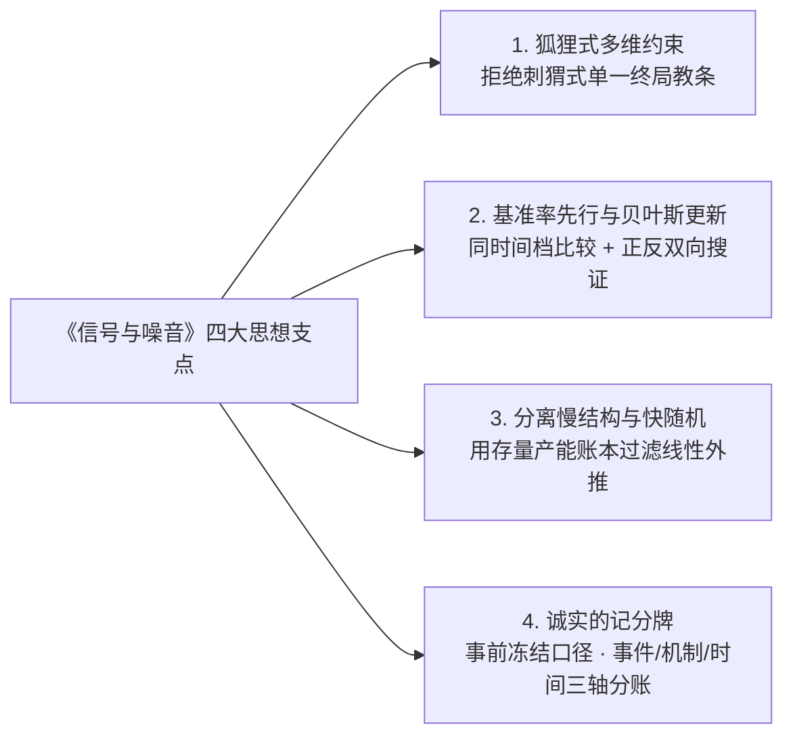
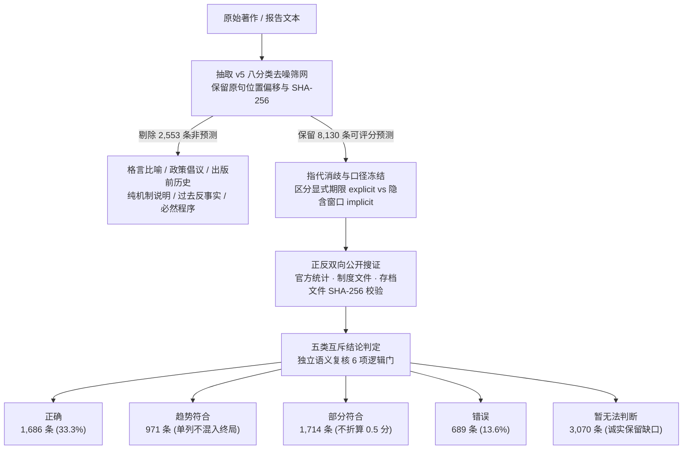

# 方法论基石：致敬《信号与噪音》，把预测变成可复盘的实证科学

> **特别致谢**：本项目的精神起点与核心问题意识，深受纳特·西尔弗（Nate Silver）经典著作 **《信号与噪音：为什么大多数预测都失败了，但有一些没有》（*The Signal and the Noise: Why So Many Predictions Fail — but Some Don't*）** 以及菲利普·泰特洛克（Philip E. Tetlock）关于“刺猬与狐狸”超预测研究的启发。在此向《信号与噪音》一书致以诚挚的敬意。

---

## 一、为什么要做这件事：信息爆炸时代的“信噪比悖论”

在《信号与噪音》中，纳特·西尔弗揭示了一个反直觉的现代困境：**人类拥有的信息量呈指数级膨胀，但客观存在的真实规律（信号，Signal）并没有同步增加；多出来的海量数据与观点，绝大多数都是干扰判断的随机波动与主观偏见（噪音，Noise）。**

当我们阅读过去几百年间的地缘战略名著、经济学经典、科技未来学畅销书与国际智库报告时，经常会陷入两种极端误区：
1. **“造神运动”（幸存者偏差）**：某位作者偶然押中了一次危机或一项技术，人们便将其奉为无所不知的先知，照单全收他在其他领域的激进断言；
2. **“全盘虚无”（事后冷嘲）**：抓住名家某一条跳票的年份大肆嘲笑，却忽略了其底层结构约束分析在更长周期内精准兑现。

要打破这两种认知幻觉，唯一的办法就是照着《信号与噪音》提倡的科学精神，**不做印象式书评，而给人类思想史建一本逐字可核验、正反证据并列、拒绝事后搬移球门的“硬核记分牌”**——于是有了 **Forecast Lab** 对跨越近五百年 **132 部著作、8,130 条可评分预测（5,060 条已明确判定）** 的全量实证复盘。

---

## 二、从《信号与噪音》汲取的四条核心准则

我们将《信号与噪音》的思想内核提炼为贯穿整个项目代码与人工审读的四条铁律：

1. **像“狐狸”一样思考，警惕“刺猬”的宏大单一叙事**
   - 刺猬型预测者习惯把复杂世界压缩成一条绝对铁律（如“人口几何增长必致大饥荒”“现代贸易不划算所以大国不再打仗”“摩尔定律指数外推将在某年消灭疾病”）；全库实证表明，凡出现“无论采取什么措施都必将……”“永远不再……”的全称断言，翻车率极高。
   - 狐狸型预测者（如国际能源署 IEA、OECD、扎卡利亚、李光耀、克里斯坦森）则同时权衡多重相互制衡的力量，明确写出前提条件与边界。
2. **先锁死“基准率”（Base Rate），再做贝叶斯增量更新**
   - 离开基准率谈准确率毫无意义：一本出版仅 2 年的书（全库 `0–3年` 档平均方向命中率本就高达 **81.0%**、错误率仅 **2.9%**）和一本跨越 30 年检验的书（`20–39年` 档平均方向命中率 **52.6%**）根本不在同一张考卷上。
   - 因此我们严格计算每部作品相对于同时间跨度同行的 **“同档超额胜率（$\Delta\text{严格}$）”** 与 **“同档低错优势（$\Delta\text{低错}$）”**，并在每次核验时强制同时检索**支持证据**与**反面证据**。
3. **区分“结构性真信号”与“顺风期线性外推噪音”**
   - 短期波动（如战后两年通胀、疫情两年远程办公激增、某国三年超高增速）极易诱使作者画出一条通往天际的直线；真正的长周期信号往往藏在**物理热力学边界、人口年龄结构、在建产能周期、财政偿付能力与组织激励约束**之中。
4. **守住诚实的记分牌：不美化模糊，不强行消掉“未知”**
   - 许多复盘为了追求好看的数字，会把“方向沾边”直接算全对，或把“部分说对”折算 0.5 分。我们在代码层面硬性锁死五类互斥结论，并把**事件是否发生、作者归因机制是否成立、时间窗口是否准时**拆成三本独立账本。

---

## 三、我们的可操作化研究方法（从原文到五类结论）

为了把上述原则落地为可重复检验的流程，我们建立了 **“抽取去噪 → 口径冻结 → 双向搜证 → 五类互斥评估 → 三轴复盘”** 的标准研究链路（底层完整细则见 [`toolkit/METHOD.md`](../toolkit/METHOD.md)）：

### 3.1 第一关：抽取 v5 八分类“伪预测过滤器”
书中大量看似宏大的句子其实根本不是预测。抽取管线 v5 为每条候选标注 `claim_type`，仅放行真正对未来可观察变化做出承诺的 `forecast`，自动剥离并单独统计以下噪音：
- `aphorism`：修辞比喻与哲理格言；
- `normative`：作者认为“政府/企业应该怎么做”的政策倡议或道德呼吁；
- `historical`：引文年份全部早于出版年的历史复述；
- `mechanism`：只解释静态理论机制、未承诺未来变化方向的分析；
- `hypothetical`：过去的反事实推演或无时间承诺的假想推演；
- `trivial`：几乎必然发生的常规程序或仪式。

同时，我们对时间承诺做严格分层：
- **显式期限（`explicit`）**：原文明确给出年份、年代或时长（如“2020 年前”“十年内”），严格按原文窗口核验；
- **隐含窗口（`implicit_publication_to_cutoff`）**：原文给出明确变化方向但未写死日期（如“差距将继续扩大”），以“出版年至证据截止日”为观察窗口，既不替作者编造年份，也不因未写日期而逃避检验。

### 3.2 第二关：五类互斥结论（拒绝二元一刀切与分数注水）

| 判定类别 | 严格适用标准 | 为什么这样设计（防噪音机制） |
| :--- | :--- | :--- |
| **正确** | 在声明的口径和观察窗口内，主要可检验结果已经符合 | 代表真正兑现的硬核信号（计算**严格胜率**的唯一分子） |
| **趋势符合** | 已有持续客观数据沿预测方向演进，但长期终点尚未到达或最终结果待验 | **单独建类**！防止把“半途顺风”提前吹成“终局命中”，同时客观反映方向预见力 |
| **部分符合** | 复合命题中分项有对有错，或不同合理统计口径结论相反 | **绝不折算 0.5 分**！保留复杂现实的颗粒度，防止掩盖关键分项失误 |
| **错误** | 主要可检验结果与预测方向相反，或在写明期限内明确落空 | 复盘盲区最宝贵的样本（用于提炼“五大高频翻车模式”） |
| **暂无法判断** | 远期期限未到、真实前提条件未触发、公开证据不足或定义不可测量 | **诚实承认未知**！不算作错误，也严禁为了降低未定率而强行下判 |

> **统一核心指标口径**（分母均为 `可判定数 = 预测数 - 暂无法判断`）：
> - **严格胜率** = $\text{正确} / \text{可判定数}$
> - **方向命中率** = $(\text{正确} + \text{趋势符合}) / \text{可判定数}$
> - **错误率** = $\text{错误} / \text{可判定数}$
> - **未定率** = $\text{暂无法判断} / \text{预测数}$

### 3.3 第三关：事件 × 机制 × 时间 三轴独立记账

受案例复盘启发（详见 [`docs/reports/case-inspired-process.md`](reports/case-inspired-process.md)），我们在评估与复盘时严格禁止跨轴偷换：
- **事件轴**：核查原定义的对象、量词与指标是否真的发生（严防把“实验室原型”偷换成“商业普及”，把“增加”偷换成“取代”）；
- **机制轴**：即便结果猜对了，也不自动证明作者给出的因果解释成立（结果命中 $\neq$ 机制验证）；
- **时间轴**：明确区分“窗口内按时兑现”与“逾期十年才发生”，不因最终发生就抹掉时间误差。

---

## 四、实证提炼：6 大“真信号”方法原型 vs. 5 大“高赔率噪音”陷阱

通过对 5,060 条已判定预测的横向归因（完整数据与人物画像见 [`docs/reports/panoramic-report.md`](reports/panoramic-report.md)），我们发现高准度预测并非来自神秘直觉，而是高度集中于 **6 套可迁移的方法原型**：

| 方法原型 | 核心动作 | 代表人物 / 机构（严格胜率 / 错误率） | 最适时间窗口 | 天然盲区（需配何种反校验） |
| :--- | :--- | :--- | :--- | :--- |
| **1. 约束账本法** | 把系统拆成存量、流量、在建产能、热力学/财政硬边界，算清谁卡住系统、谁买单 | IEA（61.9% / 3.6%错）、杰文斯（52.8%）、李光耀（42.9%）、UK GO-Science（47.1%） | 3–30 年 | 易低估高价倒逼出的新替代技术（如杰文斯漏算石油替代煤炭） |
| **2. 制度与激励结构法** | 不看口头意愿，拆解谁有否决权、谁承担代价、在位者受什么现行利润指标捆绑 | 伯克（48.4% / 0%错）、克里斯坦森（41.2%）、塔勒布《黑天鹅》（40.9% / 0%错） | 5–30 年 | 能锁死在位者为何迟钝，但不能唯一锁定颠覆者从高端还是低端破局 |
| **3. 地缘底盘与权力均衡法** | 锚定地形海道、缓冲带与大国长期安全困境，分层评估军事/科技/经济底盘 | 扎卡利亚（59.0% / 6.0%错）、麦金德（57.9%）、卡普兰（43.5%）、米尔斯海默（44.7%） | 10–50 年 | 易用上一代政治克制惯性外推新一代领导层姿态 |
| **4. 技术功能扩散链法** | 沿“已有雏形功能 → 成本跨门槛 → 基础设施配套 → 组织重塑”推演，押功能不押单一外观 | 戴维《航空器》（52.4%）、威尔斯《预言》（52.2%）、弗里德曼（49.5%）、博斯特罗姆（47.7% / 0%错） | 10–40 年 | 一旦跨过工程与商业功能，跳去预言“技术消灭战争/实现世界大同”立刻惨败 |
| **5. 风险边界与反脆弱法** | 不赌单一均值点位，识别激励不对称（收益私有化、爆雷公有化）与尾部脆弱性 | 鲁比尼（错 1.1%）、基辛格（3本书错 1.2%）、塔勒布（错 5.4%） | 高不确定与强反身性期 | 表述过度谨慎时易停留在高未定率，或把风险叠加误判为短期必现滞胀 |
| **6. 多情景条件分支法** | 拒绝单线宿命论，显式拆分前提 $A$ 与条件结果 $P(B \mid A)$ 的多条演化路径 | OECD（51.8% / 0%错）、世界银行（方向 83.9% / 2.3%错）、荷兰 WRR（52.4%） | 3–25 年 | 若不标注领先触发指标，读者容易事后只挑对的那条分支自我证实 |

与此同时，全库 **689 条明确错误** 中反复重演着 **5 种典型噪音陷阱**（做任何预测前的必查扫雷表）：
1. **忽略替代供给与技术跃迁**：把当下的稀缺当成永恒死局（如马尔萨斯错 59.1%、埃利希《人口爆炸》错 51.1%、凯恩斯漏算美洲小麦替代俄国缺口）。
2. **把“方向对”偷换成“固定速率、拍脑袋年份或极端量词”**：如《免费》断言“所有数字化事物边际成本每年减半”、《注定一战》拿单期增速硬推“2023 年中国经济比美大 50%”。
3. **跨层跳跃**：从“技术可行/经济账不划算”直接跳到“战争消失/政治终局”（如安吉尔《大幻觉》、威尔斯《公开的阴谋》）。
4. **忽略行动者绕行与内生政策反制**：把被预测对象当成不会反应的木头人（如霍纳迪漏算濒危物种保护立法、马凯硕低估供应链第三国转口绕行）。
5. **把阶段性顺风外推成永久单调直线**：把疫情、战后或泡沫期的短期斜率当成永久常态。

---

## 延伸阅读

- **工程实现**：了解我们如何用纯标准库 Python 与多重校验把这套方法论固化为防幻觉代码 → [`02-engineering-architecture.md`](02-engineering-architecture.md)
- **看数与实操**：学习三条读数底线与“七步实战预测法” → [`03-data-and-forecasting-guide.md`](03-data-and-forecasting-guide.md)
- **全景研究报告**：阅读 132 部著作完整横截面与人物画像 → [`reports/panoramic-report.md`](reports/panoramic-report.md)
