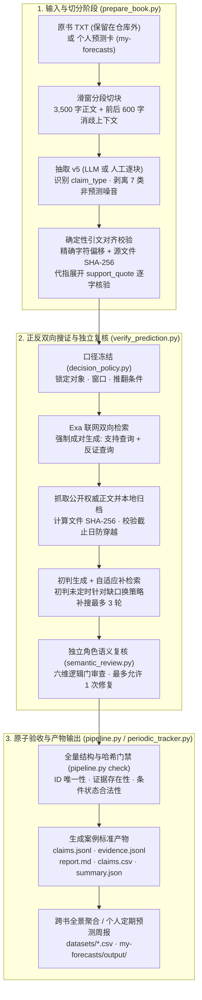
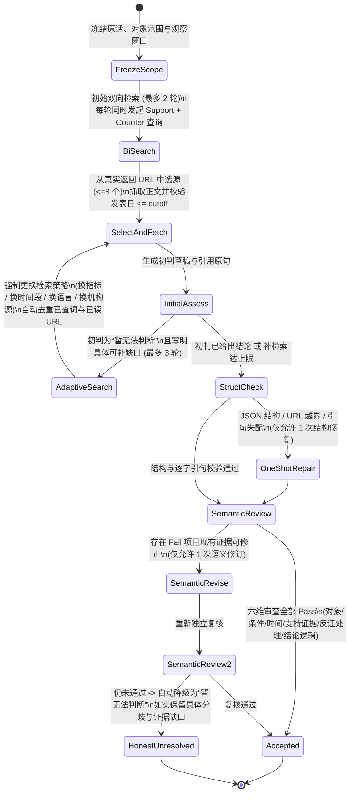
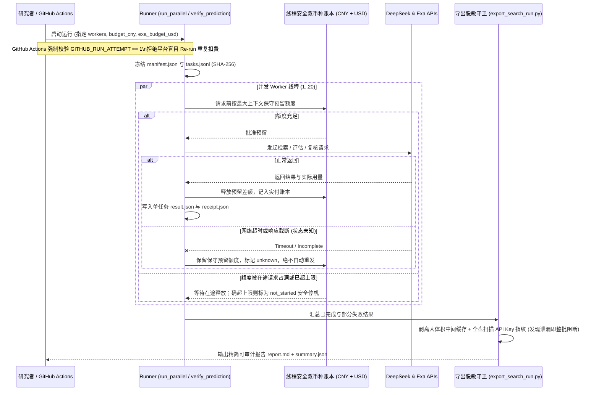

# 工程实践与系统架构：如何用确定性代码驯服大模型幻觉

把几百本书里的数千条预测整理成经得起审计的实证数据库，最大的工程挑战只有一个：**大语言模型天生擅长“顺着事后常识改写原文、脑补日期、挑选有利证据、甚至在复核时自己给自己放水”。**

因此，Forecast Lab 的核心工程哲学是：**让 LLM 只做受控的语义提议者（Proposer），把引文对齐、哈希锚定、时间防穿越、预算熔断、独立角色复核与原子落盘全部交给零外部依赖的确定性代码（Deterministic Guardrails）。**

---

## 一、系统总体架构图

整个项目由 **“通用工具引擎（`toolkit/`）”** 与 **“相互隔离的独立案例包（`cases/` & `my-forecasts/`）”** 两层组成，仅依赖 **Python 3.11+ 标准库**，无需任何外部数据库、消息队列或重型框架，确保十年后在任何机器上仍可一键校验与重现。



---

## 二、核心模块职责矩阵

`toolkit/` 下所有模块职责单一、通过标准 JSON / JSONL 文件契约通信：

| 模块文件 | 核心职责 | 关键确定性防线 |
| :--- | :--- | :--- |
| [`toolkit/prepare_book.py`](../toolkit/prepare_book.py) | TXT 自动解码、前言/后记过滤、滑窗切块、预测抽取 v5、代指消歧展开（`expand`） | 引文必须精确对齐回源文本切片（拒绝改字改标点）；`reference_resolutions` 的支持句必须逐字存在于所给上下文中 |
| [`toolkit/verify_prediction.py`](../toolkit/verify_prediction.py) | 单条/批量预测自动联网搜证、初判、自适应补检索与修订闭环 | 模型只能引用本轮搜索真实返回的 URL 与抓取正文；单条硬上限 18 次 LLM 请求，防止无限重试 |
| [`toolkit/exa_client.py`](../toolkit/exa_client.py) | 标准库实现的 Exa 搜索与正文抓取客户端 | 进程级共享 3 QPS 限流、429 退避、401/402 立即熔断、按请求哈希缓存响应 |
| [`toolkit/decision_policy.py`](../toolkit/decision_policy.py) | 统一评估规则契约（搜证规划、初判、复核共用同一判据） | 强制区分显式期限与隐含窗口，禁止把非预测或不可解条目判为“正确” |
| [`toolkit/semantic_review.py`](../toolkit/semantic_review.py) | 独立 LLM 请求担任“审稿人”，对初判执行六维语义挑战 | 支持 `quote_ref` 原句编号自动还原，防止模型复制引文时手滑改字；复核仍不过则强制收口为“暂无法判断” |
| [`toolkit/pipeline.py`](../toolkit/pipeline.py) | 案例初始化（`init`）、原子导入（`apply`）、全量校验（`check`）、报告生成（`report`） | 导入前自动备份快照与 SHA-256 收据；任一条记录或任一份证据哈希不符即整批拒绝 |
| [`toolkit/periodic_tracker.py`](../toolkit/periodic_tracker.py) | **个人定期预测管理**：快速登记预测卡（`add`）、查看追踪状态（`status`）、生成增量复盘简报（`digest`） | 事前自动冻结创建日期与信息基线，对比历史评估快照高亮状态跃迁 |
| [`toolkit/run_parallel.py`](../toolkit/run_parallel.py) | 多线程并发执行器与线程安全费用账本 | 请求发出前预留费用额度，超时或状态未知的请求保留冻结额度且**绝不自动重发**，杜绝隐性重复扣费 |

---

## 三、单条预测“双向搜证 + 自适应补检索 + 独立复核”状态机

为了让机器核查既不草率下结论，也不在缺失公开数据的题目上强行编造，[`verify_prediction.py`](../toolkit/verify_prediction.py) 为每条预测实现了一个严格有界的状态机：



### 为什么这套设计能显著压低幻觉？
1. **强制对冲确认偏误（Confirmation Bias）**：模型在第一轮检索时被强制要求写出一条 `support` 查询和一条 `counter`（反证）查询，且在选源阶段明文要求保留不利证据。
2. **打破“同质化无效重搜”**：当一轮检索后仍为“暂无法判断”时，自适应补检索要求模型显式声明 `strategy`（相比上一轮改变了什么指标口径、时间区间、官方统计源或语种），程序自动拦截重复 Query 和重复 URL。
3. **有限次修订 + 诚实兜底**：无论是结构校验还是独立语义复核，最多只给 **1 次** 修正机会；仍不通过就由确定性代码强制收口为 `暂无法判断` 并记录缺口，绝不允许“无限循环直到模型改口通过”。

---

## 四、并发预算守卫与云端断点续跑时序

在整书或大批量预测运行中（本地 CLI 或 GitHub Actions [`verify-book.yml`](../.github/workflows/verify-book.yml)），系统通过双币种（LLM 人民币上限 + Exa 美元上限）线程安全账本与不可变运行收据保障资金与数据安全：



如果某次大批量运行因网络波动或时间上限出现个别 `partial / failed` 任务，只需传入 `retry_run_id` 调用 [`prepare_cloud_retry.py`](../toolkit/prepare_cloud_retry.py)：
- 程序会校验上一轮产物的清单哈希，**只挑选技术未完成（`task_state != completed`）的条目**；
- 已经完成研究流程（哪怕研究结论是“暂无法判断”）的条目绝不重跑；
- 恢复预算自动扣减上一轮已消耗与未知预留的金额，两轮账本完整串联保留。

---

## 五、六道防污染数据闸门（`pipeline.py check`）

无论是全书案例还是你在 [`my-forecasts/`](../my-forecasts/) 中的个人预测，每次提交触发的 CI 工作流（[`.github/workflows/check.yml`](../.github/workflows/check.yml)）都会运行 **213+ 项模拟 API 单元测试**，并对每个案例执行以下六道硬检查：

1. **ID 唯一性与全覆盖校验**：候选、抽取、评估 ID 必须一一精确对应，禁止静默漏项或重复计分。
2. **本地证据字节级 SHA-256 校验**：所有计分条目引用的 `evidence_ids` 必须在 `data/evidence.jsonl` 中登记 `verified=true`，且对应本地存档文件的实时 SHA-256 与登记值分毫不差。
3. **时间防穿越校验**：每条引用证据的发表日期与观察终点（`observation_end`）不得晚于案例设定的 `cutoff` 截止日；若观察终点早于书籍出版年，自动触发 `prepublication_observation_warning_ids` 告警。
4. **代指展开防脑补校验**：`expanded_claim` 中所有消歧指代词（如“他们”“该国”）及其支撑原句必须逐字匹配所给文本，无依据的指代必须显式标为 `[指代待确认：…]`。
5. **非预测禁判正确门禁**：v5 记录中凡属于格言、倡议、历史、假设或不可解命题，代码直接封死判为“正确”的通道。
6. **报告再生幂等性校验**：CI 现场重跑 `pipeline.py report` 并执行 `git diff --exit-code`，确保仓库中展示的每一份统计数字和 CSV 都与底层 JSONL 数据 100% 同步、零手工篡改。

---

## 快速本地验证

克隆仓库后，无需配置任何 API Key、无需安装任何 pip 包，即可在本地跑通全量单元测试与案例审计：

```bash
# 1. 运行全套引擎单元测试（模拟 API、并发预算竞争、防篡改与边界条件）
python3 -m unittest discover -s toolkit/tests -v

# 2. 对任意书籍案例执行字节级证据哈希与评估逻辑审计
python3 toolkit/pipeline.py --case cases/lky-guantianxia check

# 3. 对个人定期预测样板执行审计
python3 toolkit/pipeline.py --case my-forecasts check
```
