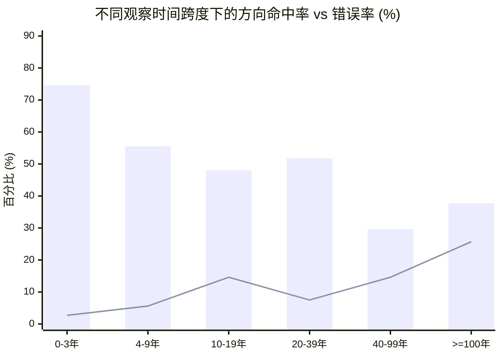

# 数据导读与实战预测指南：怎么看数据，以及怎么自己做预测

面对跨越近五百年的 **146 部独立著作、10,745 条预测、7,522 条明确判定**，如果直接把表格按“严格胜率从高到低”排个名，你几乎一定会得出错误结论。

本指南分为两部分：**上半部分教你如何正确阅读仓库数据（避开排行榜陷阱）**；**下半部分手把手教你如何把最顶尖预测者的思维沉淀为你自己的“七步预测工作流”**。

---

## 第一部分：怎么看数据？（三条防误读铁律与检索路径）

### 1. 铁律一：永远先看“时间跨度分档”，只跟同龄考卷比

2024 年出版的书测 2026 年，与 1997 年出版的书测 2026 年，面对的根本不是同一张考卷。全库按书龄跨度分档后，呈现非常清晰的难度梯度：


*(注：柱状图为方向命中率，折线为错误率。)*

- **超短窗（`0–3年`）自带三重顺风**：在途工程惯性、短期政策兑现，以及高达 **57.8%** 的难命题尚未到期（未定）。例如库兹韦尔《奇点更近》(2024) 89.8% 预测尚未到期；苏莱曼《浪潮将至》(2023) 方向命中 81.7% 看似惊艳，其实 `0–3年` 档平均方向命中本来就高达 **74.6%**，其严格胜率（15.0%）反而比同档均值低 19.2 个百分点。
- **`10–39 年` 才是检验预测真功夫的黄金试金石**：既有充足的已兑现样本，又足以淘汰靠短期热度外推的噪音。
- **正确读表姿势**：打开 [`datasets/all_cases_summary.csv`](../datasets/all_cases_summary.csv) 时，优先看最后几列的 **`同档超额严格胜率_pp`（$\Delta\text{严格}$）** 和 **`同档低错优势_pp`（$\Delta\text{低错}$）**——正值代表真正跑赢了同时间跨度的同行基准！

### 2. 铁律二：区分“显式期限（`explicit`）”与“隐含窗口（`implicit`）”

| 期限类型 | 预测总数 | 可判定数 | 严格胜率 | 方向命中率 | 错误率 | 核心启示 |
| :--- | ---: | ---: | ---: | ---: | ---: | :--- |
| **原文写明时间（`explicit`）** | 3,499 | 2,312 | 26.8% | 47.4% | **14.8%** | 拍脑袋给精确年份更易翻车；但有硬账本支撑者照样超 50% |
| **未写死时间方向句（`implicit`）** | 7,138 | 5,182 | **36.1%** | 47.4% | 11.9% | 结构与方向判断完全兑现率更高，但须防模糊表述逃避证伪 |

- **反面典型**：英国政府科学办公室《制造业的未来》(2013) 在 163 条未写日期的产业趋势上错误率仅 **3.7%**，但在 25 条写死年份的判断（如“2015 年金砖四国 GDP 超美国”）上错误率飙至 **56.0%**。
- **正面典型**：不能因此把“给数字/给时间”一棍子打死！米尔斯海默《大国政治的悲剧》（写明期限严格胜率 **62.5%**）、杰文斯《煤炭问题》（**62.5%**）、IEA《全球关键矿产展望 2024》（**53.3%**）证明：**错的不是写时间，而是没有存量、产能与建设周期账本支撑的拍脑袋时间。**

### 3. 铁律三：区分“实证预测著作”与“古典制度原理著作”

仓库中 26 部古典政治哲学与早期经济学著作（霍布斯、洛克、卢梭、联邦党人、李嘉图、密尔等）未定率高达 **88.2%**。这是因为古典名著旨在阐述抽象条件下的制度规律而非给出带结算窗口的事件预测——阅读它们时，应将其作为推演“制度激励、财政约束与权力制衡”的**底层机制词典**，而非计分排行榜样本。

### 4. 三分钟按需查数导航

- **想看全局谁最稳、各领域基准率是多少** 👉 读 [`docs/reports/panoramic-report.md`](reports/panoramic-report.md) 或用 Excel 打开 [`datasets/all_cases_summary.csv`](../datasets/all_cases_summary.csv)
- **想看历史上最精彩的 100 次神预测、50 次大师翻车，以及未来 10 年六大领域 180 条跟踪罗盘** 👉 读 [`docs/reports/curated-330-compendium.md`](reports/curated-330-compendium.md) 或查 [`datasets/curated_330_forecasts.csv`](../datasets/curated_330_forecasts.csv)
- **想深挖某一本具体书（比如《李光耀观天下》《创新者的窘境》《大棋局》）的逐句原话与核验证据** 👉 进入 [`cases/<案例目录>/`](../cases/) 阅读 `REPORT-manual-zh.md` / `REPORT-audit-zh.md` 或 `output/report.md`

---

## 第二部分：怎么用这些方法自己做预测？（七步实战闭环）

我们将 146 部著作的成败经验与 [`case-inspired-process.md`](reports/case-inspired-process.md) 合二为一，浓缩为任何人（或你的 AI Agent）都能直接照着执行的 **七步预测法**：


### Step 1：把宏大直觉拆成“六要素可检验命题”（防概念偷换）
动笔前先强制填满六个槽位：**主体 + 对象 + 量词 + 可测指标（含分母） + 期限 + 触发前提**。
- ❌ **噪音写法**：“AI 很快会取代大量白领工作。”（什么叫很快？多大比例算大量？净岗位减少还是工作内容改变？）
- ✅ **可核验写法**：“在未出台全国性强制配额限制的前提下，到 2030 年底，美国 BLS 统计的信息与专业服务业全职雇员占总非农就业比重，较 2025 年基准下降至少 2 个百分点。”
- **严查四组高频偷换**：`实验室出现 ≠ 商业普及 ≠ 市场主导 ≠ 彻底取代`；`物理可造 ≠ 商业盈利`；`局部效率提升 ≠ 总能耗下降`；`尝试推动 ≠ 达成结果`。

### Step 2：按问题场景配好“主透镜 + 反校验透镜”
不要用一个锤子敲所有钉子。下表汇总了全库验证最有效的八大场景透镜组合：

| 预测场景 | 首选主透镜（抓主趋势） | 必配反校验透镜（防盲区） | 核心领先观测指标 |
| :--- | :--- | :--- | :--- |
| **1. 地缘博弈与供应链** | 扎卡利亚（分层实力）+ 卡普兰（地理海道）+ 李光耀（现实利益账） | 伯克（内部财政/军纪承压）+ 马凯硕反例（第三国转口绕行） | 军费占财政比、转口贸易额、关键海峡保费 |
| **2. 宏观债务、利率与通胀** | 达利欧《债务危机》（去杠杆货币化）+ 塔勒布（央行隐性兜底不对称） | 凯恩斯教训（海外替代供给平抑物价）+ 索罗斯（反身性拐点） | 主权债付息占税收比、央行资产负债表增速 |
| **3. 产业颠覆与企业胜负** | 克里斯坦森（在位者毛利与价值网束缚）+ UK GO-Science（基础设施演进） | 克里斯坦森反例（高端性能破局 vs 低端廉价破局双分支并行） | 在位者高毛利包袱、新路线单位瓶颈成本 |
| **4. AI 演进与算力落地** | 博斯特罗姆（能力与对齐条件分支）+ IEA《能源与AI》（电力电网硬约束） | US NSTC / AI100（能力参差 Jaggedness 与组织采用摩擦） | 变电站并网排队周期、企业真实工作流付费留存率 |
| **5. 能源转型与大宗矿产** | IEA（分矿种在建矿山与精炼集中度账本）+ 杰文斯（效率反弹恒等式） | 杰文斯/马尔萨斯反例（高价倒逼钠电/无钴等替代技术跃迁） | 矿山资本开支与投产时滞、替代路线价差 |
| **6. 人口、老龄化与教育** | 世行 WDR（人口年龄队列惯性）+ Graddol（人口+经济+协调网络） | 国家强制协调政策（移民配额突变、推普/技能重塑政策） | 分年龄段劳动参与率、出生队列绝对值 |
| **7. 制度改革与社会治理** | 伯克（财政、军纪、产权、社会黏合四本账）+ 王沪宁（政治系统超载） | 李普曼（媒介分发结构变迁）+ 领导层代际更替非线性变量 | 基层财政自给率、跨群体社会信任度调查 |
| **8. 激进奇点/末日论去噪** | 塔勒布（看谁鼓吹、谁受益、谁买单）+ 基准率同档对照 | 五大高频失败模式逐条体检 | 是否给出独立前提、历史基准率与明确反证阈值 |

### Step 3：先列硬账本，再谈叙事
把待测系统拆成 **现有存量、每年新增流量、在建周期时滞、单位成本与买单方**。算不清账本时，绝不拍具体年份。

### Step 4：拆解行动者博弈与独立条件分支
问清四句话：**谁想做？谁有否决权？受损方怎么绕行？最后谁掏钱买单？**
写条件分支时，把 **前提 $A$ 发生的概率 $P(A)$** 与 **$A$ 发生后结果 $B$ 发生的条件概率 $P(B \mid A)$** 分开写，严禁把结果塞回前提搞循环论证（如“只要发生足够大危机就会崩溃——没崩溃说明危机还不够大”）。

### Step 5：按时间跨度决定你敢把话说多硬
- **`0–3 年`（短期）**：盯已开工产能、排期合同、立法日程，可以给出明确时间与数值区间；
- **`4–15 年`（中期）**：盯制度激励、价值网包袱与供需缺口，用多情景分支表达；
- **`15 年以上`（长期）**：只押地理底盘、人口代际结构与工程功能扩散，**绝不押单一公司命运或精确年份**。

### Step 6：发布前过一遍“五条反面扫雷清单”
1. 如果价格暴涨或供给卡脖子，有没有其他产区或替代工艺能补位？
2. 我是不是把“方向会涨”偷偷写成了“每年涨 50%”或“几乎全部取代”？
3. 我是不是从“技术能造出来”直接跳到了“能赚钱”甚至“改变政治制度”？
4. 对手方、监管层或受损群体会不会出台反制措施或借道绕行？
5. 我是不是把过去两年的疫情/泡沫/短缺顺风当成了未来二十年的直线？

### Step 7：事前冻结预测卡，定期按“事件 × 机制 × 时间”三轴复盘

下面是一张**完整填好的实战样板预测卡**（你也可以在 [`my-forecasts/cards/2026-us-datacenter-power.md`](../my-forecasts/cards/2026-us-datacenter-power.md) 中直接查看并用脚本追踪它）：

```markdown
# 预测卡样板：2026–2030 美国数据中心用电占比演进

- **编号 / 创建日期 / 信息基线截止**：`my-2026-001` / 2026-11-24 / 2026-11-24
- **可核验核心承诺**：到 2030 年底，美国数据中心年耗电量占美国总发电量的比例，将较 2025 年基准提高至少 2.0 个百分点（以美国能源信息署 EIA 或劳伦斯伯克利国家实验室 LBNL 正式统计口径为准）。
- **明确排除项（不包括什么）**：不承诺单座园区核电商业并网时间，也不等同于全美居民电价必然同幅上涨。
- **主透镜 + 反校验透镜**：
  - 主透镜：IEA《能源与AI》电力-算力物理账本（存量机架 + 超算中心在建排期）
  - 反校验：杰文斯悖论（芯片推理能效提升反而刺激更大规模 Agent 常驻调用）+ 电网变压器与并网审批时滞
- **行动者与约束账本**：
  - 推动方：云厂商与 AI 实验室（资本开支已锁定未来 2–3 年 GPU 交付）
  - 硬约束：输配电变压器交付周期（2–4 年）、PJM/ERCOT 等区域电网并网排队与地方限批
- **条件分支**：
  - **基准/高情景（权重 65%）**：电网审批维持现状或温和提速 + 推理调用持续放量 → 占比提升 2.5–4.5 个百分点
  - **受阻低情景（权重 35%）**：若主干网审批大面积冻结或 AI 商业化付费留存断崖下跌 → 占比提升落在 1.0–2.0 个百分点
- **领先观测指标（每季度/半年巡检）**：
  1. 四大云厂商季度 CapEx 指引与实际通电机架数；
  2. PJM / ERCOT 大负荷并网获批容量与平均排队时长；
  3. 单位 Token 能效提升速率 vs 企业端总 Token 消耗增速。
- **若判断失误，最可能错在哪一步**：高估了地方电网与燃气轮机交付速度（物理并网瓶颈把实际用电兑现推迟到 2030 年之后，即“事件方向对、时间轴逾期”）。
- **预定复盘周期**：每季度自动搜证巡检一次；2031 年初终局三轴结算。
```

---

## 下一步：让 AI Agent 与 GitHub Actions 替你长期盯盘

写下预测只是开始，真正的《信号与噪音》精神在于**持续吸收新证据做贝叶斯更新**。请继续阅读 👉 [`04-fork-and-agent-workflow.md`](04-fork-and-agent-workflow.md)，只需 3 分钟即可 Fork 本仓库，开启属于你自己的自动化定期预测实验室！
