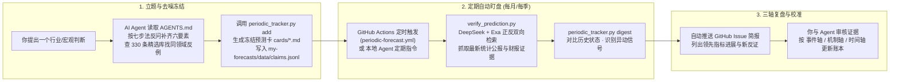

# Fork 实战指南：用 AI Agent + GitHub Actions 打造你的“定期预测实验室”

阅读完 132 部著作的复盘后，最有价值的一步是**把这套方法变成你自己的长期决策外脑**——无论是做宏观与行业研究、科技投资判断、产品路线规划，还是政策与趋势跟踪。

本仓库已经为你内置了一套开箱即用的 **个人定期预测系统**（[`my-forecasts/`](../my-forecasts/) + [`toolkit/periodic_tracker.py`](../toolkit/periodic_tracker.py) + [`.github/workflows/periodic-forecast.yml`](../.github/workflows/periodic-forecast.yml) + [`AGENTS.md`](../AGENTS.md)）。你只需 **Fork** 一次，即可跑通 **“人类立题 → Agent 拆解立卡 → GitHub Actions 定时联网巡检 → 三轴贝叶斯复盘”** 的完整闭环！

---

## 一、人机协同定期预测闭环全景图



---

## 二、三分钟极速搭建步骤

### 第 1 步：Fork 本仓库并克隆到本地

点击右上角 **Fork** 按钮创建你自己的仓库副本（私有或公开均可），然后克隆到本地：

```bash
git clone https://github.com/<你的用户名>/forecast-lab.git
cd forecast-lab
```

仓库中的 [`my-forecasts/`](../my-forecasts/) 目录已经预置了 3 条高质量的 2026–2030 前瞻预测样板（美国数据中心电力占比、世界 500 强 AI Agent 付费留存与就业影响、全球电网储能无镍钴占比），你可以保留它们作为参照，也可以清空重建自己的专属账本。

---

### 第 2 步：和你的 AI Agent 一起写下第一张预测卡

用 **Claude Code / Antigravity / Cursor / Codex** 打开仓库目录（仓库根目录自带 [`AGENTS.md`](../AGENTS.md) 与 [`.agents/skills/forecast-tracker/SKILL.md`](../.agents/skills/forecast-tracker/SKILL.md)，Agent 会自动加载全套规则），直接用自然语言对 Agent 说：

> 💬 **可直接复制给 Agent 的立卡指令：**
> “我想做一个未来三年的预测：【在这里写下你的直觉判断，例如：未来三年人形机器人在汽车工厂会大规模落地】。请先帮我查阅仓库里的七步预测法和同领域大师翻车案例，帮我把这个想法收敛成一条包含明确指标、分母、数据源、主透镜、反校验透镜、领先观测指标和证伪条件的规范预测，确认后调用 `toolkit/periodic_tracker.py` 登记到 `my-forecasts` 并运行 `check` 校验。”

你也可以直接用命令行一键登记：

```bash
python3 toolkit/periodic_tracker.py --case my-forecasts add \
  --id "2026-humanoid-auto-factory" \
  --domain "具身智能与制造业" \
  --statement "到2029年底，全球前十大汽车整车厂在正式量产线累计部署并常态化运行的双足人形机器人总数不超过20,000台。" \
  --horizon "2026–2029" \
  --scope "以前十大车企年报或官方披露的量产车间在岗台数为准，不含试点演示视频、展会样机或轮式/机械臂传统AGV。" \
  --method "约束账本法 + 技术功能扩散链法" \
  --counter-lens "检查灵巧手降本超预期或政策补贴采购带来的局部放量" \
  --indicators "车企披露的真实单工位节拍达标率、人形整机BOM成本、工业灵巧手平均无故障工作时间(MTBF)" \
  --falsification "2029年底前十大车企正式量产线常态化在岗双足人形机器人合计超过20,000台"
```

登记后，系统会自动为你生成：
- 人类易读的冻结预测卡：`my-forecasts/cards/2026-humanoid-auto-factory.md`
- 机器可审计结构化条目：`my-forecasts/data/claims.jsonl`
- 实时统计报告：`my-forecasts/output/report.md`

---

### 第 3 步：开启“自动定期预测复盘”（两种方式任选）

#### 方式一：GitHub Actions 云端零运维定时巡检（推荐）

仓库内置了 [`.github/workflows/periodic-forecast.yml`](../.github/workflows/periodic-forecast.yml)，默认**每月 1 日早上 09:00（北京时间）**自动运行，也支持随时在网页端一键手动触发：

1. 进入你 Fork 后的仓库 **Settings → Secrets and variables → Actions → New repository secret**，添加两个密钥：
   - `BOOKPRED_DEEPSEEK_API_KEY`：你的 DeepSeek API 密钥（每次巡检几条个人预测通常仅需几分钱人民币）；
   - `EXA_API_KEY`：你的 [Exa Search](https://exa.ai/) API 密钥（用于高精度抓取统计报告与网页正文）。
   *(注：如果你暂时没配密钥，工作流也不会报错，而是自动退化为生成离线账本健康简报。)*
2. 打开仓库顶部的 **Actions → Periodic Forecast Tracker → Run workflow**，点击绿色按钮试跑一次！
3. 运行完成后：
   - 工作流会自动推进观察截止日，对每条预测并发执行**支持证据 + 反证**双向检索与独立语义复核；
   - 自动在仓库 **Issues** 里为你创建一篇 **《📊 定期预测追踪复盘简报》**（包含本期联网建议、是否存在状态异动 `Signal Shifts`、最新捕获的外部链接与待补缺口），直接推送到你的邮箱！

#### 方式二：本地用 AI Agent 交互式定期巡检（无需外部 API Key 也能跑！）

即使你不配置 DeepSeek / Exa 密钥，只要你的本地 Agent（如 Antigravity、Claude Code、Cursor）具备网页搜索能力，你随时可以在月末/季末对它说：

> 💬 **可直接复制给本地 Agent 的定期复盘指令：**
> “请按 `AGENTS.md` 中的定期复盘协议，帮我对 `my-forecasts/` 里的所有在册预测做一次本季度的贝叶斯追踪：逐条搜索最新的正反公开权威数据（关注每张卡片里的领先观测指标），把核实过的来源存档进 `my-forecasts/data/sources/` 并校验 SHA-256，最后按事件轴、机制轴、时间轴向我汇报哪些预测出现了方向验证或反证信号。”

---

### 第 4 步：自定义巡检周期（周度 / 季度）

只需修改 [`.github/workflows/periodic-forecast.yml`](../.github/workflows/periodic-forecast.yml) 第 6 行的 `cron` 表达式：
- **每周一早上 09:00（北京时间）**：`cron: '0 1 * * 1'`
- **每月 1 号早上 09:00（北京时间，默认）**：`cron: '0 1 1 * *'`
- **每季度首日（1/4/7/10 月 1 号）**：`cron: '0 1 1 1,4,7,10 *'`

你甚至可以按主题建立多个独立账本目录（如 `my-forecasts-macro/`、`my-forecasts-ai/`），在手动触发或定时任务中传入不同的 `ledger` 名称分别追踪！
