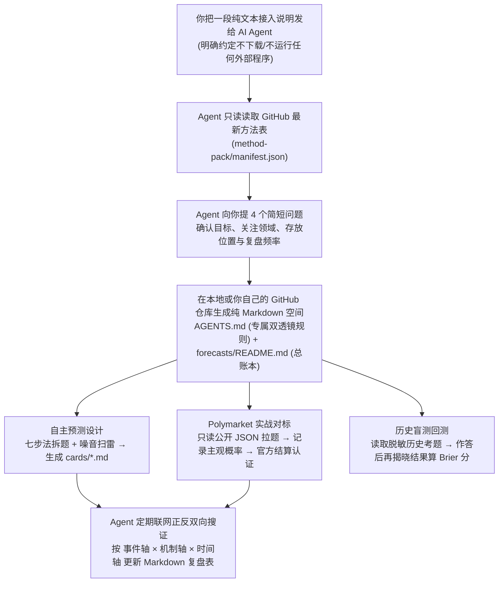

# 零代码 Agent 接入、自动事实核查与 Polymarket 练习/回测指南

> **为什么我们采用“零代码纯文本协议”？**
> 让用户从网上下载未知的 `.sh` 或 `.py` 脚本在本地运行，既繁琐又容易引发木马与供应链安全顾虑。
> 实际上，现代 AI Agent 本身已经具备**阅读网页/JSON、联网搜索权威数据、概率计算与读写 Markdown 文件**的全部能力。因此，我们将整套预测系统收敛为 **100% 肉眼可审的公开 Markdown 协议（[`AGENT_SETUP.md`](../AGENT_SETUP.md)）+ 纯数据方法表（[`method-pack/manifest.json`](../method-pack/manifest.json)）**——**全程零程序下载、零依赖安装、零私钥授权**。

---

## 一、整体工作流程



---

## 二、一步接入：复制这段话发给你的 AI Agent

打开你平时最信任的工具——无论是本地编码助手（**Claude Code、Antigravity、Cursor、Codex**），还是网页端/企业智能体（**Claude Projects、ChatGPT、Dify、Coze**），直接发送以下内容：

```text
请只读阅读 https://raw.githubusercontent.com/nebulonvc/forecast-lab/main/AGENT_SETUP.md 与方法表 https://raw.githubusercontent.com/nebulonvc/forecast-lab/main/method-pack/manifest.json ，帮我以“零代码、纯 Markdown”方式接入《信号与噪音》预测系统（全程不要下载或运行任何外部脚本程序）：
1. 先通过对话向我问 4 个简短问题，确定我的预测目标、关注领域、存放位置（本地目录、我的 GitHub 仓库或自有 Agent 系统）与复盘频率；
2. 根据我的回答，从 manifest.json 提取对应领域的历史基准胜率、主推理透镜、反校验透镜与一手数据源，在当前目录创建纯文本规则 `AGENTS.md` 与预测总账本 `forecasts/README.md`；
3. 后续每次做预测或复盘前重新只读读取一次最新 `manifest.json` 以保持方法同步，并协助我完成：七步法去噪立卡、联网正反双向事实核查、只读访问 Polymarket 公开接口拉题与结算认证，或开展历史时间截点盲测回测。
```

### 安全性一目了然（你可以随时检查这 3 个公开只读链接）
- **智能体规则说明书**：[`AGENT_SETUP.md`](../AGENT_SETUP.md)（纯中文 Markdown 文档）
- **动态演进方法与基准率表**：[`method-pack/manifest.json`](../method-pack/manifest.json)（纯 JSON 数据表，包含七大领域胜率、双透镜与噪音检查项）
- **历史盲测校准题库**：[`method-pack/curated_backtest_questions.json`](../method-pack/curated_backtest_questions.json)（纯 JSON 历史已结算考题）

---

## 三、接入后如何用自然语言驱动四大核心场景？

完成 4 个初始化问答后，你的目录里就有了专属的 `AGENTS.md` 和 `forecasts/README.md`。之后你只需要像平时聊天一样对 Agent 下达指令：

### 1. 设计并记录你自己的预测（自动调用最新 GitHub 方法去噪）

> **对 Agent 说：**
> “我想做一个判断：【未来三年人形机器人在汽车工厂很难大规模替代工人】。请先读取上游最新的 `manifest.json`，帮我按七步预测法把它收敛成包含明确分母、权威数据源、主透镜、反校验透镜、领先指标和证伪条件的规范预测卡，确认后写入 `forecasts/`。”

- **为什么预测方法更新后你无需重装任何东西？**
  因为生成在你目录里的 `AGENTS.md` 规定了：Agent 在每次立卡和复盘前都会只读拉取一次主仓库最新的 `method-pack/manifest.json`。当我们新增了领域基准率或升级了反例规则，你的 Agent 下一秒就能直接用上。

### 2. 让 Agent 自动做事实核查（正反双向权威搜证）

> **对 Agent 说：**
> “请帮我对 `forecasts/` 里所有未到期的预测做一次本月的事实核查：每条预测都必须同时搜索【支持证据】和【反面/延期证据】（优先查统计局、央行、IEA、财报等官方一手数据），把核实过的链接和日期追加到每张预测卡的三轴复盘表里，但不要改动第 1 节冻结原文。”

### 3. 接入 Polymarket 预测市场：拉题练习与官方结果认证（免登录、免密钥、免钱包）

Polymarket 提供完全公开的只读 HTTPS JSON 接口（`https://gamma-api.polymarket.com`），无需注册账号或连接加密钱包即可读取全球真金白银博弈的实时概率与官方 UMA 终局结算结果：

> **拉取实时题目练习（对 Agent 说）：**
> “去 Polymarket 公开只读接口帮我找 5 道宏观经济（`tag_slug=economy`）或 AI（`tag_slug=ai`）领域的高成交量二元预测题，告诉我交割标准，先别让我看市场概率，等我用双透镜给出我的主观概率后，再对比市场隐含概率记入账本。”

> **到期自动认证得分（对 Agent 说）：**
> “帮我核对账本里关联了 Polymarket 的预测题：未结算的更新最新市场概率漂移；已经官方结算的，按真实结果帮我算出 Brier Score 和我相对入场时市场赔率的超额优势（Market Edge）。”

- **评分公式透明可核算**：
  - **你的 Brier Score** \(= (P_{\text{user}} - Y)^2\)（\(Y \in \{0, 1\}\)，0 为完美命中，0.25 为抛硬币随机水平）；
  - **相对市场超额优势（Market Edge）** \(= (P_{\text{market}} - Y)^2 - (P_{\text{user}} - Y)^2\)（正值说明你的判断比真金白银交易的市场共识更准）。

### 4. 不用等未来到期：立刻做一次“历史时间截点盲测回测”

> **对 Agent 说：**
> “从 `curated_backtest_questions.json`（或 Polymarket 历史已结算题）里抽 3 道题考考我：每次只告诉我盲测截止日（`as_of`）和当时的背景，千万别剧透真实结局和当时的盘口概率；等我给出概率和双透镜理由后，再揭晓答案帮我算 Brier 分并复盘机制错因！”

*(你也可以反过来考你自己的 Agent：“在不搜索 `as_of` 之后任何信息的前提下，请你用七步双透镜法独立回答这几道盲测题，最后对照真实结果检验你的校准度。”)*

---

## 四、如何把这套能力放进你自己的GitHub仓库或自建Agent平台？

| 你的使用场景 | 最简、最可信的配置方式 |
| :--- | :--- |
| **本地文件夹 + Claude Code / Antigravity / Cursor** | 直接发送上文那段接入说明，自动生成纯文本 `AGENTS.md` + `forecasts/` 即可长期使用。 |
| **你自己的独立轻量 GitHub 仓库** | 将生成的 `AGENTS.md` 与 `forecasts/*.md` 直接 `git push` 到你自己的私有/公开仓库，在 GitHub 网页端即可直接审阅所有预测卡与校准表格。 |
| **自建智能体平台（Claude Projects / GPTs / Dify / Coze / LangGraph）** | 将 [`AGENT_SETUP.md`](../AGENT_SETUP.md) 设为智能体的 System Prompt，允许其只读访问 `manifest.json` 与 `gamma-api.polymarket.com` 两个公开 URL，无需部署任何后端服务。 |
| **需要字节级 SHA-256 存档校验与云端定时 Actions 的技术团队** | 直接点击 GitHub 右上角官方 **Fork** 按钮复刻本仓库（全仓库仅使用 Python 标准库，无任何第三方 `pip` 依赖，代码完全公开可审计），详见 [整仓 Fork 工作流指南](04-fork-and-agent-workflow.md)。 |
