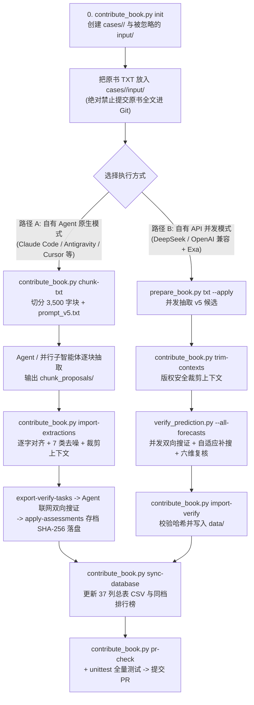

# 社区共建指南：用你自己的 Agent 或 API 拆解一本书并合入数据库

本指南面向希望将新书、机构报告或人物访谈拆解为可审计预测案例，并通过 Pull Request 合入 **Forecast Lab** 实证数据库的研究者与开发者。

无论你选择 **路径 A（用你自己的 AI Agent 原生跑书，零额外 API 费用）**，还是 **路径 B（用你自己的 DeepSeek / OpenAI 兼容 API + Exa API 并发跑书）**，最终产物都经过同一套 `v5` 抽取标准与六道确定性门禁检验，合入 [`datasets/all_cases_summary.csv`](../datasets/all_cases_summary.csv) 与 [同档基准排行榜](05-same-tier-ranking.md)。



---

## 一、给 Agent 的一段话（复制即用）

如果你使用 **Claude Code、Antigravity、Cursor、Codex CLI、Windsurf、OpenCode** 等编码智能体，Fork 并克隆仓库后，直接复制下面这段话发给它即可：

```text
请帮我按《信号与噪音》Forecast Lab 的 v5 标准协议拆解一本新书，并生成可直接提交 PR 合入主数据库的完整案例（先阅读 `.agents/skills/book-contributor/SKILL.md` 与 `docs/07-contribute-a-book.md`）：
1. 先向我确认 5 项元数据与运行方式：书名、作者、初版代理年份、所属七大标准领域之一、所属六类标准作者类型之一，以及原书 TXT 文件路径（我来把原书 TXT 放入被 `.gitignore` 忽略的 `cases/<slug>/input/` 目录，绝不提交进 Git）。同时问我是使用【路径一：由你（Agent 原生阅读与自带联网搜索）零 API 费用完成】，还是【路径二：调用我配置的 DeepSeek / OpenAI 兼容 API 与 Exa API 并发跑完】。
2. 初始化案例并切分原文：运行 `python3 toolkit/contribute_book.py init ...`，切块执行 v5 抽取（严守逐字 quote 对齐、7 类非预测剔除与指代消歧），并通过 `contribute_book.py trim-contexts` 裁剪 `context`，确保不泄露原书全文。
3. 严格执行正反双向一手事实核查：对每条可评分预测，必须成对检索支持证据与反面/瓶颈证据（优先统计局、央行、IEA/OECD/世行、学术与财报一手出处），将正文存档至 `cases/<slug>/data/sources/` 并登记真实 SHA-256 与截至日（<= cutoff），执行六维语义复核后按五类互斥结论落盘。
4. 合入总数据库并运行全部 PR 门禁：依次运行 `python3 toolkit/contribute_book.py sync-database --case cases/<slug>`、`python3 toolkit/contribute_book.py pr-check --case cases/<slug>` 与 `python3 -m unittest discover -s toolkit/tests -v`。
5. 全部门禁通过后，为我汇总本书的五类统计与同档超额表现，检查 `git status` 确认无原书全文或 API 密钥残留，并协助我创建分支、提交 Commit 与 Pull Request。
```

---

## 二、准备元数据与原书 TXT

> [!TIP]
> **还在挑选拆解书目？** 可直接查阅待拆解高价值书单 [`08-candidate-books-backlog.md`](08-candidate-books-backlog.md)（含 38 部大战略家实战著作与 20 部跨学科补缺经典，已预先校准防穿越底本年份 $t_0$、标准领域与推荐 `slug`）。

1. **合法标准领域（7 选 1）**：
   `地缘政治与国际秩序`、`宏观经济、金融与市场`、`科技、商业与产业颠覆`、`AI与奇点前沿`、`人口、能源、资源与生态`、`社会结构、制度、文化与教育`、`科幻推演与乌托邦/反乌托邦`
2. **合法标准作者类型（6 选 1）**：
   `国际机构与政府智库`、`政治家与战略实务者`、`地缘与社科政治学者`、`经济学家与金融投资人`、`科技商业思想家与产业实践者`、`古典思想家与科幻/乌托邦作家`
3. **初始化案例目录**：
   ```bash
   python3 toolkit/contribute_book.py init \
     --case cases/author-book-v5 \
     --book "书名" \
     --author "作者" \
     --publication-year 2010 \
     --domain "科技、商业与产业颠覆" \
     --author-type "科技商业思想家与产业实践者"
   ```
   将准备好的 UTF-8 TXT 原书放入 `cases/author-book-v5/input/book.txt`（如果是 PDF，可先用 `pdftotext -enc UTF-8 book.pdf cases/author-book-v5/input/book.txt` 转换）。`cases/*/input/` 已被 `.gitignore` 忽略。

---

## 三、路径 A：自有 Agent 原生模式（零额外 API 费用 + 并行防偷懒架构）

针对整书长文本（10 万～50 万字）在 Agent 处理中常见的三大痛点（**串行太慢、Context 膨胀爆炸、Agent 偷懒跳读或只处理前半部分就声称完成**），本仓库提供了基于 **分片磁盘交换 + 密码学阅读证明（Proof-of-Reading）+ 确定性状态机重派** 的并行架构，并附带 Antigravity 原生 `run_workflow` 脚本 [`toolkit/antigravity_book_workflow.py`](../toolkit/antigravity_book_workflow.py)：

1. **怎么并行（Wave-Batched Map-Reduce）**：
   - `chunk-txt --batch-size 4` 将全书切为 3,500 字 chunk 并按每 4 个 chunk 打包成独立分片 `output/txt_import/batches/batch-XXXX.jsonl`。
   - `export-verify-tasks --batch-size 3` 将待核验预测按每 3 条打包为 `output/verify_batches/vbatch-XXXX.jsonl`。
   - 编排脚本通过 `parallel(wave, worker_fn)` 并发启动多路无状态 Worker Agent 同时处理不同分片。
2. **怎么保证 Context 不爆炸（Disk-Swapped State & 200B Receipt）**：
   - 主编排器（Orchestrator）**绝不读取原书文本或任何 chunk 正文**，仅读取 `manifest.json` 的分片 ID 列表。
   - 每个 Worker Agent 拥有全新的独立上下文，只读取自己负责的 1 个小分片（约 1.2 万字），将结果直接落盘到 `chunk_proposals/<chunk_id>.json` 或 `verify_proposals/<batch_id>.jsonl`，并通过 `finish` 仅返回 `<200` 字节的计数回执。无论书有多厚，主会话与子会话 Context 始终恒定在安全水位。
3. **怎么保证绝不偷懒（Zero-Trust Proof-of-Reading & Dual-Evidence Gates）**：
   - **块尾锚点阅读证明（`body_sha256_12` + `tail_anchor`）**：Worker 为每个 chunk 提交 JSON 时（即使 `"predictions": []`），必须填入该块正文 SHA-256 前 12 位以及**从该 chunk `body` 后 45% 区域逐字复制的一段 `>=8` 字连续原文（`tail_anchor`）**。若 Worker 没读到块尾、只读了开头，或漏写了任何一个 chunk，`import-extractions --require-proof` 与 `audit-progress` 会直接识别并由工作流自动重派该分片。
   - **与 `verify_prediction.py` (`search-verifier-v3`) 100% 同构的多轮自适应搜证与独立六维复核**：
     - **多轮自适应变策补搜（`--require-adaptive-rounds`）**：初轮（`kind="initial"`）必须先锁定 `research_scope` 并成对执行 `support` + `counter` 检索；若初轮后结论仍为 `"暂无法判断"`（且不是终点在未来的 `basis="future"`），**严禁单轮直接交卷**！必须针对点名的决定性缺口（`gap_before`）执行至少 2 轮（最多 3 轮）`kind="adaptive"` 变策补搜（每轮声明全新的 `strategy_change`——如切换中英文、改查统计局/IEA/OECD/行业协会代理指标、调整时间窗，并使用不重复的检索词），完整记录在 `round_history` 中。
     - **证据原句逐字对齐（`evidence_notes`）**：每条被引用的 `evidence_id` 必须在 `evidence_notes` 中提供 `relation`（`support`/`counter`/`boundary`/`background`）与 `quote`（由 `semantic_review.align_quote` 机械校验必须逐字存在于归档证据正文中）。
     - **独立六维语义复核（`--require-semantic-review`）**：每个核验分片由独立的 Reviewer Agent（不重新搜证）对 `object_match`、`condition_logic`、`time_alignment`、`evidence_support`、`counterevidence`、`verdict_logic` 六项逐一打标（`pass`/`fail`/`unknown`），通过 `semantic_review.validate_review` 校验；若返回 `revise` 则触发 1 次修订与二次复核。
     - **双向证据硬门禁（`--require-dual-evidence`）**：每条已判定预测（正确/趋势符合/部分符合/错误）必须绑定 `>=2` 条独立公开来源且每条归档正文 `>=60` 字（成对覆盖支持证据与反面/瓶颈证据），单边搜证会被直接拦截。

### 方式 1：Antigravity 一键并行工作流（`run_workflow`）
在 Antigravity 中初始化案例后，直接让 Agent 调用 `run_workflow` 运行 [`toolkit/antigravity_book_workflow.py`](../toolkit/antigravity_book_workflow.py)：
```python
run_workflow(
    ScriptPath="/abs/path/to/toolkit/antigravity_book_workflow.py",
    Description="Parallel v5 book extraction and dual-evidence verification",
    Args={
        "case": "cases/author-book-v5",
        "txt": "cases/author-book-v5/input/book.txt",
        "chunk_batch_size": 4,
        "verify_batch_size": 3,
        "max_wave_concurrency": 6,
        "max_retries": 3,
    },
)
```

### 方式 2：分步 CLI 驱动并行子智能体

#### Step A1：确定性滑窗切块与分片
```bash
python3 toolkit/contribute_book.py chunk-txt \
  --case cases/author-book-v5 \
  --txt cases/author-book-v5/input/book.txt \
  --batch-size 4
```
程序会在 `cases/author-book-v5/output/txt_import/` 生成：
- `chunks.jsonl` 与 `batches/batch-XXXX.jsonl`：已跳过序言/致谢/后记的 3,500 字正文切片（含 `body_sha256_12` 与前后 600 字消歧上下文）；
- `prompt_v5.txt`：`DISCOVER_PROMPT_V5` 完整抽取规范；
- `chunk_proposals/`：供并行子智能体按 `<chunk_id>.json` 写入抽取结果。

#### Step A2：并行子智能体逐块抽取、阅读证明校验并导入对齐
每个并行子智能体读取分配给它的 `batches/batch-XXXX.jsonl`，为**每个** `chunk_id` 在 `chunk_proposals/<chunk_id>.json` 写出如下格式（无预测的 chunk 也必须显式保留 `"predictions": []` 及块尾 `tail_anchor` 以防漏读）：
```json
{
  "id": "txt-00001",
  "body_sha256_12": "a1b2c3d4e5f6",
  "tail_anchor": "从该chunk的body后45%末尾区域逐字摘录的连续原句",
  "predictions": [
    {
      "quote": "从 body 中逐字照抄的连续原文",
      "kind": "prediction",
      "claim_type": "forecast",
      "speaker": "作者名",
      "attribution": "author",
      "future_oriented": true,
      "claim": "一句中文概括",
      "changes": "会变化的对象与方向",
      "horizon": "原文显式写出的时间（无则空字符串）",
      "resolvable": true,
      "confidence": "medium",
      "expanded_claim": "补全代指与条件的独立陈述",
      "reference_resolutions": [],
      "unresolved_references": [],
      "time_text": "",
      "condition_text": "",
      "method": "原文体现的推理办法（无则 unknown）",
      "method_basis": "explicit",
      "reason": "为何属于出版后可核验预测的简短理由"
    }
  ]
}
```
运行零信任进度审计与确定性导入（强制核验每个块的阅读证明、逐字引文对齐、v5 7 类非预测筛除、去重与版权上下文裁剪）：
```bash
python3 toolkit/contribute_book.py audit-progress --case cases/author-book-v5
python3 toolkit/contribute_book.py import-extractions \
  --case cases/author-book-v5 \
  --txt cases/author-book-v5/input/book.txt \
  --proposals cases/author-book-v5/output/txt_import/chunk_proposals \
  --require-proof
```

#### Step A3：导出核验分片、联网双向搜证并落盘
```bash
python3 toolkit/contribute_book.py export-verify-tasks --case cases/author-book-v5 --batch-size 3
```
并行子智能体按 `output/verify_batches/vbatch-XXXX.jsonl` 领取任务，利用自带联网工具对每条预测**强制成对搜索支持证据与反面/瓶颈证据（每条已判定预测 >=2 条独立证据）**，分别准备：
- `evidence_raw.jsonl`（或 `output/evidence_proposals/*.jsonl`）：每条含 `{"id": "ev-001", "url": "https://...", "date": "2024-05-01", "coverage": "2010-2024", "excerpt": "关键原句", "limitation": "口径限制", "text": "抓取的公开页面正文（>=60字）"}`；
- `assessments.jsonl`（或 `output/verify_proposals/*.jsonl`）：按 `METHOD.md` 五类互斥结论与六维语义复核标准写出评估记录。

执行一键证据 SHA-256 归档、多轮自适应搜证记录校验、独立六维语义复核校验与原子落盘：
```bash
python3 toolkit/contribute_book.py apply-assessments \
  --case cases/author-book-v5 \
  --assessments cases/author-book-v5/output/verify_proposals \
  --evidence-raw cases/author-book-v5/output/evidence_proposals \
  --semantic-reviews cases/author-book-v5/output/semantic_reviews \
  --require-dual-evidence \
  --require-adaptive-rounds \
  --require-semantic-review
```

---

## 四、路径 B：自有 API 并发模式（DeepSeek / OpenAI 兼容 + Exa）

如果你配置了自己的 API Key（支持 DeepSeek 官方及任何 OpenAI 兼容接口，如 OpenAI、OpenRouter、通义千问、SiliconFlow 等）：

```bash
# 方式 1：使用 DeepSeek 官方 API
export BOOKPRED_DEEPSEEK_API_KEY="你的 DeepSeek Key"
export EXA_API_KEY="你的 Exa Key"

# 方式 2：使用任意 OpenAI 兼容 API（如 OpenAI / OpenRouter / Qwen）
export BOOKPRED_LLM_BASE_URL="https://api.openai.com/v1"
export BOOKPRED_LLM_API_KEY="你的 API Key"
export EXA_API_KEY="你的 Exa Key"
```

依次运行四条命令即可全自动完成整书拆解、版权裁剪、联网双向核查与结果固化：
```bash
# 1. 并发抽取全书 v5 候选（若用第三方模型可传 --model gpt-4.1-mini 等）
python3 toolkit/prepare_book.py --case cases/author-book-v5 txt cases/author-book-v5/input/book.txt --apply --workers 12 --budget-cny 15

# 2. 版权安全裁剪上下文（严防 claims.jsonl 拼接原书全文）
python3 toolkit/contribute_book.py trim-contexts --case cases/author-book-v5

# 3. 并发联网双向搜证、自适应补搜与六维独立语义复核
python3 toolkit/verify_prediction.py --case cases/author-book-v5 --all-forecasts --workers 8 --budget-cny 20 --exa-budget-usd 10

# 4. 校验存档哈希并正式写入 data/claims.jsonl 与 data/evidence.jsonl
python3 toolkit/contribute_book.py import-verify --case cases/author-book-v5
```

---

## 五、合入总数据库、PR 自检与提交流程

完成路径 A 或路径 B 后，执行最终合入与验收：

```bash
# 1. 更新 datasets/all_cases_summary.csv、datasets/same_tier_ranking.csv 与 docs/05-same-tier-ranking.md
python3 toolkit/contribute_book.py sync-database --case cases/author-book-v5

# 2. 运行 PR 准入五重门禁（元数据、哈希校验、版权长度拦截、密钥扫描、数据库一致）
python3 toolkit/contribute_book.py pr-check --case cases/author-book-v5

# 3. 运行仓库全部单元测试
python3 -m unittest discover -s toolkit/tests -v
```

确认 `git status` 中不包含 `input/`、原书 `.txt`/`.pdf` 或密钥文件后，提交分支并发起 Pull Request！GitHub Actions 会自动运行 `check.yml` 复核全部测试、证据哈希、数据库同步与社区贡献审计。
