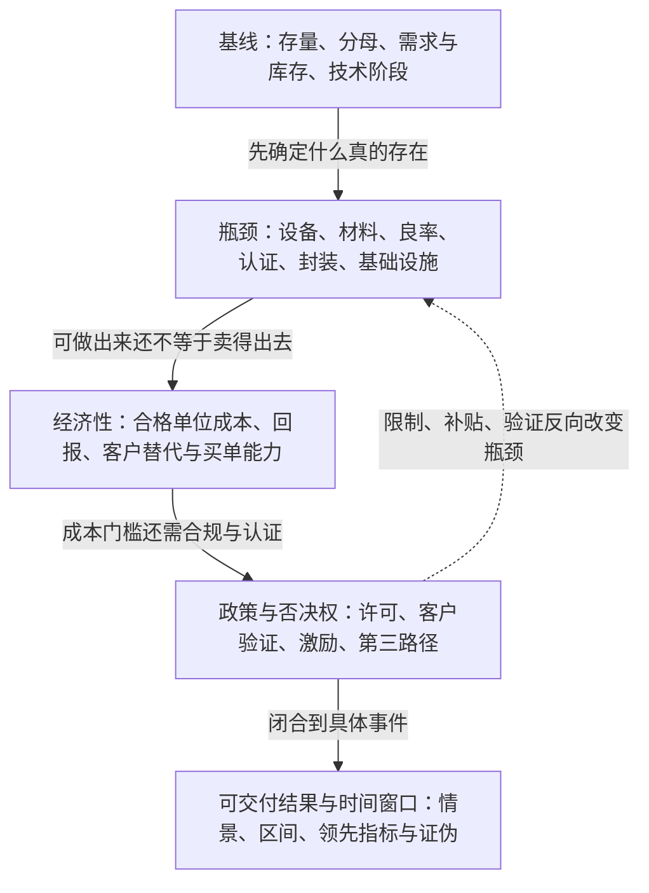

# 半导体预测框架：Forecast Lab 主方法与多视角证据系统

版本 v1.2。初始编制日期：2026-11-25，Asia/Shanghai（UTC+8）；基线同步日期：2026-11-27，Asia/Shanghai（UTC+8）。v1.0 是已交付研究报告的完整 Markdown 转写；v1.1 于 2026-11-25 增补 [第 2.12 节](#audit)：任何预测都不得绕过本框架，框架中的每一步都要实际执行，并在预测报告里留下可复核的自检矩阵；v1.2 于 2026-11-27 将仓库引用基线从早期 `dd8c271`（132 部作品、8,130 条预测，彼时 PR #12 尚未合并）同步对齐至当前 `main` 提交 `b19d694c`（146 部作品、10,745 条预测、7,522 条已判定；[PR #12](https://github.com/nebulonvc/forecast-lab/pull/12) 与 [PR #14](https://github.com/nebulonvc/forecast-lab/pull/14) 均已通过全部 CI 并合入 `main`）。增补只写在文档里，不改 `toolkit/`，不改既有评分、排名或数据库。本文可单独阅读，不依赖原 Page 登录。

研究对象是“怎样做半导体预测”，不是任何公司的投资建议，不是任何新事件的预测，也不是自动监控任务。本版没有具体命题、统计口径和期限，因此不发布事件概率，不以 50%、专家平均意见或历史胜率代填。后续修改应保留版本差异和证据截止日。

> [!IMPORTANT]
> **本版结论。** 采用“Forecast Lab 六步主流程 + 半导体约束账本 + 按题选择的多视角反校验”。第三部分给出的是有证据边界的条件性推理，不冒充各人的新预测。创建本文不构成同意把任何具体预测登记、冻结或自动追踪。用户确认入库在 [自检矩阵](#audit-this) 中的状态是 **待确认**，不是已执行。

## 阅读导航

- [版本、标签与仓库方法的关系](#meta)
- [一、结论与预测概率：怎样形成、怎样交付、何时不赋值](#part1)
  - [1.1 本版采用的框架与规则出处](#conclusion)
  - [1.2 先把事件定义到可以结算](#definition)
  - [1.3 四类数字与概率纪律](#probability)
  - [1.4 情景、依赖、基准率与更新](#scenarios)
  - [1.5 《芯片战争》入库记录（PR #12）：一次评分口径校验，而非能力背书](#pr12)
  - [1.6 第一部分的交付门槛](#gate1)
- [二、整体分析方法：从原文到可复盘预测](#part2)
  - [2.1 六步主流程与真实工具入口](#sixsteps)
  - [2.2 四层摩擦与同构检验](#friction)
  - [2.3 六套主方法与四步推导](#methods)
  - [2.4 基线—瓶颈—经济性—政策因果链](#causal)
  - [2.5 存量、建设管线与合格交付上限](#capacity)
  - [2.6 七个子行业的计量、瓶颈与误判](#segments)
  - [2.7 周期、系统计量与否决权](#cycle)
  - [2.8 实时三瓶颈、红队与敏感性](#bottlenecks)
  - [2.9 证据账本、版本与冲突](#evidence)
  - [2.10 领先指标、证伪与前瞻校准](#evaluation)
  - [2.11 第二部分的一次预测验收流程](#gate2)
  - [2.12 强制逐步执行、资料详查与报告自检矩阵](#audit)
- [三、多视角系统：来源、贡献、盲点与条件推演](#part3)
  - [3.1 先分清原始观点、抽象视角与条件推演](#distinction)
  - [3.2 各视角证据矩阵](#matrix)
  - [3.3 按人物与机构展开条件性推理](#lenses)
  - [3.4 怎样让不同观点修正同一个预测](#combine)
  - [3.5 专家历史记录的公平核验与缺口](#trackrecord)
  - [3.6 完整工作流与紧凑报告规范](#finalspec)
  - [3.7 本版来源、核验范围与未验证项](#sources)
- [来源账本](#ledger)

<a id="meta"></a>

## 版本、标签与仓库方法的关系

正文用两种标签区分责任，避免把本次产业规程写成引擎内置协议，也避免把引擎规则改写成另一套方法：

| 标签 | 含义 |
| :--- | :--- |
| **【仓库规则】** | 当前 `main` 提交 `b19d694c9fb5216c087fc438b53ae9fed927f37d`（2026-11-27，Asia/Shanghai；初始编制时核对自 `dd8c2718eea5de22d38dba1a4a8add50907d067e`）里已经发布的方法、判定、工具契约与图谱。本文只引用，不改实现。 |
| **【本次补充】** | 为了把上述方法用到半导体题目上而写的通用分析规程：事件概率纪律、依赖图、七子行业操作卡、公共因果骨架、专家记录抽样、来源去重，以及第 2.12 节的逐步执行与报告自检。除明确标成仓库规则的句子外，这些规程不是引擎内置代码。自检规程约束的是以后每一份预测报告必须怎样留下执行记录，不改变优化器的计算公式。 |

与现行文档的对应关系：

- 五类判定、显式期限与隐含窗口：[《信号与噪音方法论》](01-methodology-signal-and-noise.md)、[`toolkit/METHOD.md`](../toolkit/METHOD.md)
- 七步预测与同档阅读：[《数据导读与实战预测指南》](03-data-and-forecasting-guide.md)
- 六套主方法、超学习器、同构扩散与三轴更新：[《数据驱动的预测方法优化》](06-forecast-method-optimization.md)、[优化器技能](../.agents/skills/forecast-optimizer/SKILL.md)
- 四层摩擦包络与 12 次浪潮：[历史技术扩散图谱](../datasets/historical_tech_diffusion_atlas.json)
- 146 部作品同档榜：[同档基准排行榜](05-same-tier-ranking.md)

当前 `main`（`b19d694c`）引擎文档描述的训练库已扩充为 **146 部作品、10,745 条预测，其中 7,522 条已判定**（初始 2026-11-25 转写时核对的 `dd8c271` 基线为 132 部作品、8,130 条预测、5,060 条已判定）。这些是仓库主干对应提交的说明，不是本文自身重新训练或独立复跑交叉验证的结果。本文没有运行 `optimize`、`tech-analog`、`reference-class`、`update` 或 `train`，没有修改 `toolkit/`，没有改案例账本、既有评分、排名或数据库，也没有登记新预测。因此下文不出现针对具体半导体命题的优化前后对比数字，也不自称可操作化达到 `6/6`。

来源研究环境自称默认走 CLI，解释器为 Python 3.13.5，优化器零第三方依赖，且未挂载系统或会话级 Forecast Lab MCP。仓库文档写的支持范围是 Python 3.11+ 标准库。3.13.5 只是来源环境的解释器版本，不是本仓库改过的唯一运行时。来源还读过两份不在本仓库公开树中的本地初始化笔记，并声明不编造它们的 GitHub 链接。本文不粘贴本机路径。四层年数以仓库图谱为准，不以那两份本地笔记为准。

来源环境的技能目录按名称没有装到 `forecast-optimizer`，所以改为通读仓库内技能正文。本仓库有该技能文件。那条记录只说明来源环境的装载状态。

<a id="part1"></a>

## 一、结论与预测概率：怎样形成、怎样交付、何时不赋值

<a id="conclusion"></a>

### 1.1 本版采用的框架与规则出处

| 层次 | 采用什么 | 不做什么 |
| :--- | :--- | :--- |
| 主方法 | Forecast Lab：原文诊断、历史同构、实时瓶颈、四步推导、二次校验、确认后冻结 | 不先凭语感改写命题，再找引擎背书 |
| 产业落地 | 七子行业分拆；存量、流量、良率、成本与认证账本 | 不把节点名称、投资宣布、实验室演示当成有效供应 |
| 观点输入 | 按本题机制选择人物及机构，逐条回查原始来源 | 不按名气、国别、人数或未经审计的命中率赋权 |
| 概率交付 | 定义清楚的事件判断 + 推导 + 不确定性 + 更新与证伪条件 | 不把历史结构校准、渗透区间或情景名字当成事件概率 |

【仓库规则】主方法版本对齐当前 `main`（`b19d694c`，自 `dd8c271` 以来六步流程不变）。正式预测仍走仓库六步：先对用户原文做 `optimize`，技术与产业题做同构压力测试，再核查本题自己的三项实时瓶颈，写出主方法与四步推导，二次校验后才在用户确认时冻结。见 [第 2.1 节](#sixsteps)。

【本次补充】事件概率和情景的建模纪律、来源依赖图、专家记录抽样规程、七子行业操作卡，以及“基线—瓶颈—经济性—政策”公共因果骨架，是为执行仓库方法而增补的通用分析规程。

【实施边界】来源研究没有运行 `optimize` 或 `tech-analog`，没有训练、改代码、写预测账本、创建监控或联系他人。本文同样没有。它是研究规程，不是已经冻结的预测承诺。只有用户以后明确确认某条具体预测，才另行冻结入库。

<a id="definition"></a>

### 1.2 先把事件定义到可以结算

| 字段 | 必须明确的内容 |
| :--- | :--- |
| 主体与对象 | 哪个公司、地区或供应链环节；预测的是技术能力、有效供应、出货、营收、价格还是采用率。控制权、生产地、总部地不可混用。 |
| 量词与阈值 | 超过、至少、累计、持续、首次达成或平均水平。达到一次，和连续多个期间达到，是不同事件。 |
| 可测指标与分母 | 份额必须锁定全球或地区、市场类别、产品代际、用途、单位和统计方法。分子分母须同口径。 |
| Flow / Stock | 当年新增、季度投片、当年出货是流量。已安装设备、在运营合格产能、累计保有量是存量。两者不能互相代替。 |
| 唯一结算源 | 事前选定能覆盖该指标的权威数据源、具体表或字段、发布周期和修订处理办法。研究可用多源，最终裁定规则必须唯一。 |
| 期限 | 基期、目标截止日、观察频率、数据发布滞后与结算日。显式原期限不能悄悄延后。 |
| 边界与条件 | 是否含 IDM 自用、OSAT、先进封装、转售、服务、库存、海外子公司。条件事件必须给出外生前提及其触发标准。 |

若没有覆盖全球且口径一致的唯一权威源，应直接标明“不可严格结算：缺的是覆盖、定义或唯一性”，保留为条件性研究判断。不能拿某公司的指引、某平台份额或几个渠道样本替代全球分母。可以另提一个可测代理指标，但必须另立事件，并经用户确认，不偷换原命题。

【仓库规则】一般命题要严查“出现 ≠ 普及 ≠ 主导 ≠ 取代”。【本次补充】半导体链路上还要插入认证和量产：“出现 ≠ 通过认证 ≠ 规模量产 ≠ 普及 ≠ 主导 ≠ 取代”。对同一句里并列的多个目标拆卡，避免一个分项成立掩盖另一个落空。统计口径的改变属于事件定义的版本变化，不只是证据更新。

<a id="probability"></a>

### 1.3 四类数字与概率纪律

| 数字类别 | 定义与用途 | 不得混同 |
| :--- | :--- | :--- |
| 事件概率 | 在指定信息截止与条件下，对事先定义事件最终成立的主观判断 | 不是引擎历史胜率，也不是专家支持人数占比 |
| 历史结构校准 | 结构相似的历史命题在可判定条件下，正确、趋势符合、部分符合、错误的结局分布 | 不是新事件的发生概率，也不是“改用某方法就造成准确率提升”的因果证据 |
| 证据置信度 | 对本次输入的可靠性、覆盖度、口径一致性、可追溯性与时效的评价 | 证据可信不等于事件大概率发生；高质量反证也可以很可信 |
| 情景权重 | 在互斥且穷尽的一组情景中分配的主观质量；或明确标为无概率的压力测试 | 不能把任意列举的情景各赋权后宣称穷尽；官方 Base Case 也不是官方概率 |

【本次补充】只有事件定义、证据覆盖与推导链足以支持时，正式报告才给“主观概率点值 + 合理不确定区间”。区间反映可辩护的模型、参数和证据解释变化，不伪装为抽样统计置信区间，并须写明区间怎样产生。不能从两位专家的分歧随手拿最小、最大值做区间。

先固定一套判断规则与信息截止，再做敏感性：变更可解释的良率、利用率、工期、成本或政策分支，观察结论是否跨过阈值。如果主要不确定性属于不可量化的外生冲击，只能说明方向和条件，不能用小数点掩饰未知。报告精度与证据分辨率匹配，不机械输出小数概率。

当前没有命题，所以没有事件概率的点值、区间或示例数字。下面四条是拒绝精确赋值的规则，不是一张待填的空概率表：

1. **拒绝精确赋值的情形：** 没有事件或期限；分母无法定义；唯一结算源缺失；关键事实依赖匿名传闻；主要必要条件未知且无可辩护先验；参考类完全不匹配；相互冲突的数据无法消解。
2. **拒绝赋值不是空表：** 改交当前能成立的机制结论、哪些约束可以核算、哪些情景边界不可跨越、哪一类新事实会改变判断，以及还不能量化的原因。
3. **不以 50% 表示“不知道”，不以 0% 或 100% 表示强烈语气。** 没有定义的新事件，本版不填任何概率。
4. 若用户希望保留不可严格结算的研究判断，可在明确条件下讨论主观信念，但不得混入可自动判对错的正式前瞻成绩。

<a id="scenarios"></a>

### 1.4 情景、依赖、基准率与更新

【本次补充】先按真正影响结果的外生变量构建情景，例如政策许可、客户认证或关键设施就绪。情景须互斥、穷尽。若有未覆盖路径，明确并入剩余情景，而不是让权重和不足一。压力测试情景可以不赋概率，但须标明“非概率情景”。在已经赋权、并且权重合计为一的时候，事件概率才可以写成条件分解：

$$P(E) = \sum_i P(S_i)\cdot P(E\mid S_i), \qquad \sum_i P(S_i) = 1$$

本报告没有一组情景，因此不计算这个和。

必要条件有依赖，不能把“设备到货、认证、良率、规模出货”当作独立事件连乘。共同受同一许可或客户决定支配的条件应进入同一分支。先画依赖图，使用条件概率：

$$P(A\cap B\cap C) = P(A)\cdot P(B\mid A)\cdot P(C\mid A\cap B)$$

无法识别依赖时，给边界和敏感性，而不是编一个精确联合概率。本文不给 \(A\)、\(B\)、\(C\) 的数值。

基准率优先寻找同环节、同技术阶段、同分母、相近期限和相同结算难度的历史群体，同时列成功与失败样本，并说明筛选规则。【仓库规则】引擎的 `reference-class` 只提供结构性参考类，不自动给出当前事件的先验。找不到适当基准率，就报告“未找到可比基准率”、已搜索范围和不可比原因。如仍给主观先验，必须列推导与宽敏感性，不能借全库平均率冒充产业基准。

【仓库规则】新增证据按事件轴、机制轴、时间轴分别更新，成对检索支持与反面证据。工具 `bayesian_update` 支持阻尼对数赔率更新，更新对象是已判定四类分布（正确、趋势符合、部分符合、错误），不是把一个尚未定义的半导体事件自动变成二元概率。没有命题、没有证据条目时，不调用该工具，也不摘抄一组“半导体后验”。

【本次补充】先判断证据究竟新增了什么，检查它在旧模型中是否已被预期、是否只是旧闻重发，再决定更新幅度。若未来要对某个已定义事件的主观概率做人工记录，形式可以是：

$$\operatorname{logit}(p_{\text{新}}) = \operatorname{logit}(p_{\text{旧}}) + \sum_j \lambda_j \cdot \log(\mathrm{LR}_j)$$

这是记录纪律，不授权凭空给似然比或固定阻尼系数，也不替换引擎内部的四类更新。每个似然比与阻尼系数都须有相应事件模型、可靠性与依赖判断依据。没有可辩护数值，就进行定性或情景更新，不假装跑出精确后验。相同原始数据的转述合并。部分重叠来源只使用新增部分。独立测量即使来自同国、同业或同政策圈，也可能带来新增信息，不能一刀切去重。重大定义变化要重建基线并保留旧版，不把定义变化包装成普通概率微调。

<a id="pr12"></a>

### 1.5 《芯片战争》入库记录（PR #12）：一次评分口径校验，而非能力背书

本节只校验一次评分口径。它不证明《芯片战争》或任何作者具备可迁移到新题目上的预测能力，即使案例已通过审查合入 `main`，回顾性评分也不能直接当作新题目的先验胜率。

来源初始核验窗口是 **2026-11-25 23:24–23:30（Asia/Shanghai）**（彼时 [PR #12](https://github.com/nebulonvc/forecast-lab/pull/12) 尚在过程提交 `9e1f23e`、141 部阶段）。**2026-11-27 基线同步复核**：[PR #12](https://github.com/nebulonvc/forecast-lab/pull/12) 已完成全部 14 部扩充书目拆解与单元测试修复，通过 GitHub Actions 检查并合并入 `main`（合并提交 `373681fd`），随后 [PR #14](https://github.com/nebulonvc/forecast-lab/pull/14)（提交 `b19d694c`）完成了 146 部全库模型与图表重算；其中 [`cases/miller-chip-war-v5`](../cases/miller-chip-war-v5/) 的底层预测条数、五类计数与证据哈希保持不变。

| 项目 | 核验结果（对齐当前 `main` 提交 `b19d694c`，保留初始核验轨迹） |
| :--- | :--- |
| 状态与版本 | [PR #12](https://github.com/nebulonvc/forecast-lab/pull/12) 已于 2026-11-27（UTC 时间 `2026-11-26T16:34:00Z`）通过 CI 并 Squash 合并入 `main`（`373681fd`）；当前 `main` 头提交为 `b19d694c`（初始核验时为未合并的过程提交 `9e1f23e`）。 |
| 库规模与排位 | 当前 `main` 为 **146 部作品同档榜**，Chris Miller《芯片战争》位于主榜第 3 名（综合超额 **+19.5** 个百分点；在早期 132 部 `dd8c271` 基线中尚未收录，在 PR #12 中途 141 部快照中曾为 +19.4）。 |
| 候选与预测 | 《芯片战争》58 条候选，排除 9 条非预测，纳入 49 条预测。没有重复条目计数。案例摘要与总表行均为 49 条预测、41 条可判定。本文没有重新审判这 49 条。 |
| 五类展示 | 正确 26；趋势符合 4；部分符合 11；错误 0；暂无法判断 8。可判定 \(= 49 - 8 = 41\)。 |
| 严格与方向 | 严格胜率 \(26/41 = 63.4\%\)（超额 +35.2pp）；方向命中 \((26+4)/41 = 73.2\%\)（超额 +17.7pp）；错误率 \(0/41 = 0\%\)（低错优势 +5.6pp）。分母不是 49，也不是 58。 |
| 未定与时限 | 8 条未定中 5 条条件未触发、3 条未来期限。证据截止为 2026-11-25，出版年代理 2022，同档标签 4–9 年。标签不表示每一条都有相同显式终点。 |
| 评分与证据 | 规则 `simple-v3-trend-four-class`。摘要列证据 161 条，哈希全部核验通过。四类底层 verdict 把趋势保留在部分符合中，`display_verdicts` 再将趋势单列，不能重复加总。 |
| CI 历史与现状 | 初始核验窗口记录过中途提交上的失败运行 [Actions run 45644526419](https://github.com/nebulonvc/forecast-lab/actions/runs/45644526419)（2026-11-25 23:23）；后续修复公网 URL 误报正则与补齐全部 14 书后，PR #12 与 PR #14 的 GitHub Actions `Check forecasts` 均已全绿通过并合入 `main`。这提醒任何时候都不能用本地口头自述替代实测 CI 状态。 |

时间口径：【仓库规则】[方法论](01-methodology-signal-and-noise.md) 将原文明确给出的年份、年代或时长按原期限核验。无日期但有变化方向的条目，使用“出版年至证据截止日”的隐含观察窗口。案例摘要对全部 58 条候选记录的 `horizon_sources` 计数为隐含窗口 42、显式 16。这是候选级计数，不是对 49 条预测重新统计的比例。本文不把这两个候选级数字误写成预测级分布。

原文核对的一个边界例：[`cases/miller-chip-war-v5/data/claims.jsonl`](../cases/miller-chip-war-v5/data/claims.jsonl) 首条包含“如果中国成功，那么中国将重塑全球经济，重新平衡军事力量。”这是带前提的方向性表述。不能把“如果”删掉，改述为无条件必然结局，也不能仅凭后来局部进展就自动结算长期结果。本次只校验记录、引用、计数与定义，没有重新裁判全书 49 条预测。

0 错误不等于全对：11 条部分符合、4 条趋势符合和 8 条未定仍须保留。【仓库规则】“正确”要求主要可检验结果在声明口径和窗口内已符合；“趋势符合”不算严格兑现；“部分符合”不折算半分；“错误”是方向相反或原期限明确落空。摘要明确说是回顾性父记录计数，不是独立预测准确率或前瞻能力证明。共享事件簇、选书偏好、近期未定样本，使作者排名不能直接变成本题概率。

其他统计也必须带版本，而且不能当成机构或个人对所有问题的统一能力权重：

- 李光耀《李光耀回忆录》（2000 年下卷，可判定 24，严格胜率 45.8%）在早期 132 部榜为主榜第 16（综合超额 +10.1pp），在 PR 中途 141 部快照为第 19，在当前 **146 部 [同档基准排行榜](05-same-tier-ranking.md)** 中随 `20–39年` 档新书（如盖茨《未来之路》740 条可判）加入而更新为主榜第 31（综合超额 +7.7pp）；《李光耀观天下》（2013，可判定 170）居主榜第 20（综合超额 +10.7pp）。名次与同档基准随样本库扩容而自然浮动，不是同一次排名里的两种能力。
- IEA《全球关键矿产展望2024》在当前 146 部榜的严格胜率为 66.7%（主榜第 22，综合超额 +10.7pp），分母为可判定 63。这不是 IEA 对半导体问题的统一权重。
- OECD《数字经济展望2024》在当前 146 部榜的方向命中为 100%，分母仅 15；严格胜率 60.0%（主榜第 5，综合超额 +18.0pp）；属 0–3 年档。短窗与小分母不能外推成该机构的整体准确率。

<a id="gate1"></a>

### 1.6 第一部分的交付门槛

1. **先验收事件，再讨论概率。** 主体、对象、阈值、分母、Flow/Stock、唯一结算源、期限、边界缺一项，就显式报告缺口。不得用代理悄悄补全。
2. **四类数字分栏交付。** 事件主观概率、历史结构校准、证据置信度、情景权重各自解释。无命题时交付赋值规程，而不是空概率或示例数字。
3. **数值必须能追溯。** 分母、样本筛选、依赖假设、来源截止、区间生成方式、拒绝精确赋值的条件，都要随结论一起出现。
4. **先交建议卡，后确认冻结。** 用户确认是另一个明确动作。撰写本报告不构成同意登记、冻结或自动追踪任何具体预测。该步在自检矩阵里只能标 **待确认**，不能标已执行。
5. **每一步都要有执行记录。** 正式预测不得绕过 [第 2.12 节](#audit)。只打勾、只写“已完成”或为了让检查通过而补造输出，都不算执行到位。

<a id="part2"></a>

## 二、整体分析方法：从原文到可复盘预测

<a id="sixsteps"></a>

### 2.1 六步主流程与真实工具入口

【仓库规则】一次真实预测按下面六步走。六步都要做，不能因题目看起来简单就抽掉诊断、同构、瓶颈、推导、二次校验或确认中的任何一步。【本次补充】做完还不够，报告必须按 [第 2.12 节](#audit) 记下每一步的命令或操作、证据与输出、状态、缺口和影响。本通用报告没有命题，所以不替用户跑第 1 步和第 5 步；这个限制写在自检矩阵里，不写成“已通过”。

1. **用户原文的基线诊断。** 保留原句，先 `optimize`。检查六要素、显式方法、无账本硬数字、无账本超越或取代的定时断言、阶段顺风线性外推、复合捆绑及速度透支等陷阱。不能先精修，再伪装成原文基线。
2. **技术与产业的历史同构压力测试。** 用 `tech-analog` 与技术差异审计检查四层摩擦、主类比与次类比、Flow/Stock、速度倍数和周转底线。人工纠正关键词误匹配。
3. **按本题核查三项实时瓶颈。** 只在做真实预测时执行。选真正主导本题的三个可查指标，核验行业基数。不机械搬用电网、机器人或概念验证留存的示例清单。
4. **显式主方法与四步推导。** 将基期存量、在建流量、否决权或成本门槛、实时瓶颈代入主方法。写出反校验透镜、结论边界和承诺硬度。
5. **规范稿二次校验与整卡交付。** 再 `optimize`，检查 `score_out_of_6` 是否达到 6、`explicit_method_disclosed` 是否为 true、陷阱是否清零。未达标如实说明。达标也不等于结论已经在现实中成立。
6. **用户确认后冻结与三轴复盘。** 只有用户明确确认具体承诺之后，才冻结定义、证据截止、方法、主观判断及证伪条件。确认前，这一步的状态是 **待确认**，不得运行登记或冻结。确认后的复盘分别记事件、机制、时间，不静默改写原承诺。未确认就没有复盘对象，不能提前建监控。

来源研究称，已用 `--help` 核对下列四个子命令在其环境中有入口，并且这些命令不是本版预测运行：

```bash
python3 toolkit/forecast_optimizer.py optimize --help
python3 toolkit/forecast_optimizer.py tech-analog --help
python3 toolkit/forecast_optimizer.py reference-class --help
python3 toolkit/forecast_optimizer.py update --help
```

本文转写没有重跑这四条帮助，也没有对任何命题调用它们，所以不贴任何优化器输出。未来任一实际调用前仍以当时帮助为准。若 MCP 已挂载，先读该工具的 schema，不能把 CLI 的短横线参数与 MCP 工具名混用。不要运行 `train`。不要为了接入去改共享仓库或擅自挂载连接器。

<a id="friction"></a>

### 2.2 四层摩擦与同构检验

【仓库规则】下表的年数是图谱 `four_layer_speed_laws.typical_5_to_50_years` 的层级包络，表示历史样本从约 5% 到约 50% 的典型跨度。它们不是半导体自然定律，也不是某一浪潮的点估计。命题跨层时拆成不同进度的子链，不能用一个扩散斜率通吃。

| 层级 | 历史 5%→50% 包络 | 半导体应用边界 |
| :--- | :--- | :--- |
| L1 · 纯比特 | 2–5 年 | 算法、零硬件复制可能较快。设计软件的使用不等于流片，更不等于合格晶圆产能。 |
| L2 · 终端替换 | 4.5–14.5 年 | 手机、PC、车辆等更新周期。新机渗透率不能冒充全部保有量。 |
| L3 · 企业工作流 | 7.5–16 年 | EDA 与设计流程采用、权限与客户组织迁移。试用快于核心流程替代，任务变化快于岗位存量变化。 |
| L4 · 重资产 / 监管 | 12–26 年 | 设备、材料、制造、HBM 与封装产线通常受交付、认证、折旧、基础设施与许可约束。以最慢短板限速。 |

[方法优化文档](06-forecast-method-optimization.md) 与仓库说明里的浪潮点估计，和上面的包络不是同一层数字。点估计包括：消费互联网与生成式对话端流量约 2.8 年、存量约 3.5 年，浏览器浪潮流量约 5.5 年；智能手机流量 4.8 年、存量 6.5 年，乘用电动车新车流量 6.5 年、保有量 14.5 年；公有云 7.5 / 9.5 年，跨国 ERP 9.0 / 11.5 年；工业机器人流量 14 年、存量 22 年，电网新增流量约 9 年、发电存量约 22 年，L4 自动驾驶与临床新药约 14–20 年。具体题目应核对图谱原项与所选类比，不能从包络或点估计里任选对结论最有利的年数。来源所述“方法文档的细分浪潮与四层概括略有差别”，指的就是这一层差别，不是两套互相否定的定律。

12 次浪潮包括消费互联网、智能手机、PC、电动车、公有云、ERP、工业电气化、机器人、电网、强监管技术和航空航天等。引擎的关键词与领域亲和匹配只提出候选类比，不能证明“同构”。必须逐项检查：分母是否相同，物理单位是否相同，替换是否受资产寿命限制，买单方是谁，认证或监管否决权是否相似，网络效应和资本成本是否可比。

【仓库规则】快于同构前辈约 2.2 倍，或击穿周转底线，属于高危速度透支。约 1.35–2.2 倍为需要催化证据的温和超速。引擎打印的 `1.0x–1.5x` 渗透区间，是相对于历史骨架的类比区间，不是发生概率。1–2 年的在手订单与已搬入机台，要优先用当前基数，不用技术浪潮的平均速度覆盖真实排产。

【本次补充】实时核查用来判断斜率更接近“慢于历史骨架”“贴着 1.0x 骨架”还是“靠近 1.5x 催化带”。来源用 `0.8x / 1.0x / 1.5x` 作这三档的示意。当前引擎代码计算并展示的是 1.0x 与 1.5x 两端，不把 0.8x 当作内置输出，也没有把任一倍数自动变换成事件概率。示意倍数不是实测份额。

没有可靠实测的当前份额时，不传 `--current-share`，并披露引擎缺省基期。当前实现是：未给出当前渗透率时 \(s_0 = 0.04\)；目标份额无法解析时 \(s_1 = 0.35\)；期限无法解析时有效年数取 5 年。三者都是占位假设，不是当前行业事实。本报告没有命题，因此不把 0.04、0.35 或 5 年套到任何半导体指标上。存量范围必须在技术同构调用中显式标明 Stock，不能依赖自动识别。

<a id="methods"></a>

### 2.3 六套主方法与四步推导

【仓库规则】六套主方法以 `toolkit/forecast_optimizer.py` 里的 `SIGNAL_METHODS` 为准。实际预测以 `explicit_method_specification` 为起点，复核后可以改选并解释原因。方法名不是论证。四步里要有本题真实账本与因果关系。下表左列是引擎步骤的压缩转述，右列是本次半导体规程里的对应问法。右列不替换左列。

| 主方法 | 引擎四步（仓库规则） | 半导体题目上要问清的对应物（本次补充） |
| :--- | :--- | :--- |
| 约束账本法 | ① 基期存量与统计分母；② 已锁定在建产能、CapEx 排期与物理交付时滞；③ 热力学、电网、财政偿付等硬瓶颈上限及买单方；④ 扣除高价诱发的替代供给或效率反弹后锁定区间 | 把“硬瓶颈”落到设备、材料、良率、合格产能和客户买单，而不是只写投资额 |
| 制度与激励结构法 | ① 预算、监管、人事否决者；② 在位者毛利、选票或 KPI；③ 合规阻挠或第三路径；④ 现行激励下可落地的变化 | 增加认证否决、产能配置、出口管制与验证反应，仍要指出谁承担代价 |
| 地缘底盘与权力均衡法 | ① 地理、海道、缓冲带与人口等慢变量；② 军事投送、制造与金融份额；③ 同盟安全困境与第三国转口弹性；④ 长期均势与短期外交波动分开 | 把制造、设备、材料与许可纳入力量对比，并把库存波动从长期能力里拆出 |
| 技术功能扩散链法 | ① 真实环境中的功能雏形；② 单位功能综合成本跨过替代门槛；③ 电力、通信、标准与合规配套；④ 组织采用摩擦。押功能渗透，不押政治终局 | 功能验证要落到产品或产线；配套写明设备、材料、封装、标准与客户验证 |
| 风险边界与反脆弱法 | ① 杠杆、期限错配、单点集中；② 顺周期收益私有化、尾部损失外部化；③ 流动性、展期或监管宽容能把出清推迟多久；④ 用脆弱性阈值和重定价方向代替精确崩盘日 | 半导体题里的推迟机制常表现为补贴、豁免与库存缓冲。这是领域实例，不删除引擎里的一般兜底步骤 |
| 多情景条件分支法 | ① 独立于结果的外生前提及其先验权重；② 分别推演条件结果；③ 每条分支绑定公开触发器；④ 事前固定证伪标准，不事后只挑有利分支 | 前提常是许可、认证或设施就绪。没有具体命题时不填任何分支概率 |

【仓库规则】反校验透镜针对主方法最容易漏掉的机制。引擎为每套方法备有默认反校验，例如约束账本对高价诱发的替代与效率反弹，制度分析对新进入者绕开现行价值网，地缘分析对财政透支与转口，功能扩散对能力参差和组织摩擦，风险边界对兜底拉长脆弱结构的存续期，条件分支对循环论证。

【本次补充】半导体题上优先准备这三支反校验，它们是默认透镜的产业问法，不是第七套主方法：用客户验证否决权反校验“投钱必有产出”；用效率与替代供给反校验“永远稀缺”；用需求与库存周期反校验“出货高增无限延续”。

承诺硬度随证据而定。唯一结算源、基期、硬约束和时限均可核验，才有条件作较硬承诺。主要依赖传闻、政策猜测或模糊全球分母时，只能保留研究性、条件性结论。不能为了让优化指标更好看，把原问题改成一个更容易成立但实质不同的问题。

<a id="causal"></a>

### 2.4 基线—瓶颈—经济性—政策因果链

【本次补充】下面是七子行业共用的因果检查骨架。它不替代前一节的六套主方法。



第一步记现在实际有多少、需求是谁。第二步找最慢的必要环节。第三步问产出是否具有全生命周期经济性。第四步问谁能阻止、加速或绕开这条链。政策会反向改变成本与学习投入，所以不是永远排在最后才考虑。

每条因果箭头都要说明机制、证据、时滞和反事实：即使这一节点改善，下一节点是否会接棒成为瓶颈。如果中间一条箭头只剩宣传或推测，就在该节点保留不确定性，不能从起点公告直接跳到终点份额。

<a id="capacity"></a>

### 2.5 存量、建设管线与合格交付上限

【本次补充】产能账本分五层。上一层的数字不能代替下一层。

| 账本层 | 计入条件 | 不可替代为 |
| :--- | :--- | :--- |
| 基期在运营存量 | 设备已安装，工艺和客户口径可用，产能单位一致。区分设计能力、额定能力、有效能力 | 公司宣布的投资或厂房面积 |
| 在建与设备订单 | 记录付款与订单状态、长交期机台、到货、安装、验收、工艺准备的分阶段日期 | 当年可立即投产的完整产能 |
| 可投产管线 | 水电、人员、材料、PDK 与工艺、许可及配套都达到相关要求，并列出未完成条件 | 风险试产，或几台机台到厂 |
| 有效合格产出 | 实际利用率、产品组合、裸片面积、良率、测试与客户认证都进入模型 | 投片量、名义产能或总美元投入 |
| 存量退出与重新配置 | 折旧、报废、维护、节点转移、HBM 与普通 DRAM 转换，以及客户切换停机 | 假定全部存量持续满载，并可无摩擦转产 |

存量滚算：

$$\text{运营存量}_{t+1} = \text{运营存量}_{t} + \text{实际投运新增} - \text{退出或报废} \pm \text{转产净变化}$$

合格裸片的简化核算：

$$\text{合格裸片流量} \approx \text{同期投片量} \times \text{单片可切裸片数} \times \text{对应良率}$$

后一式要按晶圆尺寸、裸片面积、边缘损失、周期时间和产品代际分组。本期投片与本期完工不一定同批。良率公开不足时给情景范围并标注假设，不从一家客户传闻推全厂良率。利用率已经包含在实际投片量里时，不能再乘一次。

系统交付上限取同时可互配的必要资源中的最短板：

$$\text{系统交付上限} \le \min_k \frac{\text{第 }k\text{ 类合格资源}}{\text{每系统用量}_k}$$

其中 \(k\) 至少包括逻辑合格件、HBM 合格容量、封装合格件，以及其他被本题证明为必要的资源。这个最小值只在同期、同规格、同单位及可互配时成立，还要考虑调度、供应提前期、库存缓冲与在制品。一个瓶颈解除，只说明这个上限提高，不证明需求同步存在。晶圆、堆叠、封装和机柜数要通过明确的物料清单映射，不能简单相加。

<a id="segments"></a>

### 2.6 七个子行业的计量、瓶颈与误判

【本次补充】下列操作卡按仓库的半导体纪律展开。每题只选择相关指标，不把全表机械抄入报告。所有数值都要到该题自己的证据截止日重新获取。本表没有填任何当前行业数字。

| 子行业 | 核心指标与分母 |
| :--- | :--- |
| 芯片设计 | 按用途和性能档区分设计赢单、tape-out、首硅、通过客户验证的量产型号、实际出货与收入。不能以芯片颗数等同可用算力。性能比较须统一精度、功耗、批量、软件栈和任务。 |
| EDA / IP | 区分工具席位、付费收入、设计流程覆盖、目标节点 PDK 认证、进入流片并量产的设计数。IP 授权、版税和一次性服务收入分开。采用分母不能只统计自家客户。 |
| 设备 | 按工序与规格统计订单、出货、安装、验收、可量产机台数、吞吐量与稼动。国产份额需定义按台数、销售额还是客户产线可用工序，并写明市场范围。 |
| 材料 | 按纯度、缺陷、规格、晶圆尺寸和认证用途统计合格供给、客户数、供应份额、批次一致性。产能吨数不能跨高纯等级直接合并。 |
| 晶圆制造 | 按尺寸、节点、工艺、产品组合统计投片、额定产能与合格产能、利用率、良率、周期时间、合格裸片和营收。全球份额须明确 foundry 与 IDM、自用与外售。 |
| 存储 / HBM | 分 DRAM、NAND、HBM 及代际，统计 bit 产出、晶圆投入、堆叠层数、合格 stack、容量与带宽、合约价、客户认证和产品组合。bit 份额不等于收入份额。 |
| 先进封装与测试 | 按封装类型和代际统计可用面积、基板与中介层规格、月处理能力、合格 package、测试能力、已知合格裸片（KGD）和终测良率。不同厂的“月产能”须核对片、面板、件或面积口径。 |

| 子行业 | 瓶颈与时滞 | 最常见误判 |
| :--- | :--- | :--- |
| 芯片设计 | IP 与 EDA 授权、流片、首硅调试、重投、软件适配、客户量产，有可能反复迭代 | 设计发布即规模供货；峰值浮点性能即实际系统吞吐；样片等同稳定可售产品 |
| EDA / IP | 工艺验证、PDK、复杂流程兼容、存量设计迁移、授权与客户风险。试用先于核心项目替换 | 下载或试用增长等于全流程替换；某一点工具突破等于先进节点全链可用 |
| 设备 | 关键零部件、整机交期、出口许可、安装验收、工艺窗口与可靠性。客户验证可能跨多个季度 | 出货等于已在厂内稳定量产；有一台样机等于替代全部工序 |
| 材料 | 纯化与缺陷控制、批次一致、关键原料与容器、长期客户验证与第二来源资格 | 实验室纯度达标等于量产认证；低端产量可无成本切为高端 |
| 晶圆制造 | 关键机台、厂务、工程师、良率学习、客户资格、爬坡。安装与可交付之间有时差 | 节点名即物理世代；厂房封顶即满产；资本开支同比直接换算当年产出 |
| 存储 / HBM | 硅通孔、堆叠与键合、测试良率、基底芯片、封装配套、客户验证，以及 DRAM 产线的机会成本 | 层数提高只增容量、不降良率；全部 DRAM 扩产都可无摩擦转为 HBM |
| 先进封装与测试 | KGD、基板与中介层、工艺迁移、热与翘曲、可靠性测试、客户整机验证 | 按晶圆数增长等同封装件数增长；忽视更大封装面积吃掉新增名义产能 |

每张卡还应列出买单方、替代品、约束可否绕行、认证谁说了算。分类不是固定壁垒。设计、制造、HBM、封装、互联与电力经常共同决定系统性能，必须把跨环节依赖映射回同一事件，不各自宣称份额增长后再把系统产出重复计一次。

<a id="cycle"></a>

### 2.7 周期、系统计量与否决权

1. **供需、库存与价格要三角核对。**
   - 需求拆成最终使用、客户备货和渠道库存。出货与终端消耗不一致时，先解释库存变化。订单可能取消或重复下单。交期缩短可能来自供给改善，也可能来自需求走弱。
   - 价格拆成合约与现货、产品组合、代际、币种、折扣和账期。收入增长可能是售价或组合，不一定是数量。高价会刺激替代、扩产与效率改善，短缺不必永久化。
   - 产能利用率回升与新增产线并存时，分别核算旧线恢复和新线贡献。季度同比、环比和累计口径分别呈现，不拿周期低点制造结构性高增。
2. **单位与系统能力要守恒。**
   - 节点营销名不是栅长、密度、性能或能效的统一尺度。8 英寸与 12 英寸、不同裸片面积和技术代际不能直接相加。
   - 投片、合格裸片、合格封装、系统和营收是不同账本。设备收入、晶圆厂资本开支、代工收入、封测收入、终端收入，可能对应同一实物的不同账单。
   - 封装面积、HBM 堆叠层数、容量、带宽与算力不能互相当成额外出货单位。系统级吞吐必须统一精度、互联、内存容量与带宽、软件和利用率。
3. **出口管制、客户认证与激励是否决权。**
   - 区分规则公布、生效、许可、豁免、服务支持、备件、软件升级与实际执法。先读当前法律原文，再看公司披露，不把旧评论当现行规则。
   - 控制目标可能是成本、规模、时间或可靠性，而不是“能否做出任意一个芯片”。进口库存、第三地、降规格、替代工艺与本地供应都应进入可行路径，但每条都要证据。
   - 大客户不认证、终端不采用、许可证不发、关键供应商拒供，都可以使技术能力到不了收入。政策激励、补贴与低资金成本可延缓出清，但不会自动消除工艺学习和材料瓶颈。

来源 S17 用来说明为什么要区分层次：台积电 2024 年度报告的股东信披露，亚利桑那第一厂已在 2024 年第四季以 N4 工艺量产，良率与台湾厂相当。这是公司对该厂、该工艺的披露。它不证明“全球最先进制程已经全部外移”，也不能被“海外绝不可能量产”的笼统话语抹去。公司对未来节点的排期是前瞻计划，不当作已实现事实。本版不把旧年度计划升级为 2026 年的现状。原文与日期见 [来源账本 S17](#ledger)。

<a id="bottlenecks"></a>

### 2.8 实时三瓶颈、红队与敏感性

【仓库规则】每个真实题选三项与机制有关、可在季度或半年核查的瓶颈。先看引擎建议，再问它是否选错了行业。若替换清单，记录替换理由。三项是高信息密度的研究入口，不代表世界只有三个变量。

| 选择维度 | 合格做法 |
| :--- | :--- |
| 物理可交付 | 找最慢环节：已验收机台、可用材料、合格产能、堆叠良率、可并网设施。不是投资宣布总额。 |
| 商业转化 | 客户通过验证后的规模订单、持续复购或现金成本门槛。不是样片、会议演示或无约束意向。 |
| 许可与配套 | 当前规则、许可证、客户认证、人员、备件、软件和上下游可互配状态。用真实触发器，而不是政策口号。 |
| 可观测性 | 逐项记录定义、单位、频率、来源、数据期、发布滞后与修订习惯。不可观测的项目，不能因为重要就假装精确。 |

【本次补充】红队至少提供三类反例：约束可以绕行吗；需求会不会比供给更弱；看似长期的差距会不会被产品组合或系统效率改变。必须提出最强版本的反方，并寻找会推翻主结论的实际证据。若相反结果也能被当前叙事解释，该叙事还没有预测力。

敏感性按影响结论的程度排序。逐项变更关键参数，识别单点脆弱性，再组合有现实关联的参数。不能把每项最悲观的取值拼成不可能共同出现的极端。没有分布依据就做边界或情景，不滥用蒙特卡洛制造伪精确。政策许可与认证、良率与吞吐可能相关，联合变化必须有机制解释。

分别测试：时间推迟但规模不变；成本更高但技术成功；需求不及预期；替代技术有效；统计修订改变阈值。让使用者知道结论对哪个假设最敏感，比多加一个概率小数更有价值。本报告没有可调参数，因此不做数值敏感性表。

<a id="evidence"></a>

### 2.9 证据账本、版本与冲突

| 记录字段组 | 最小内容 |
| :--- | :--- |
| 身份与原文 | 证据编号、完整 URL、真实标题、作者或机构、原句或表格定位、转载链。区分事实、展望、推断和传闻。 |
| 时间与版本 | 事件或数据的发生期、页面发布与修订日、访问时间（Asia/Shanghai）、本次证据截止。预测引擎的提交、参数、输入原文和输出版本。 |
| 计量与覆盖 | 单位、分子分母、地域、产品与代际、Flow/Stock、样本覆盖、会计或技术口径，以及是否包含库存、价格与产品组合。 |
| 可靠性与依赖 | 一手数据的生产者、测量方式、利益关系、与其他证据的重叠比例及依据、同源组、还能新增的信息、证据缺口。 |
| 分析用途 | 支持或反驳哪个节点；影响事件、机制、时间中的哪一轴；被模型预期到多少；采用、降权或排除的理由。 |
| 可复现材料 | 允许保存时留下公开材料快照与真实 SHA-256、计算步骤与换算、手工判断说明和版本差异。不能把未计算的哈希写成已核验。 |

【仓库规则】产业与公司事实优先使用研究侧的公司与产业证据工具；论文与技术机制优先使用学术文献工具，再用产业来源核验商业化。研究时优先审计性一手源：公司法定披露、官方统计与海关、监管规则、定义清楚的行业机构数据。媒体和匿名供应链只作线索，不能单独支撑全球分母。OECD 的价值链图谱（S16）可帮助明确细分环节、投入产出和集中度，但不是所有指标的唯一结算源。

【本次补充】冲突按这个顺序处理：先查是不是数据期、分母、单位、代际、会计合并、估算方法或修订版本不同；再查是否彼此转载；最后才判断真正的实质分歧。无法消解时并列保留，并说明对结论的影响范围，不取平均掩盖冲突。不因一份数据支持事先喜欢的结论而提升它的等级，也不因官方身份就忽略自利展望和披露覆盖的边界。

冻结前写明数据修订规则：用初值还是终值，最终结算用哪次发布，修订是否触发重算。历史回测只能使用预测发布当时可知的输入。事后核验的理由不能反灌成事前特征。共享仓库上的旧文件不自动等于远程最新版本，引用时固定提交。

【本次补充】只要这一步是在查资料，就不能停在标题或转述。每条进入判断的资料都要满足 [第 2.12 节](#audit-sources) 的五项追溯：原始来源、真实日期、指标的分母与代际或状态、来源独立性、相反证据。做不到的项目写入缺口，不把残缺检索写成已经查清。

<a id="evaluation"></a>

### 2.10 领先指标、证伪与前瞻校准

| 层次 | 作用与边界 |
| :--- | :--- |
| 2–3 个领先指标 | 每个具体事件选季度或半年可查的指标，写方向、阈值、来源与预期时滞。可用合格机台、客户认证、有效产能或合格出货。不因此自动创建提醒。 |
| 更新触发 | 新许可、认证延迟、良率学习停滞、取消订单、需求或库存拐点，会改变判断。触发更新不等于事件已经结算。 |
| 事件轴红线 | 目标阈值或对象的实测变化证明原事件不成立。不能换产品、地域或分母来挽救。 |
| 机制轴红线 | 原假定必要的瓶颈被独立证据证明可以低成本绕行，或因果链失效。即使结果碰巧对，也不能宣称机制已验证。 |
| 时间轴红线 | 交付、认证或投运延迟已经使原期限不可达，或原窗口明确结束。不能只因远期方向仍可能成立就延期，用来保住胜率。 |
| 最终结算 | 按事前唯一规则、原期限与数据发布滞后结算。未触发前提、证据不足和期限未到分别记录，不一律判错，也不强判正确。 |

【仓库规则】正式整卡应展示实际优化前后的严格胜率、方向命中、部分符合和错误风险，并说明历史结构校准不是事件概率。指标下降也如实报。工具输出里，趋势的展示类与底层四类的映射必须标明，不能重复计算。此通用版本未运行优化，因此不编造优化前后数字，也不自称已经达到 `6/6`。

【本次补充】若未来要评价本框架自身的前瞻概率，需要事前记录概率与定义，结算后用严格恰当评分规则做校准。不能只统计选中的命中案例。对二元事件：

$$\mathrm{Brier} = \operatorname{mean}\left[(p_i - y_i)^2\right], \qquad y_i \in \{0,1\}$$

$$\mathrm{LogLoss} = -\operatorname{mean}\left[y_i \ln p_i + (1-y_i)\ln(1-p_i)\right]$$

对数评分在概率取 0 或 1 且结果相反时会发散。任何数值截断规则都应事前固定，不能事后保护成绩。本报告没有一组 \((p_i, y_i)\)，因此不算这两个分数。

多分类评分要另行固定类别与规则，不能把仓库的五类结局标签直接当成每条新事件的二元发生概率。未到期与不可严格结算的研究判断单列。共享同一出口规则、客户或产线的事件按事件簇报告，不能假定样本独立之后夸大精度。关注校准、样本覆盖、分领域与分期限的表现，以及相对基准，而不是只看一次总分。样本少时承认统计不稳定。

<a id="gate2"></a>

### 2.11 第二部分的一次预测验收流程

1. **接题。** 保存用户原文与初始信息截止，识别七子行业，并判断是否为复合命题。未知期限先向用户确认，不擅自替用户决定。
2. **原文诊断。** 读当前帮助后运行实际的 `optimize`，保留原始输入与输出。技术扩散或存量题再做真实同构检验，并显式声明 Stock。
3. **补齐定义。** 锁定指标分母和唯一结算规则。查不到唯一全球源，就标不可严格结算，不偷换代理。
4. **搭约束账本。** 核对基期、在建、实际投运、良率与利用率、认证与系统物料清单。每条假设标出处。
5. **核查三瓶颈。** 支持与反证成对搜索。按题选择专家视角，沿引文链识别新增信息。
6. **推导与压力测试。** 使用一套主方法的四步链，辅以反校验、相关情景和敏感性。区分技术成功、经济性、有效供应和收入。
7. **整卡与二次校验。** 规范稿再次 `optimize`，展示实际的前后四类校准及局限。事件概率如果有，就单列点值、合理区间与依据。
8. **用户验收。** 清楚列出领先指标、三轴红线、更新触发与最终结算的区别。只有用户确认具体承诺后才冻结。未经另行授权，不自动监控。本文件没有这项确认，状态保持 **待确认**。
9. **把上面八步写进自检矩阵。** 每步都要有实际操作、证据或输出、状态、缺口和影响。缺行、空白或只打勾，报告就不合格。工具失败、付费墙、无命题或页面超时，写 **受限** 或 **未执行**，并说明因此不能声称的结论。详见 [第 2.12 节](#audit)。

<a id="audit"></a>

### 2.12 强制逐步执行、资料详查与报告自检矩阵

【本次补充】这是文档内的执行规程，不是对优化器、训练或历史评分的修改。规则只有三条：

1. **所有预测都不能绕过本框架。** 第 2.1 节的六步、第 2.11 节的验收项、本节的资料详查和第三部分的视角检验，每一行都要做。不能因为结论已经“明显”、引擎分数好看、或某一步暂时没有数据，就把它留空。
2. **预测报告里必须有自检，而且自检要能复核。** 每一行都写下实际操作或命令、证据来源或输出、状态、缺口、对结论的影响。只打勾、只写“已完成 / 已检查 / 通过”，或者把未运行的命令写成已有输出，都不算执行到位。
3. **受限就写受限，不为了通过而补造。** 无命题、工具失败、付费墙、页面超时、没有唯一分母、没有原帖，都要写在缺口里。允许的状态只有四个：`已执行`、`受限`、`未执行`、`待确认`。没有“不适用所以跳过”。某步的对象似乎不存在时，仍然要做判断并保存依据，状态写 `已执行` 或 `受限`，不能事前抽掉这一行。

`待确认` 只用于还没有得到用户授权的动作。登记、冻结、写入 `my-forecasts/`、开启监控，在用户明确确认那条具体承诺之前，状态必须是 **待确认**。撰写报告的人不得把这一行改成 `已执行`。

<a id="audit-sources"></a>

#### 资料详查：查进判断的每一条都要追到这五项

需要查资料时，查到能核对的程度。下面五项缺任何一项，该条资料就不能单独支撑分母、份额、良率、产能或事件概率；相应自检行的状态至多是 `受限`。

| 追溯项 | 要留下什么 | 不能怎样写 |
| :--- | :--- | :--- |
| 原始来源 | 数据或论述的生产者、真实标题、完整 URL、转载链终点。逐字句加引号；媒体记录标明转述 | 不把转载、搜索摘要或模型复述升级成原始披露；不把机构稿算成个人原话 |
| 真实日期 | 事件或数据的发生期、页面发布日、修订日、访问日，并标明时区。预测引擎引用要固定提交 | 不把转载日期当成数据期，不把旧年度计划写成当前现状 |
| 指标口径 | 分子、分母、单位、地域、产品代际，以及状态：订单、到货、安装、验收、认证、试产或量产。标明 Flow 还是 Stock | 不把投片、名义产能、投资额、bit、颗数和美元混成一个份额 |
| 来源独立性 | 这条资料相对已采用证据新增了什么生成过程或测量。引文链 A→B→C 只计终点的新事实，以及中间环节独有的方法 | 不因同国、同业或同政策圈就当成同一条；也不因国籍不同就当成独立 |
| 相反证据 | 成对检索到的反证：链接、日期、口径，以及它碰到因果链的哪一节。若按既定范围没有找到，写明检索范围和“未找到” | 不把“正文没写反证”当成不存在反方；不删除会削弱结论的材料 |

付费内容只用公开可见部分，并写明没有审阅的范围。接口返回凭证无效、页面超时或档案打不开时，保留失败事实，改用已经打开的材料，不根据摘要补造引文，也不改走需要认证的下层接口。本文出现的 `API_KEY_INVALID` 只是这个失败事实的错误码，文中没有任何密钥。

<a id="audit-rows"></a>

#### 预测报告必须逐行填写的矩阵

正式预测照抄下面 22 行，不得合并、删除或改成勾选框。命令行在调用前以当时的 `--help` 为准。若环境挂的是 MCP，先读 schema，再调用同一步的工具；CLI 参数名不能直接当成 MCP 参数。本表命令是仓库内入口，不是某次已经产生的输出。

| 行 | 步骤 | 实际操作或命令 | 证据来源或输出里至少要有 |
| :--- | :--- | :--- | :--- |
| 1 | 保全原文与信息截止 | 把用户原句和初始截止日原样写入报告，先不改写 | 原句、截止日、时区；与后文规范稿的差异 |
| 2 | 识别复合命题与阶段 | 标出七子行业，并拆开“出现 / 通过认证 / 规模量产 / 普及 / 主导 / 取代” | 拆卡清单，或“未拆”的原句位置 |
| 3 | 事件定义七字段 | 逐项填写主体与对象、量词与阈值、指标与分母、Flow/Stock、唯一结算源、期限、边界 | 七字段；缺项写成“不可严格结算”及所缺的覆盖、定义或唯一性 |
| 4 | 原文基线诊断 | `python3 toolkit/forecast_optimizer.py optimize --statement "<用户原文>" --domain "<领域>"` | 原始输入与完整输出；六要素、显式方法、陷阱。不使用先改写再运行的文本冒充原文基线 |
| 5 | 历史同构 | `python3 toolkit/forecast_optimizer.py tech-analog --statement "<用户原文>"`；存量题显式声明 Stock。无可靠实测份额时不传 `--current-share` | 主类比与次类比、层级、速度倍数、是否占用缺省基期 0.04、目标 0.35 或期限 5 年。这些缺省值不是行业实测 |
| 6 | 人工复核类比 | 对照 [扩散图谱](../datasets/historical_tech_diffusion_atlas.json)，检查分母、单位、资产寿命、买单方、认证或监管否决权 | 接受或纠正关键词匹配的理由。不从包络里挑选最有利的年数 |
| 7 | 子行业操作卡 | 只取与本题有关的指标，并说明其余指标为何不进入该题 | 所选指标、分母、未选原因。不把全表空数抄成当前事实 |
| 8 | 五层产能账本 | 核对基期存量、在建、可投产、合格产出、退出与转产；系统产出取可互配资源的最短板 | 每条数字的出处、单位和状态。没有数字就写假设与情景，不编造良率 |
| 9 | 周期、单位与否决权 | 三角核对需求、库存、价格；分开晶圆、裸片、封装、系统与收入；先读现行规则原文 | 口径差异、现行规则的日期、公司披露与旧评论的界限 |
| 10 | 三项实时瓶颈 | 按本题选择物理可交付、商业转化、许可或配套中真正起作用的三项，季度或半年可查 | 定义、单位、频率、来源、数据期、发布滞后、反证。不用其他行业的示例清单充数 |
| 11 | 资料详查 | 对第 10 行及一切进入判断的资料做 [五项追溯](#audit-sources)；支持与反证成对检索 | 原始 URL、真实日期、分母与代际或状态、独立性、相反证据或“未找到”的范围 |
| 12 | 主方法与四步推导 | 从六套仓库方法中选一套，用本题账本写完四步，并写反校验透镜与承诺硬度 | 方法名、四步中的本题事实、反校验会推翻什么。方法名本身不是论证 |
| 13 | 因果链、红队与敏感性 | 走完基线、瓶颈、经济性、政策，并检查政策对瓶颈的反向作用；做三类反例和有机制的敏感性 | 每条箭头的机制、证据、时滞、反事实。无分布就不做伪精确的随机模拟 |
| 14 | 情景、依赖与基准率 | 只在互斥且穷尽时赋权；相关条件用条件概率，不连乘独立事件。`reference-class` 只作结构参考 | 权重和是否为一，或标明非概率情景。找不到可比基准率就写搜索范围。不借全库平均率冒充产业先验 |
| 15 | 四类数字分栏 | 事件概率、历史结构校准、证据置信度、情景权重分栏。达不到门槛就拒绝精确赋值 | 点值、区间及区间来源；或拒绝赋值的原因。不填 50% 表示不知道，不把历史胜率当成事件概率 |
| 16 | 规范稿二次校验 | 对规范稿再次运行 `optimize`，不改命题来换取更高分数 | 实际的前后输出、`score_out_of_6`、`explicit_method_disclosed`、未清零的陷阱。未达 6 如实保留；达到 6 也不等于现实已经成立 |
| 17 | 领先指标与证伪 | 写 2–3 个领先指标、更新触发、事件轴、机制轴、时间轴红线，以及最终结算源 | 方向、阈值、来源、时滞。更新不等于结算，未到期不强行判对或判错 |
| 18 | 多视角检验 | 按本题选择视角；每个视角分开写原始材料、本报告抽象、条件推演 | 链接与日期、新增了哪条假设、盲点、何种事实会使其局部失效。不按名气、国别或人数赋权，不替人发布概率 |
| 19 | 专家历史权重 | 若要使用命中率，先冻结抽样规则并同时收录五类结局；否则权重为空 | 原句、发布日、原期限、结算源。没有这套审计，就写“无数值权重” |
| 20 | 自检矩阵本身 | 把第 1–22 行全部写入报告。每行都要有步骤、实际操作或命令、证据来源或输出、状态、缺口、影响 | 六项缺一即不合格。勾选框不能代替这六项 |
| 21 | 用户确认入库 | 仅在用户明确确认该条承诺后，才可用 `register_optimized_forecast`，或运行 `python3 toolkit/periodic_tracker.py --case my-forecasts add` 及随后的 `pipeline.py check` | 用户确认的原话、确认时间、被确认的陈述。没有确认记录时，状态只能是 **待确认** |
| 22 | 确认后的三轴复盘 | 确认并冻结之后，才按事件、机制、时间记录新证据。不默认创建监控 | 触发器、新证据、是否改变原承诺。确认前没有这一步的对象 |

历史结构校准若来自引擎输出，必须附上那次运行的原始结果。没有运行，就不能填写优化前后的严格胜率、方向命中、部分符合或错误风险，也不能写已经达到 `6/6`。

<a id="audit-this"></a>

#### 本文件的自检：规程已经写明，预测步骤没有执行

下表是本文件自己的执行记录，不是一份半导体事件预测的及格证明。本文件没有具体命题，因此所有需要命题才能运行的步骤都是 `未执行`。登记入库没有用户确认，状态是 `待确认`。这些状态不能改成 `已执行` 来使本文看起来通过。

| 行 | 步骤 | 实际操作或命令 | 证据来源或输出 | 状态 | 缺口 | 对结论的影响 |
| :--- | :--- | :--- | :--- | :--- | :--- | :--- |
| 1 | 保全原文与信息截止 | 未接收到一条待预测的用户原句 | 无命题原文 | 未执行 | 没有主体、期限和信息截止 | 本文不能形成可结算事件 |
| 2 | 识别复合命题与阶段 | 未做拆卡 | 无 | 未执行 | 无复合命题可拆 | 不能用阶段词代替结论 |
| 3 | 事件定义七字段 | 未填七字段 | 第 1.2 节只有字段定义 | 未执行 | 七字段皆空 | 按第 1.3 节拒绝赋予事件概率 |
| 4 | 原文基线诊断 | 未运行 `optimize` | 无优化器输出 | 未执行 | 没有原文，不能为了有输出而编造命题 | 不出现优化前后数字，不写 `6/6` |
| 5 | 历史同构 | 未运行 `tech-analog` | 无同构输出 | 未执行 | 无当前份额，故也不使用缺省 0.04 | 0.04、0.35 和 5 年都不是本文件的半导体事实 |
| 6 | 人工复核类比 | 未对具体类比做人工复核 | 第 2.2 节只核对了图谱包络与浪潮点估计的差别 | 未执行 | 没有选定的同构前辈 | 年数区间不能被拿去支持某项技术的时间表 |
| 7 | 子行业操作卡 | 未选具体子行业指标 | 第 2.6 节是空白操作卡 | 未执行 | 无当前数值 | 全表不是当下产业事实 |
| 8 | 五层产能账本 | 未建产能账本 | 无 | 未执行 | 无基期与在建数据 | 不能给出合格供给上限 |
| 9 | 周期、单位与否决权 | 未核一条现行许可或产线 | S17 只说明 2024 财年股东信的层次，见 [来源账本](#ledger) | 受限 | 没有把旧年报升级为 2026 年现状，也没有重读全部规则原文 | 该例只约束“怎样使用公司披露”，不证明任何厂的现状 |
| 10 | 三项实时瓶颈 | 未选三项瓶颈 | 无 | 未执行 | 无具体机制 | 不存在可季度跟踪的瓶颈数字 |
| 11 | 资料详查 | 框架来源使用了 [S1–S18](#ledger) 的公开 URL 与页面所标日期；转写未逐页重抓正文 | 来源报告称已打开 S1–S17 的公开部分；S18 仅书目。产业语义检索返回 `API_KEY_INVALID`。纽约时报访谈与一份新加坡档案页面超时 | 受限 | 陆行之无原帖；李光耀无足够论述；付费部分未读；失败检索没有被换成摘要引文 | 这些材料只支撑视角抽象，不支撑新事件的分母或概率 |
| 12 | 主方法与四步推导 | 未把六套方法代入一条命题 | 第 2.3 节并列了引擎步骤与产业问法 | 未执行 | 无四步所需要的本题账本 | 方法表不是预测结论 |
| 13 | 因果链、红队与敏感性 | 未做红队数值试验 | 第 2.4、2.8 节是检查项 | 未执行 | 无可调参数 | 不提供敏感性数字 |
| 14 | 情景、依赖与基准率 | 未构建情景权重 | 公式只作记录纪律 | 未执行 | 没有互斥穷尽的情景，也没有可比基准率搜索记录 | 不计算 \(P(E)\)，不用全库平均率充作先验 |
| 15 | 四类数字分栏 | 四类数字只写了定义和拒绝规则 | 全文无事件概率点值或区间 | 已执行 | 无命题，故没有可交付的概率 | 历史结构校准、PR 口径和缺省 0.04 都不是事件概率 |
| 16 | 规范稿二次校验 | 未对规范稿运行第二次 `optimize` | 无 | 未执行 | 没有规范稿 | 不能声称陷阱已清零 |
| 17 | 领先指标与证伪 | 未写针对某事件的指标阈值 | 第 2.10 节只有层次定义 | 未执行 | 无结算对象 | 不能开始更新或结算 |
| 18 | 多视角检验 | 第 3.3 节写了已读材料的转述、抽象和条件推演 | [S1–S18](#ledger) | 受限 | 不是对一条已定义事件的检验；若干角色只有媒体记录或书目 | 条件推演不代表本人预测，不提供人物概率 |
| 19 | 专家历史权重 | 未做 2022–2026 专家抽样 | 146 部现榜与历史快照只作口径例子，见第 1.5 节 | 未执行 | 无统一前瞻成绩 | 所有人都不获得数值权重 |
| 20 | 自检矩阵本身 | 填写了本表 22 行 | 本节 | 已执行 | 本表证明的是“步骤未跑”，不是“预测已通过” | 读者可以据此拒绝把本文当作成品预测 |
| 21 | 用户确认入库 | 未调用 `register_optimized_forecast`，未运行 `periodic_tracker.py add`，未写入 `my-forecasts/` | 无用户确认记录 | 待确认 | 没有针对具体承诺的确认 | 不登记、不冻结、不建监控。此状态不得改为已执行 |
| 22 | 确认后的三轴复盘 | 未做三轴复盘 | 无冻结承诺 | 未执行 | 第 21 行尚未确认，没有复盘对象 | 不产生事后成绩，也不提前结算 |

第 15 行和第 20 行的 `已执行`，只表示拒绝赋值的规则和这张矩阵已经写进文档。它们不弥补第 4–8、10、12–14、16–17、19、22 行的未执行，也不把第 21 行变成已经入库。

<a id="part3"></a>

## 三、多视角系统：来源、贡献、盲点与条件推演

<a id="distinction"></a>

### 3.1 先分清原始观点、抽象视角与条件推演

| 层次 | 写法与责任 |
| :--- | :--- |
| 原始材料 | 准确标作者、标题、日期、原始链接和上下文。逐字原话用引号。转述注明转述。媒体记录不升级成本人原始帖文。 |
| 我们的抽象 | 从所读材料提炼可复用的问题和变量，只代表本报告的分析分类，不声称覆盖作者全部立场。 |
| 条件性推演 | “若某事实成立，则此机制下结论、时间或约束应怎样变化。”这是本报告的推演，不是本人的新预测，不给个人事件概率。 |

本版没有把用户长文里的绝对断言当作证据。“2022–2026 实测很准”“美国设备商永久失去中国”“最先进制程绝不外移”“90% 噪音可滤掉”都未通过统一抽样和结算审计，不能作为人物权重或已实现事实。所列材料用于核实框架特征，不构成对全部人物历史成绩的尽职调查。

语气和时间很重要。早期发言可能强调技术封锁，后续材料可能承认成本较高的绕行。不同日期的观点不能拼成一个永恒不变的人设。强调制造学习，也不等于宣称所有技术都会必然追平。人的观点是可检验假设的来源，不是被模型服从的权威。

可证伪的是某一次具体的机制假设。一次事实变化，不能证明整个视角永远无效。以下各节的“条件推演”全部属于本报告。

<a id="matrix"></a>

### 3.2 各视角证据矩阵

| 参考视角 | 优先问什么，优先查什么 | 边界与局部失效信号 |
| :--- | :--- | :--- |
| Chris Miller | 供应链扼制点、集中度、同盟与许可。查规则原文、关键供应商、设备可替代性及维修服务 | 集中并不等于不可替代。若独立认证的替代工艺或设备能稳定规模交付，就下修该扼制点的强度 |
| Dylan Patel / SemiAnalysis | 系统性能、成本、封装、HBM、电力与建设。查规格、物料清单、设施进度、任务吞吐和可部署容量 | 模型依赖假设，且可能使用非公开输入。若实测系统吞吐或工程进度持续偏离模型，需重估，而不是只改叙事 |
| Dan Wang | 工艺知识、制造集群与学习积累。查工程迭代、供应商协作、客户采用与商业持续性 | 跨产业成功不可自动外推到前沿芯片。若长期投入未转化为认证、良率或成本改善，学习机制需修正 |
| 顾文军 / 芯谋研究 | 国产化是否解决实际问题，以及晶圆厂利用率、订单与竞争力。查客户认证、产线、财报与市场需求 | 个人专栏与机构预测分开。宏大国产替代叙事若缺少订单和差异化、只有低端内卷，就不能作高渗透推演 |
| 路风 | 自主研发怎样形成组织吸收能力。查持续产品开发、试验、人员、工艺和客户反馈 | 书摘涉及显示等产业，不等同前沿晶圆制造已验证。若只买设备、不积累开发能力，不能套自主学习成功链 |
| 陆行之 | 资本开支、毛利、工厂区位、库存与投资回报。查法说会、折旧、补贴、良率、订单 | 此版只有媒体发言记录，未获得原帖。若实际投产、成本或补贴改变原条件，要按时间重估，不采用永久化说法 |
| 黄钦勇 / DIGITIMES | 客户共创、供应链角色、产业整合与全球部署。查客户结构、配套密度、从设计到量产的协作 | 不能把“台湾供应链优势”扩大为所有环节必定不迁移。若客户可在他处获得同等配套和速度，局部优势需重估 |
| Paul Triolo | 政策实施、企业反应、国产生态与可见性。查规则、许可、采购与验证，以及替代路线 | 政策反噬并不等于限制没有成本。若替代长期无法稳定交付、许可恢复或客户选择改变，需修正永久脱钩推演 |
| TrendForce | 按代际核对供需、bit、晶圆、营收、封装与认证。查官方研究稿、方法定义与企业披露 | 机构估计不是全球唯一实测。代际组合、良率或认证改变时，需更新供需模型，而不是硬外推标题 |
| IEA | AI 设施的能耗、区域并网、效率、供电时滞。查电网与电源项目、电量、功率、IT 负载与 PUE | Base Case 不是概率。全球年电量充足，不代表具体地点能及时并网。局地短板不能被总量掩盖 |
| OECD | 价值链分段、贸易依赖、集中度与统计口径。查投入产出、数据覆盖与跨国可比性 | 贸易额不等于工艺能力。分辨率不足、转口和分类变更，会限制全球份额结论 |
| 李光耀（历史参照） | 用户指定的长期国家能力、小经济体处境与国际秩序参照。本版只核书目与仓库排名 | 未取得足够原始论述来做半导体框架归因。不生成他对当代节点、HBM、许可或季度订单的预测 |

<a id="lenses"></a>

### 3.3 按人物与机构展开条件性推理

#### Chris Miller：扼制点并非只有一句“卡住了”

- **【原始材料转述｜S1】** 2023 年 Decoder 访谈讨论先进制芯工具、ASML，以及美国与荷兰、日本协调限制，也讨论限制对设备商市场收入的代价。这里能支持“专业化与集中形成扼制点”的框架，不能据此证明所有替代永远不可能。
- **【我们的抽象】** 把关键工具、零部件、服务、软件及同盟协调画成依赖网络，分别评估能否做出来、能否规模化、成本与进度。
- **【条件推演】** 若必要环节仍无经验证的可替代方案，且许可有效收紧，则增加交付迟延和成本上行的压力。若替代路线通过独立客户认证并形成稳定供给，就下调该节点的约束强度。仍需追问其他瓶颈是否接棒。一次替代不能被说成全链封锁失效。

#### Dylan Patel / SemiAnalysis：把算力承诺还原成系统账本

- **【原始材料转述｜S2】** 2024-03-13 的合著报告把数据中心建设、电网、电气与冷却配套，同加速器、CoWoS 和 HBM 供给联系在一起，说明芯片不能脱离可部署的基础设施单独外推。公开文章也描述了数据中心数据库及区域补充数据。模型结论仍是机构估算。
- **【我们的抽象】** 把理论算力、可用加速器、内存与互联、实际任务吞吐、上架与供电统一为系统级约束。成本用每合格服务单位，而不是单颗芯片标价。
- **【条件推演】** 若封装或 HBM 改善，但并网或冷却未就绪，可交付芯片不应全部算作可部署算力。若软件效率或利用率提高，单位任务所需的芯片与电力可以下降，但总需求可能反弹。模型必须同时检查效率与需求，不自动抵消。盲点是非公开输入与工作负载假设，需用实测和项目进度反校验。

#### Dan Wang：工艺知识与业务连续性，不是必然赶超

- **【原始材料转述｜S3】** 2023-02-28 的文章强调制造工作力和 process knowledge，同时承认中国在逻辑制造及相关工具方面的差距。**【S4】** 2023-07-03 的访谈认为，限制会促使企业为业务连续性培育本地生态，也明确不把中国崛起视为必然。
- **【我们的抽象】** 把设备采购、技术知识，与企业组织中的工程实践、供应商合作、可重复量产区分开。宏观的工程师数量只是条件之一，不等于特定工艺的良率和客户接受。
- **【条件推演】** 若本地替代获得持续的真实订单、迭代反馈和稳定的良率改善，学习曲线可以上修。若只有补贴和产线宣布，反复试产却没有认证和成本进展，就不能从其他制造业的成功直接推芯片成功。人才、资本、客户与时间都要进入约束。

#### 顾文军 / 芯谋研究：结果导向与市场验证

- **【原始材料转述｜S5】** 顾文军 2021-07-09 专栏的公开可见部分强调，少用模糊的“国产化”概念，去解决实际问题。**【S6】** 2024-01-09《如何应对 Fab 内卷》署名芯谋研究，强调订单、政府支持的退出预案和差异化竞争。不能把机构稿直接算作顾文军个人原话。
- **【我们的抽象】** 把国产化拆到具体工序、规格和客户。把名义新增产能，和具有订单、技术特色、现金流的有效产能分开。
- **【条件推演】** 若客户认证、重复采购、利用率和现金成本一起改善，替代才有可持续基础。若同质扩产而订单不足，可能先表现为降价、闲置或整合，而不是份额全面突破。媒体引用的机构预测，若日期或口径不同，不得拼接成一条连续的“命中记录”。

#### 路风：自主开发与吸收能力

- **【原始材料转述｜S7】** 2020-05-16 刊载的《新火》书摘把技术能力理解为知识与行动相联，强调自主研发是吸收外部知识的基础，也明确自主创新不等于闭门造车。材料涉及核电、高铁、半导体显示和数控机床等经验。
- **【我们的抽象】** 考察企业是否真正掌握产品概念、系统设计、试验改进与工艺开发，而不是只获得设备使用权。显示产业的经验不能自动当作先进逻辑制造的定量基准率。
- **【条件推演】** 若自主产品开发、生产反馈和持续客户需求形成闭环，可提高组织学习这一机制的可信度。若只做装配，或没有可持续的研发与反馈，就不能由大市场或长期亏损直接推导必然追平。还要对照专利、材料、设备和资金持续性等硬边界。

#### 陆行之：资本回报、库存与区位成本

- **【材料边界｜S8、S9】** 本版取得的是 2022-12-13 论坛发言的今周刊报道，以及 2024-02-23 工商时报对脸书观点的转述，没有取得本人原帖或完整原始讲稿。这些媒体记录可以回核，但不足以把用户指定的角色升级成已经完整证实的个人框架。
- **【媒体记录转述】** S8 提到赴美、技术差距、毛利与库存周期。S9 提到补贴与设备移入速度的关系。这些是有日期、有条件的观点，不是“最先进制程永不外移”的永久定律。
- **【我们的抽象与条件推演】** 暂且把它用作资本开支、折旧、补贴、利用率和区位回报的反校验入口。若补贴、客户溢价或成本改变，区位上的有利选择可能改变。若库存消化但终端需求没有跟上，利用率恢复可能弱于出货表象。具体产线事实优先采用公司披露。本版不授予个人历史准确率权重，也不以他的名义发布事件概率。

#### 黄钦勇 / DIGITIMES：客户共创的产业组织

- **【原始材料转述｜S10】** 2024-03-05 的本人专栏讨论台湾优势来自商业模式、管理、技术研发与产业整合，并突出与客户共享、共创的产业结构，也指出代工经济在规格定义上的限制。这不是“只看订单、不看政治”的简单人设。
- **【我们的抽象】** 从单个晶圆厂延伸到客户、设计、制造、封装与配套的协同密度和上市速度，同时看价值分配与客户议价。
- **【条件推演】** 若客户共创与配套网络维持上市速度和良率优势，某些高复杂度环节的黏性较强。若客户要求地域分散并愿意支付成本，或其他地区建立起相当的配套，部分迁移也可能成立。必须按环节、规模和时间分拆，不能把产业优势解释成所有产能永不迁移。

#### Paul Triolo：实施、反应与信息可见性

- **【原始材料转述｜S11】** 2024-11-20 的文章讨论出口管制下中国半导体产业的演化、企业与材料环节的反应，也指出技术信息越来越不透明，单凭拆解就说“只落后三年”可能误导。文章本身区分复杂现实，不能缩成“限制完全无效”。
- **【我们的抽象】** 把规则、实际执法、企业的业务连续性、研发与采购替代、反制措施连接成反馈系统，同时考虑信息收缩使测量不确定性上升。
- **【条件推演】** 若许可受限，且本地替代通过客户认证，替代采购的激励可以增强。若关键工序仍依赖外部供给、良率低或成本过高，限制仍可拖慢扩产。对“永久失去某市场”要另立期限、产品范围与客户范围，检验许可、售后、存量与新订单。不能用一句政策评论作结算。

#### TrendForce：产品代际、良率与分母

- **【原始材料转述｜S12】** 2024-09-30 的稿件明确，HBM3e 12 层的良率学习和客户验证会影响扩产，名义上的硅通孔扩产并不保证全部实现。旧代际可能过剩，新代际仍可能紧张。**【S13】** 2024-04-16 的稿件把 CoWoS-L 验证、系统网络与冷却优化纳入量产时间。二者都是当时的研究估算或展望。本版不替该机构判断后来是否命中。
- **【我们的抽象】** 按 bit、晶圆、stack、封装、营收和代际分别做供需表，不从一个总数推出全部产品同涨同跌。
- **【条件推演】** 若客户验证延迟，或堆叠良率达不到目标，名义产能增长不能直接变成合格供给。若产品组合转向更高层数或更大封装，应重新换算单位产能消耗。新闻转载要追溯到 TrendForce 原稿，同一份原始估计只算一次。

#### IEA 与 OECD：硬约束和统计地图

- **【原始材料转述｜S14、S15】** IEA《Energy and AI》于 2025-04-10 发布，用全球与区域模型，以及不同的效率、采用和能源瓶颈情景，分析数据中心需求。S15 明确，当前与未来电耗都有较大不确定性，数据中心和能源系统的建设周期不同。Base Case、Lift-Off、High Efficiency、Headwinds 不是官方概率分布。
- **【原始材料转述｜S16】** OECD 于 2025-06-24 发布价值链图谱，识别环节、行动者、投入与数据集，以及地域集中和贸易依赖。它的用途是定位依赖和统计漏洞，不是直接预测哪家公司会赢。
- **【我们的抽象与条件推演】** 若地方并网与设备交期落后于服务器建设，即使全球电量足够，也应约束当地部署。若效率改善，要重新计算单位服务耗电，但仍要检查总需求是否反弹。若贸易统计不能区分关键规格，就把对应的全球份额结论降为不可严格结算，不拿总进口额顶替关键工艺能力。

#### 李光耀：仅保留长周期历史参照

- **【核验范围｜M4、P4、S18】** 本版核了书目信息和库内排名口径，没有取得足够的原始论述来为他建立半导体预测框架。一次官方档案网页获取超时，没有根据搜索摘要补造引文。
- **【用户指定角色】** 长期国家能力、小经济体处境和国际秩序的历史参照。这是本版的参考角色安排，不声称是本人对当代半导体的真实立场。
- **【我们的条件推演】** 在长期政策情景里，检查国家能力、外部依赖与战略回旋空间是否持续改变。绝不据此推断当代先进节点、HBM 良率、季度订单，或任何个人事件概率。若未来需要具体归因，先读对应原文与上下文。不同版本榜单（132 部快照 vs 146 部现榜）上的名次差，见 [第 1.5 节](#pr12)，不能平移成半导体准确率。

<a id="combine"></a>

### 3.4 怎样让不同观点修正同一个预测

1. **先锁定同一个基准事件。** 所有人讨论相同的主体、阈值、分母和期限。先建立基期与约束，不先征集支持某结论的人。
2. **按本题选择最能补缺的视角。** 工程与系统题优先看成本和良率；产能题优先看订单、认证和资本开支；政策题优先看规则实施与企业反馈；长期能力题才增加组织学习与历史参照。不每次把名单机械看全。
3. **把观点拆成可检验节点。** 一句宏大断言要拆成对基线、瓶颈、经济性、政策和时间的假设。每条回查原文、日期、证据与必要条件。
4. **对引文链而不是对国别做依赖审计。** 媒体 A 引用研究 B，研究 B 引用公司 C，最终只多出 C 的一条事实，以及 B 独有的方法。若 B 另有独立测量，可保留新增信息。同处一个政策地理或行业圈，不自动构成同源。
5. **有分歧时先校正口径。** 检查流量还是存量、全球还是公司、先进还是成熟、样片还是量产、晶圆还是 bit 还是美元、训练还是推理、峰值还是实效、现金成本还是全成本、季度还是多年、政策目标是否不同。不同的问题不应该拿来“平均意见”。
6. **让证据修改模型，再形成判断。** 用新事实修正对应的参数或分支，记录影响的轴与理由。必要条件有依赖，就联合建模，不按赞成人数或名气加权。保留真正未解决的模型分歧。

同样的观察可能同时支持两种机制。“可以生产，但成本很高”可能同时符合“扼制点仍有效”和“工程绕路已经发生”。“出货增加，但合格可售量不足”可能同时符合“扩产”和“验证瓶颈”。不要强迫每条证据只能投乐观或悲观一票。对单一基准预测，最终只输出一套有边界的推导，保留分支与反证，不拼成十几条互不相干的人物预测。

若两位分析师真对同一参数有冲突，先比较测量覆盖、样本、原始证据和方法。不能因同处某个政策圈就抹掉其中一条，也不能因来自不同国家就假定彼此独立。独立信息的定义，是生成过程或数据是否新增，不是立场是否不同。观点多样有助于发现盲点，但不能保证滤掉任何固定比例的噪音。

<a id="trackrecord"></a>

### 3.5 专家历史记录的公平核验与缺口

【本次补充】未来若要评价某位专家，先冻结查询期、主题、可纳入的公开渠道和抽样规则，再同时收录正确、趋势符合、部分符合、错误和未定。记录原句、发布日期、当时可知的信息、原期限、前提、分母、修订或撤回，以及最终结算源。原始帖文拿不到，就降为媒体转述证据，不把它装成逐字原话。

应防止四种选择偏差：只找命中案例；事后把模糊话具体化；把团队或机构结论归到一个人；把同一事件的多条表述当成独立成功。跨技术阶段和期限要分层比较。书中被引用、但未获作者认可的他人观点，不要算作本人预测。原文里写明的方法，和事后才推断出来的方法，也必须分开。个人或机构若当时从未公布概率，不能事后逆推成当时的百分比。

本次不穷尽审计名单，也没有查明这些人在 2022–2026 年的统一前瞻成绩。[146 部同档榜](05-same-tier-ranking.md) 及其历史快照只是特定作品、特定抽取与结算口径下的回顾统计。不把米勒、李光耀、IEA、OECD 某一本书的成绩，平移为对半导体新问题的整体准确率。没有通过这种审计之前，所有人只提供视角与线索，不提供数值权重。

<a id="finalspec"></a>

### 3.6 完整工作流与紧凑报告规范

下面是后续每一次正式预测的交付规范，不是待填空表。每个项目规定内容和不达标时的处理。原文、初版和后续修订必须可区分。验收的核心不是“版面齐了”或“6/6 拿到了”，而是别人能在同一版本与证据截止下，复现口径、账本和推导，并找到能推翻结论的事实。报告末尾必须嵌入 [第 2.12 节](#audit) 的 22 行自检。缺行、只打勾，或在没有输出时宣称完成，这份报告就不合格。

1. **第一部分：结论与预测概率。**
   - 开头先给可核验承诺：主体、对象、量词、指标及分母、Flow/Stock、唯一结算源、原期限、排除边界与条件。源不足时明确不可严格结算，并说明限制。
   - 给能够支持的主观事件概率点值和合理不确定区间，说明信息截止、基准率、情景权重与依赖假设。达不到赋值门槛，就给机制结论和拒绝精确赋值的理由，不放空表，不塞 50%。
   - 把实际的历史结构校准、证据置信度与事件概率分开。列出最敏感的假设、2–3 个领先指标和三轴证伪红线。
2. **第二部分：如何得出结论。**
   - 保存用户原文的实际 `optimize` 结果。复合题拆卡，技术题做同构，存量题显式声明 Stock。说明主类比与次类比为何成立或不成立，以及是否使用了缺省值。
   - 展开基期、建设管线、合格产出、经济性、许可和认证账本。三项实时瓶颈逐项列出数据期、来源、测量口径、反证与时滞。
   - 用选定主方法的四步链推出结论，反校验主盲点。展示情景、敏感性和必要条件的依赖。二次 `optimize` 后，如实展示四类前后校准与任何未达标项。
3. **第三部分：不同视角怎样检验同一结论。**
   - 列出本题选了谁、为何相关、读了什么原始材料、哪些是直接原话或转述、哪些是本报告的抽象与条件推演。未查实的角色与观点明确标注。
   - 解释每个视角对哪条假设带来新增证据，盲点是什么，什么事实会使其局部失效。展示引文链去重与真正的独立信息。不平均人头，不按名气赋权。
   - 记录支持与反证，分歧究竟来自分母、时间、阶段还是成本，以及最终采用或排除的原因。附上完整链接、版本、截止、重算规则和修改日志。
4. **结尾：确认、冻结、更新与结算。**
   - 提交建议卡，并请用户确认具体预测承诺。自检矩阵第 21 行在确认前固定为 **待确认**。没有确认，不登记、不冻结，不静默改原句，也不把该行改成已执行。
   - 后续手动更新先查触发器，再按事件、机制、时间三轴记录新证据与变化。触发更新不等于提前结算。不默认创建监控。新增资料仍要完成五项追溯。
   - 最终按事前选定的源与期限结算。前瞻概率成绩与历史回顾样本分开。未定单列，共享事件簇单列。Brier 与 log loss 只能在定义匹配的前瞻记录上评估。

此报告完成的是通用框架。下一版应由用户选定的具体命题与期限来驱动，不预设他们将问哪家公司、哪个地区、哪个节点或哪一种市场份额。

<a id="sources"></a>

### 3.7 本版来源、核验范围与未验证项

| 范围 | 本版实际完成与限制 |
| :--- | :--- |
| 仓库方法 | 初始编制完整阅读了技能正文、方法说明与协作规范（`dd8c271`），v1.2 于 2026-11-27 同步核对当前 `main`（`b19d694c`，146 部作品 / 10,745 条预测）。未重新训练，未修改引擎代码。来源曾参考的两份本地初始化文件不在公开树中，本文不编造链接，也不粘贴本机路径。 |
| PR #12 与案例入库 | 来源在 2026-11-25 曾核对 PR #12 中途状态（`9e1f23e`），v1.2 已核实 [PR #12](https://github.com/nebulonvc/forecast-lab/pull/12)（`373681fd`）与 [PR #14](https://github.com/nebulonvc/forecast-lab/pull/14)（`b19d694c`）均已通过全部 CI 并合并入 `main`，[`cases/miller-chip-war-v5`](../cases/miller-chip-war-v5/) 已在主干树内，见 [第 1.5 节](#pr12)。只校口径和记录，未重新审判全书。 |
| 公开文章 | 已打开 S1–S17 所列文章或报告网页的公开内容。付费材料只使用公开可见部分，不声称审阅了付费模型的全部输入。S18 只核到书目信息，不支撑半导体立场归因。 |
| 来源不足 | 陆行之只取得媒体发言记录，未获得本人原始帖文或完整讲稿。李光耀未取得足够原始论述，只保留用户指定的历史参考角色。其余材料也只支撑本文的有限框架抽象，不代表完整立场或历史成绩。 |
| 检索覆盖 | 来源优先尝试产业语义检索，接口返回凭证无效（错误码 `API_KEY_INVALID`）。未读取、未记录任何密钥，未做认证，也未改走需要认证的下层接口。公开资料用网页检索与页面读取补充。此报告未做论文级的新技术论证，因此未调用学术文献工具。以后涉及论文机制，须先走该工具，再核验商业化。 |
| 获取失败 | 纽约时报的 Miller 访谈和一份新加坡档案页面获取超时。本版分别改用已经取得的 Decoder 原访谈，并明确保留李光耀的归因缺口。获取失败不等于该材料不存在。 |
| 没有宣称完成 | 没有完整审计名单履历或 2022–2026 成绩，没有验证用户长文里的永久性断言，没有对无命题运行优化，没有发布新事件概率，没有登记预测，没有启用监控。逐步执行记录见 [本文件自检](#audit-this)：需命题的步骤为未执行，入库为待确认。 |

引用编号 M 为仓库方法，P 为 PR 快照，S 为本次公开材料。公开来源里的历史观点只用于框架学习。未来的具体题目需要重查当时有效的规则、公司披露和市场数据。除明确逐字引用外，正文都是注明来源的转述、本报告的抽象，或条件性推演。

<a id="ledger"></a>

## 来源账本

日期均为来源页面或来源报告所标日期。链接是公开 URL，固定到编制与同步复核日能够打开的地址。仓库文件同时给出相对路径与当前 `main`（`b19d694c`）的固定链接，以便在检出的树内跳转并锁定版本。

### M · 仓库方法与现行主干基线（提交 `b19d694c`，2026-11-27；初版核对自 `dd8c271`）

| 编号 | 材料 | 日期 | 地址 |
| :--- | :--- | :--- | :--- |
| M1 | Forecast Optimizer 技能正文（146 部 / 10,745 条） | 仓库提交 `b19d694c`，2026-11-27 | [仓库内路径](../.agents/skills/forecast-optimizer/SKILL.md)；[该提交上的文件](https://github.com/nebulonvc/forecast-lab/blob/b19d694c9fb5216c087fc438b53ae9fed927f37d/.agents/skills/forecast-optimizer/SKILL.md) |
| M2 | 数据驱动的预测方法优化（146 部 / 10,745 条） | 同一提交的版本快照 | [仓库内路径](06-forecast-method-optimization.md)；[该提交上的文件](https://github.com/nebulonvc/forecast-lab/blob/b19d694c9fb5216c087fc438b53ae9fed927f37d/docs/06-forecast-method-optimization.md) |
| M3 | 信号与噪音方法论：预测、五类判定与指标 | 同一提交的版本快照 | [仓库内路径](01-methodology-signal-and-noise.md)；[该提交上的文件](https://github.com/nebulonvc/forecast-lab/blob/b19d694c9fb5216c087fc438b53ae9fed927f37d/docs/01-methodology-signal-and-noise.md) |
| M4 | 146 部作品同档基准榜（当前 `main`） | 2026-11-27（132 部旧榜见 `dd8c271`） | [仓库内路径](05-same-tier-ranking.md)；[当前 `main` 提交](https://github.com/nebulonvc/forecast-lab/blob/b19d694c9fb5216c087fc438b53ae9fed927f37d/docs/05-same-tier-ranking.md) |

### P · 《芯片战争》入库案例与 PR #12 / #14 审计记录（已合入 `main`）

| 编号 | 材料 | 日期 | 地址 |
| :--- | :--- | :--- | :--- |
| P1 | PR #12（14 部高价值作品入库，已合并 `373681fd`）与 PR #14（全库重算，已合并 `b19d694c`） | 2026-11-25 初始核验；2026-11-27 合入复核 | [PR #12](https://github.com/nebulonvc/forecast-lab/pull/12)；[PR #14](https://github.com/nebulonvc/forecast-lab/pull/14) |
| P2 | 米勒《芯片战争》案例摘要（`main` 已入库） | 证据截止 2026-11-25 | [仓库内路径](../cases/miller-chip-war-v5/output/summary.json)；[固定提交](https://github.com/nebulonvc/forecast-lab/blob/b19d694c9fb5216c087fc438b53ae9fed927f37d/cases/miller-chip-war-v5/output/summary.json) |
| P3 | 原文抽取、条件、时限与判定记录（`main` 已入库） | 证据截止 2026-11-25 | [仓库内路径](../cases/miller-chip-war-v5/data/claims.jsonl)；[固定提交](https://github.com/nebulonvc/forecast-lab/blob/b19d694c9fb5216c087fc438b53ae9fed927f37d/cases/miller-chip-war-v5/data/claims.jsonl) |
| P4 | PR #12 中途 141 部阶段榜单历史快照（供核对第 1.5 节历史名次浮动说明） | 历史提交 `9e1f23e`（2026-11-25） | [历史提交快照](https://github.com/nebulonvc/forecast-lab/blob/9e1f23e0cb27ff5c13505925186707d27211c98b/docs/05-same-tier-ranking.md) |
| P5 | PR #12 早期过程提交上的失败运行记录（修复前历史快照） | 2026-11-25 23:23，Asia/Shanghai | [run 45644526419](https://github.com/nebulonvc/forecast-lab/actions/runs/45644526419) |

### S · 本次公开材料

| 编号 | 材料 | 站点与边界 | 日期 | 地址 |
| :--- | :--- | :--- | :--- | :--- |
| S1 | Inside the global battle over chip manufacturing | The Verge / Decoder，Nilay Patel 主持的 Chris Miller 访谈。纽约时报另一篇访谈获取超时，不以搜索摘要补造引文 | 2023-02-01，Asia/Shanghai（页面原时间为 1 月 31 日 UTC） | <https://www.theverge.com/23578430/chip-war-chris-miller-asml-intel-apple-samsung-us-china-decoder> |
| S2 | AI Datacenter Energy Dilemma — Race for AI Datacenter Space | SemiAnalysis；Dylan Patel、Daniel Nishball、Jeremie Eliahou Ontiveros。公开部分；不声称读过全部非公开模型输入 | 2024-03-13 | <https://newsletter.semianalysis.com/p/ai-datacenter-energy-dilemma-race> |
| S3 | China’s Hidden Tech Revolution: How Beijing Threatens U.S. Dominance | Dan Wang / Foreign Affairs | 2023-02-28 | <https://www.foreignaffairs.com/china/chinas-hidden-tech-revolution-how-beijing-threatens-us-dominance-dan-wang> |
| S4 | Why China’s Tech Dominance Is Not Inevitable | Foreign Policy；Ravi Agrawal 对 Dan Wang 的编辑访谈实录 | 2023-07-03 | <https://foreignpolicy.com/2023/07/03/why-chinas-tech-dominance-is-not-inevitable/> |
| S5 | 半导体产业不需要形式主义的“国产化” | 顾文军 / 财新专栏。只用公开可见部分 | 2021-07-09 | <https://opinion.caixin.com/2021-07-09/101737991.html> |
| S6 | 如何应对 Fab 内卷 | 芯谋研究署名，与非网刊载。不擅自认定为顾文军个人执笔 | 2024-01-09 | <https://www.eefocus.com/article/1656263.html> |
| S7 | 世界上不存在“引进、消化、吸收、再创新”的模式 | 路风《新火》书摘，观察者网刊载。书摘不是全书，显示等产业经验不自动外推到前沿逻辑制造 | 2020-05-16 | <https://www.guancha.cn/lufeng2/2020_05_16_550592.shtml> |
| S8 | 陆行之谈台积电赴美、技术差距与库存周期 | 今周刊林韦伶报道。论坛发言的媒体记录，不是本人原始帖文 | 2022-12-13 | <https://www.businesstoday.com.tw/article/category/183015/post/202212130033/> |
| S9 | 补助输给英特尔怎么办？陆行之说台积电可以这样做 | 工商时报李正杰报道。转述其脸书观点，未取得原帖 | 2024-02-23 | <https://www.ctee.com.tw/news/20240223700875-430501> |
| S10 | 2024 年产业展望系列之 9：台湾是影舞者、军火库？ | 黄钦勇 / DIGITIMES 本人专栏 | 2024-03-05 | <https://www.digitimes.com.tw/col/article/?id=14000> |
| S11 | The Evolution of China’s Semiconductor Industry under U.S. Export Controls | Paul Triolo / American Affairs | 2024-11-20 | <https://americanaffairsjournal.org/2024/11/the-evolution-of-chinas-semiconductor-industry-under-u-s-export-controls/> |
| S12 | HBM3e 12-Hi Faces Yield Learning Curve and Customer Validation Challenges | TrendForce 官方研究新闻稿。当时的估算与展望，本版不代判后来是否命中 | 2024-09-30 | <https://www.trendforce.com/presscenter/news/20240930-12319.html> |
| S13 | Demand for NVIDIA’s Blackwell Platform Expected to Boost TSMC’s CoWoS Total Capacity | TrendForce / Frank Kung 官方研究新闻稿 | 2024-04-16 | <https://www.trendforce.com/presscenter/news/20240416-12119.html> |
| S14 | Energy and AI | IEA 官方报告。情景名称不是官方概率 | 2025-04-10 | <https://www.iea.org/reports/energy-and-ai> |
| S15 | Energy demand from AI | IEA《Energy and AI》中关于模型口径与情景的章节 | 2025-04-10 | <https://www.iea.org/reports/energy-and-ai/energy-demand-from-ai> |
| S16 | Mapping the semiconductor value chain | OECD 官方报告。用于定位依赖与统计漏洞，不是所有指标的唯一结算源 | 2025-06-24 | <https://www.oecd.org/en/publications/mapping-the-semiconductor-value-chain_4154cdbf-en.html> |
| S17 | TSMC 2024 Annual Report — Letter to Shareholders | 台积电官方年度报告。财年 2024，不是 2026 年的实时指引 | 2024 财年报告 | <https://investor.tsmc.com/static/annualReports/2024/english/index.html> |
| S18 | One Man’s View of the World（书目信息） | Google Books / Straits Times Press。只核书名、作者与 2013 年出版信息，不支撑当代半导体立场 | 2013 | <https://books.google.com/books/about/One_Man_s_View_of_the_World.html?id=UejjngEACAAJ> |
