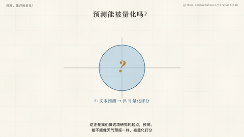
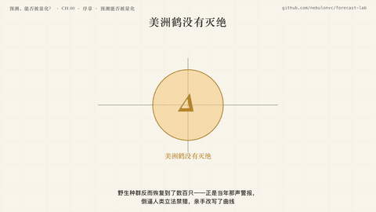

# 演示视频与字幕导览（`media/`）

本目录收录围绕 **132 部著作、8,130 条预测实证复盘** 制作的新版纸面动态数学风双部演示视频预览、完整时间轴与双行 SRT 字幕。

> 💡 为保持 Git 仓库轻量高速克隆，两部 1080p 30fps 高清 MP4 原片托管于本仓库的 **[GitHub Releases (`v1.1.0`)](https://github.com/nebulonvc/forecast-lab/releases/tag/v1.1.0)**，点击下方链接即可直接观看或下载。

---

## 视频一：《预测，能否被量化？》精华短版（时长 `03:49`）

- 📥 **[下载 / 观看 1080p 完整高清版 MP4](https://github.com/nebulonvc/forecast-lab/releases/download/v1.1.0/01-short-quantifying-forecasts.mp4)**
- 📝 **[阅读完整时间轴字幕 (`01-short-quantifying-forecasts.srt`)](subtitles/01-short-quantifying-forecasts.srt)**

**内容亮点**：从「为什么天气预报有准确率，预言家却从不记账」出发，用不到 4 分钟讲清量化评分方法、全库核心反常识发现（国际智库 47.0% vs 科幻作家 29.6%、写死年份错误率 17.9% vs 不写死日期 12.3%）以及普通人能立刻上手的三条决策底线。

---

## 视频二：《预测，能否被量化？》完整大课版（时长 `01:12:29`）

- 📥 **[下载 / 观看 1080p 完整高清版 MP4](https://github.com/nebulonvc/forecast-lab/releases/download/v1.1.0/02-masterclass-quantifying-forecasts.mp4)**
- 📝 **[阅读完整时间轴字幕 (`02-masterclass-quantifying-forecasts.srt`)](subtitles/02-masterclass-quantifying-forecasts.srt)**

### 13 章完整时间轴导览

| 起始时间 | 章节主题 | 时长 | 核心内容 |
| :---: | :--- | :---: | :--- |
| `00:00` | **CH.00 · 序章 · 预测能否被量化** | `05:58` | 1913 霍纳迪美洲鹤开场、无记账的预言市场、`forecast-lab` 开源研究缘起与三大难点 |
| `05:58` | **CH.01 · 怎么把预测量化** | `06:10` | 剔除伪预测、六要素拆题、五类分级、Brier 校准直觉与时间窗控制 |
| `12:08` | **CH.02 · 全库成绩单** | `06:09` | 六大群体同台对决、控时间窗后智库依然领先、威尔斯/达利欧/凯文·凯利跨书反差 |
| `18:17` | **CH.03 · 地缘政治与国际秩序** | `06:00` | 麦金德 1919 巴黎和会、卡普兰《地理的复仇》、李光耀欧元财政账本与换代盲区 |
| `24:17` | **CH.04 · 宏观经济与金融** | `05:47` | 杰文斯煤炭悖论、塔勒布风险边界、达利欧债务周期、鲁比尼滞胀与凯恩斯辞职风波 |
| `30:04` | **CH.05 · 科技商业与产业颠覆** | `05:31` | 克里斯坦森磁盘会议室与特斯拉破局、凯文·凯利《失控》vs《必然》、英国 2006 智能基建 |
| `35:35` | **CH.06 · AI 与奇点前沿** | `06:42` | 博斯特罗姆《超级智能》、斯坦福 AI100、彼得·蒂尔撞上电网墙、库兹韦尔原子世界瓶颈 |
| `42:17` | **CH.07 · 人口、能源与生态** | `06:21` | 马尔萨斯与美洲小麦替代、埃尔利希 vs 绿色革命、IEA 关键矿产与霍尔丹风电制氢 |
| `48:38` | **CH.08 · 社会结构与制度治理** | `06:22` | 伯克 1790 法国大革命 31 中 0 错、格拉多尔英语未来与普通话漏算、王沪宁《美国反对美国》 |
| `55:00` | **CH.09 · 科幻推演插曲** | `03:58` | 凡尔纳 1863 巴黎、威尔斯 1901 技术命中与政治失手、戴维《航空器》的硬约束 |
| `58:58` | **CH.10 · 五大翻车模式** | `05:21` | 线性外推、写死年份、绝对量词、跨层跳跃、忽略反制与三秒钟扫雷清单 |
| `01:04:19` | **CH.11 · 七步方法与实战演示** | `05:36` | 以「美国 AI 数据中心用电」为例，手把手演练从六要素拆题到事前封存的完整七步 |
| `01:09:55` | **CH.12 · 尾声 · 未来雷达** | `02:34` | 跨越两百年的三步日常工具箱与 `forecast-lab` 开源追踪指南 |

---

*历史归档：初版两部视频（`v1.0.0`）仍保留在 [GitHub Releases (`v1.0.0`)](https://github.com/nebulonvc/forecast-lab/releases/tag/v1.0.0)。*
